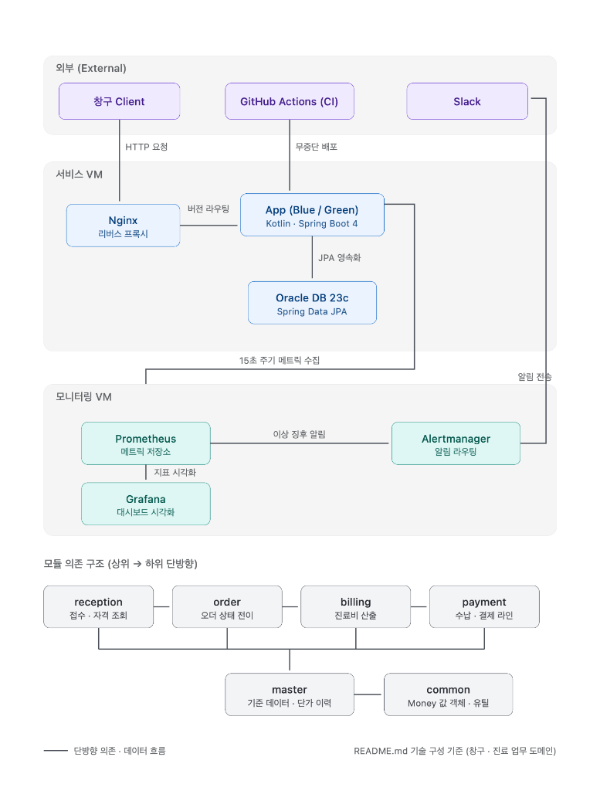

# HTS-EMR

**모듈 간 경계 격리, 동시성 통제, 관측 가능성 확보**를 목표로 설계한 Spring Boot 기반 백엔드 시스템입니다.

단일 배포 단위의 단순함을 유지하면서 모듈 간 결합도를 낮추기 위해 **Spring Modulith 기반의 모듈러 모놀리스** 아키텍처를 채택했습니다.

## 기술 스택

| 구분 | 기술 |
| :--- | :--- |
| **Language & Runtime** | Kotlin, JDK 21 |
| **Framework** | Spring Boot 4, Spring Modulith |
| **Database & Persistence** | Oracle Database 23, Spring Data JPA, Flyway |
| **Test** | JUnit 5, Testcontainers Oracle |
| **Infra & Observability** | Nginx, Docker, Prometheus, Grafana, Alertmanager |

## 전체 아키텍처

서비스 환경과 모니터링 환경을 가상 머신 단위로 분리하여 **요청, 배포, 관측 흐름을 독립적으로 구성**했습니다.

<p align="center">
  
</p>

* **트래픽 및 무중단 배포**: `Nginx` 리버스 프록시와 `Blue/Green` 배포 방식을 조합해 배포 시 요청 유실과 서비스 중단을 방지합니다.
* **관측 환경 분리**: 모니터링 스택을 별도 VM에 배치하여 애플리케이션 부하와 관측 시스템 자원을 격리했습니다.

## 핵심 기술 과제 및 해결 전략

### 1. 모듈 경계 격리 및 의존성 규칙 강제

* **패키지 단위 캡슐화**: 각 모듈을 독립된 패키지로 분리하고, 내부 구현체는 은닉한 채 공개 인터페이스와 값 객체로만 통신합니다.
* **의존성 검증 자동화**: 모듈 간 단방향 의존성을 유지하며, 순환 참조나 허용되지 않은 참조가 발생하면 **아키텍처 테스트가 실패**하도록 강제합니다.

### 2. 데이터베이스 제약 조건 기반 동시성 제어

* **DB 수준 중복 차단**: 서비스 계층의 조회 시점과 커밋 시점 사이에 발생하는 동시 변경 요청을 제어하기 위해, 테이블에 유일 제약 조건과 함수 기반 유일 인덱스를 적용했습니다.
* **예외 변환 및 재시도 처리**: 무결성 제약 조건 위반 예외가 발생하면 명확한 **도메인 예외**로 변환하여 클라이언트가 재시도할 수 있도록 응답합니다.

### 3. 실제 운영 환경과 동일한 테스트 구축

* **실제 DB 기반 검증**: 인메모리 DB를 사용하지 않고 **Testcontainers**로 실제 Oracle DB 컨테이너를 실행해 SQL 및 인덱스 동작을 검증합니다.
* **동시성 및 격리 수준 검증**: 다중 스레드 테스트 환경에서 트랜잭션 격리 수준과 DB 제약 조건에 따른 예외 발생 여부를 검증합니다.

## 모듈 구조

애플리케이션은 기능 단위의 모듈로 분리되어 있으며, **상위 모듈에서 하위 모듈 방향으로만 단방향 의존**합니다.

```text
reception ──▶ order ──▶ billing ──▶ payment
    │           │          │           │
    └───────────┴──────────┴───────────┴──▶ master ──▶ common
```

| 모듈 | 주요 역할 및 책임 |
| :--- | :--- |
| **`reception`** | 진료 접수 트랜잭션 처리 및 외부 자격 조회 클라이언트 연동 |
| **`order`** | 오더 엔티티 생명주기 관리 및 상태 전이 제어 |
| **`billing`** | 단가 및 계산 규칙에 기반한 진료비 산출 도메인 로직 처리 |
| **`payment`** | 수납 트랜잭션 처리, 결제 라인 생성, 동시 결제 요청 제어 |
| **`master`** | 기준 데이터 및 일자별 단가 이력 조회 |
| **`common`** | 불변 `Money` 값 객체 및 전역 공통 유틸리티 제공 |