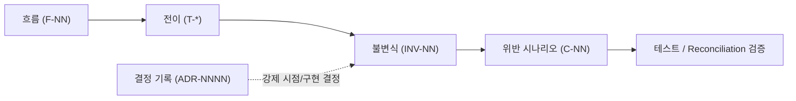

# 문서 규격

상태: 확정 · 갱신: 2026-11-05

> 이 디렉터리(`docs/`)의 모든 문서가 따르는 작성 규격입니다.  
> 실제 내용은 각 세부 문서에서 작성하며, 본 규격에서는 **디렉터리 위치, 네이밍, ID 체계, 작성 템플릿**만 정의합니다.

---

## 목차
- [1. 디렉터리 구조 및 작성 순서](#1-디렉터리-구조-및-작성-순서)
- [2. 공통 작성 규칙](#2-공통-작성-규칙)
- [3. ID 식별자 체계](#3-id-식별자-체계)
- [4. 문서별 작성 양식](#4-문서별-작성-양식)
  - [4.1 domain/01-flow.md (업무 흐름)](#41-domain01-flowmd--업무-흐름)
  - [4.2 domain/02-glossary.md (용어 사전)](#42-domain02-glossarymd--용어-사전)
  - [4.3 domain/03-state-transitions.md (상태 전이표)](#43-domain03-state-transitionsmd--상태-전이표)
  - [4.4 domain/04-invariants.md (불변식 및 정합성 위반)](#44-domain04-invariantsmd--불변식-및-정합성-위반)
  - [4.5 modules/<module>.md (모듈 경계)](#45-modulesmodulemd--모듈-경계)
  - [4.6 adr/NNNN-<제목>.md (의사결정 기록)](#46-adrnnnn-제목md--의사결정-기록)
- [5. 추적성(Traceability) 검증 규칙](#5-추적성traceability-검증-규칙)

---

## 1. 디렉터리 구조 및 작성 순서

```text
docs/
├── README.md                     # 본 문서 (문서화 규격 및 표준)
│
├── domain/                       # [1단계] 도메인 분석: 순수 업무 관점 서술 (구현 기술 배제)
│   ├── 01-flow.md                # 업무 흐름 (정상 흐름 → 대안/취소/수정 흐름)
│   ├── 02-glossary.md            # 유비쿼터스 용어 사전
│   ├── 03-state-transitions.md   # 생명주기 및 상태 전이표
│   └── 04-invariants.md          # 도메인 불변식 및 정합성 파괴 시나리오
│
├── modules/                      # [2단계] 모듈 설계: 도메인을 수용한 모듈 경계
│   ├── README.md                 # 모듈 간 의존성 그래프 및 이벤트 흐름
│   └── <module>.md               # 모듈 상세 (master, order, billing, payment, reconciliation)
│
└── adr/                          # [3단계] 열린 결정: 실험 기반 아키텍처 결정 기록
    └── NNNN-<kebab-case>.md      # 예: 0001-master-reference-strategy.md
```

- **읽는 순서**: 파일 접두사 숫자는 순차적 읽기 순서입니다. 새 도메인 문서가 필요하면 다음 번호를 부여합니다.
- **분할 기준**: 단일 파일이 과도하게 길어질 경우 동일한 이름의 하위 디렉터리로 분할합니다.  
  *(예: `domain/03-state-transitions/order.md`)*

---

## 2. 공통 작성 규칙

| 항목 | 규칙 |
| :--- | :--- |
| **언어** | • 본문 설명은 **한국어**로 작성합니다.<br>• 코드/설계에 사용될 식별자(상태, 이벤트, 필드명 등)는 **영어 백틱**으로 표기합니다. *(예: `Order.CONFIRMED`)* |
| **문서 헤더** | 모든 문서 제목 바로 아래에 상태와 최종 갱신일을 명시합니다.<br>`상태: 초안 | 검토중 | 확정 · 갱신: YYYY-MM-DD` |
| **다이어그램** | • **Mermaid 텍스트 문법만 허용**합니다. (이미지 바이너리 금지 → Git diff 리뷰 가능성 확보) |
| **미결 표기** | 빈칸으로 두지 않고 반드시 추적 가능한 형태로 남깁니다.<br>• `미정(ADR-NNNN)` 또는 `미정(질문: ...)` |

> [!WARNING] **domain/ 디렉터리 작성 시 금지 사항**
> 테이블, 컬럼, 클래스, 트랜잭션, Outbox, 폴링, 락 등 **기술/구현 용어를 절대 사용하지 않습니다.**  
> 기술 구현 용어는 `modules/` 및 `adr/`에서 다룹니다.

---

## 3. ID 식별자 체계

문서 간의 모든 상호 참조는 고유 ID를 통해 연결합니다.
- **불변 원칙**: 한 번 부여된 ID는 절대 재사용하지 않습니다.
- **폐기 표시**: 폐기된 ID는 삭제하지 않고 `~~취소선~~`으로 처리하여 변경 이력을 보존합니다.

| 분류 | ID 형식 | 예시 | 정의 위치 | 용도 및 설명 |
| :--- | :--- | :--- | :--- | :--- |
| **정상 흐름** | `F-NN` | `F-01`, `F-02` | `domain/01-flow.md` | 정상적인 업무 진행 단계 |
| **대안 흐름** | `F-NN.a` | `F-03.a`, `F-03.b` | `domain/01-flow.md` | 취소, 변경, 예외 분기 흐름 |
| **가정** | `A-NN` | `A-01` | `domain/01-flow.md` | 확인할 수 없어 설계상 정한 전제 |
| **상태** | `<집합체>.<STATE>` | `Order.CONFIRMED` | `domain/03-state-transitions.md` | 집합체의 특정 생명주기 상태 |
| **상태 전이** | `T-<집합체약어>-NN` | `T-ORD-01`, `T-PHM-02` | `domain/03-state-transitions.md` | 특정 이벤트에 의한 상태 변화 트리거 |
| **불변식** | `INV-NN` | `INV-01`, `INV-07` | `domain/04-invariants.md` | 비즈니스상 반드시 지켜져야 하는 규칙 |
| **위반 시나리오** | `C-NN` | `C-01`, `C-04` | `domain/04-invariants.md` | 정합성이 깨지는 구체적 결함 케이스 |
| **결정 기록** | `ADR-NNNN` | `ADR-0001` | `adr/` | 아키텍처 의사결정 및 실험 기록 |

> [!NOTE]
> **용어(Glossary)**는 별도 ID를 부여하지 않고 마크다운 앵커 링크로 직접 참조합니다.  
> *(예: `[수납](02-glossary.md#수납)`)*

---

## 4. 문서별 작성 양식

### 4.1 `domain/01-flow.md` (업무 흐름)

- 정상 흐름(`F-01`...)을 먼저 완결한 후, 대안/취소 흐름(`F-NN.a`)을 후반부에 분리하여 기술합니다.
- 분기점이나 다자간 상호작용 구간에는 반드시 Mermaid `sequenceDiagram`을 첨부합니다.

**작성 템플릿:**
```markdown
### F-NN. <단계 이름>
- **행위자**: <사람 역할(예: 의사, 병동간호사, 약사) 또는 '시스템'>
- **시작 조건**: <이 단계가 트리거되는 사전 상태 또는 조건>
- **하는 일**: <행위자가 수행하는 구체적인 행위 서술>
- **남는 기록**: <이 단계의 결과로 남는 데이터/명사 목록>
- **다음 단계**: F-NN (또는 분기 F-NN.a)
- **현장 메모**: <레거시 환경에서 발생했던 문제나 특이사항 (선택)>
```

---

### 4.2 `domain/02-glossary.md` (용어 사전)

모호하거나 다의적으로 쓰이기 쉬운 용어를 정의합니다.

**작성 템플릿:**
| 용어 | 영문 코드명 | 정의 | 혼동 주의 (비교 대상) | 소유 모듈 |
| :--- | :--- | :--- | :--- | :--- |
| 예: 수납 건 | `Payment` | 산정된 본인부담금을 받았다는 사실을 내원 건에 기록함 | '결제(`PaymentLine`)'는 카드 승인 등 지불 수단의 처리로 병원 밖에서도 일어나고, '수납'은 병원이 진료비를 받았다는 병원 안의 기록 | `payment` (미정이면 `미정`) |

- **정의**: 한 문장으로 명확히 서술.
- **혼동 주의**: 실무에서 자주 섞여 쓰이는 용어 간 차이 기술 (예: 접수 vs 수신, 취소 vs 반려).
- **영문 코드명**: 엔티티 후보는 `PascalCase`, 상태는 `UPPER_SNAKE`, 속성은 `lowerCamel`로 표기. 업계 표준어를 우선하고 언어 기본 이름(`Collection` 등)과 겹치지 않게 함.
- **소유 모듈**: 모듈 경계 확정 전까지는 `미정`으로 표기.

---

### 4.3 `domain/03-state-transitions.md` (상태 전이표)

집합체(Aggregate) 단위로 절을 나누어 작성합니다. 상태도는 Mermaid `stateDiagram-v2`를 사용하며, **불일치 시 표가 항상 우선**합니다.

**작성 템플릿:**
```markdown
## <집합체 이름> (예: 수납 건 Payment)

### 1. 상태 목록
| 상태 | 의미 | 종료 상태 여부 (Y/N) |
| :--- | :--- | :--- |

### 2. 정상/허용 전이표
| 전이 ID | 현재 상태 | 트리거 이벤트 | 행위자 | 가드 조건 (전제) | 다음 상태 | 남는 기록 | 관련 INV |
| :--- | :--- | :--- | :--- | :--- | :--- | :--- | :--- |

### 3. 허용하지 않는 전이 (명시적 금지)
| 현재 상태 | 시도된 이벤트 | 거부 이유 | 관련 INV |
| :--- | :--- | :--- | :--- |
```

> [!IMPORTANT]
> 정합성 버그는 대부분 **'허용하지 않는 전이'**가 방어되지 않아 발생합니다. 허용하지 않는 전이는 반드시 누락 없이 기술해야 합니다.

---

### 4.4 `domain/04-invariants.md` (불변식 및 정합성 위반)

**불변식 정의 표:**
| ID | 불변식 요약 | 검증 범위 | 강제 시점 | 위반 시나리오 | 검증 방법 |
| :--- | :--- | :--- | :--- | :--- | :--- |
| `INV-01` | "취소가 요청된 오더 항목은 시행할 수 없다" | 모듈 간 | 즉시 | `C-01` | 미정(테스트명) |

- **검증 범위**: `집합체 내부` | `집합체 간` | `모듈 간` | `시간 경과`(최종 일관성)
- **강제 시점**: `즉시`(동기 트랜잭션 차단) | `사후 검출`(reconciliation 모듈 탐지) | `미정(ADR-NNNN)`

**위반 시나리오 템플릿 (C-NN):**
```markdown
### C-NN. <시나리오 제목>
- **깨지는 불변식**: INV-NN
- **재현 순서**:
  1. t1: <행위자 A가 수행한 작업>
  2. t2: <동시에 또는 직후 행위자 B가 수행한 작업>
- **결함 결과**: <시스템에 남는 불일치 데이터 상태>
- **재현 방법**: <통합 테스트 또는 동시성 테스트 방안 (미정이면 '미정')>
- **레거시 경험**: <과거 레거시에서 겪었던 실제 장애 사례 (선택)>
```

---

### 4.5 `modules/<module>.md` (모듈 경계 명세)

`modules/README.md`에는 전체 모듈 간 의존 관계 다이어그램(Mermaid `flowchart`)을 배치하고, 개별 모듈 파일은 아래 양식을 따릅니다.

**작성 템플릿:**
```markdown
# <module 이름>

상태: 초안 · 갱신: YYYY-MM-DD

## 1. 책임 (Responsibility)
- 이 모듈이 독점적으로 수행하는 비즈니스 책임

## 2. 소유 대상 (Ownership)
- 소유하는 집합체 및 엔티티 (`02-glossary`의 '소유 모듈'과 일치해야 함)

## 3. 공개 계약 (Public Contract)
- 외부 모듈에 노출하는 API 및 도메인 이벤트 (이름, 파라미터, 보장 수준)

## 4. 모듈 의존성 (Dependencies)
- 참조하는 타 모듈 목록 및 명확한 참조 이유

## 5. 명시적 비책임 (Non-Goals)
- 경계 밖으로 밀어내어 이 모듈에서 절대 하지 않는 일

## 6. 관련 규칙
- 관련 INV ID, ADR ID 목록
```

---

### 4.6 `adr/NNNN-<제목>.md` (아키텍처 결정 기록)

번호는 `0001`부터 순차적으로 부여하며, **실험과 검증 데이터 없는 '채택'은 불가**합니다.

**작성 템플릿:**
```markdown
# ADR-NNNN. <결정 제목>

상태: 제안 | 실험중 | 채택 | 폐기 | 대체됨(ADR-NNNN) · 갱신: YYYY-MM-DD

## 1. 맥락 (Context)
- 결정이 필요한 기술적/비즈니스 배경 (관련 INV, C 인용)

## 2. 고려한 대안 (Alternatives)
- 후보군 목록 및 각 후보의 한 줄 핵심 아이디어

## 3. 실험 및 측정 (Experiments)
- 후보별 실험 방법, 측정 지표, 벤치마크 결과
- 재현 명령 (테스트 메서드명 또는 재현 스크립트 경로)

## 4. 최종 결정 및 근거 (Decision)
- 채택된 대안과 결정적 근거 (실험 측정치 인용)

## 5. 영향 및 트레이드오프 (Consequences)
- 이 결정으로 감수한 단점, 변경되는 INV의 강제 시점
```

---

## 5. 추적성(Traceability) 검증 규칙

문서 리뷰 시 다음 추적 연결고리가 끊기지 않았는지 상호 검증합니다.



1. **전이의 출처**: 모든 상태 전이(`T-*`)는 1개 이상의 업무 흐름(`F-*`)에서 파생되어야 합니다.
2. **불변식의 반증 가능성**: 모든 불변식(`INV-*`)은 반드시 1개 이상의 구체적 위반 시나리오(`C-*`)를 가져야 합니다. *(위반 시나리오를 설계할 수 없다면 불변식이 아니라 단순 사실/정의입니다.)*
3. **위반의 검증성**: 모든 위반 시나리오(`C-*`)는 최종적으로 자동화된 테스트 또는 `reconciliation` 배치 점검 로직으로 연결되어야 합니다.
4. **미결 추적**: `미정(ADR-NNNN)`으로 마킹된 모든 항목은 해당 ADR이 `채택` 상태로 전이될 때 반드시 함께 구현 사양으로 갱신되어야 합니다.
