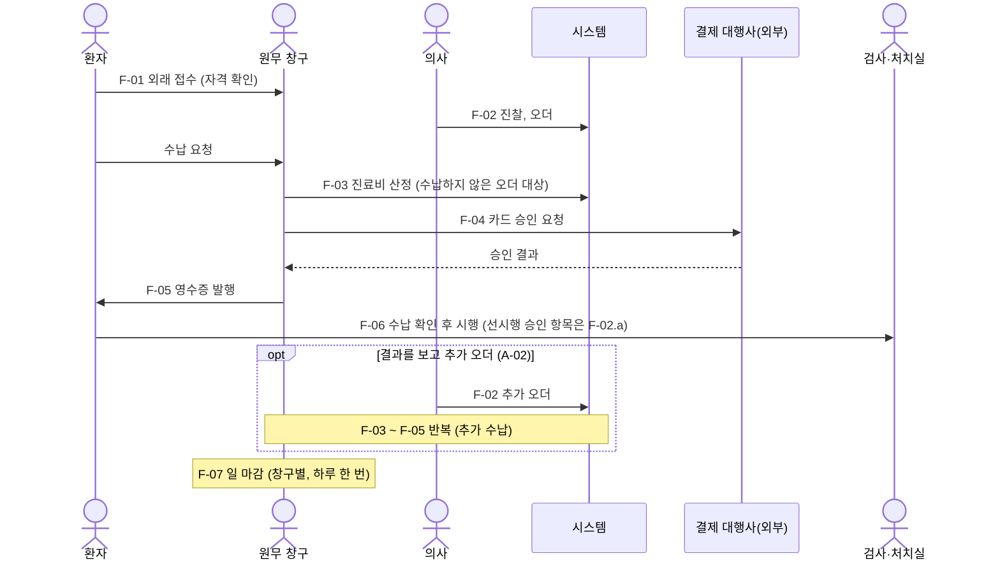
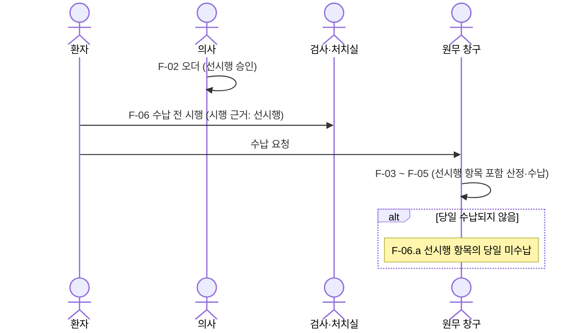
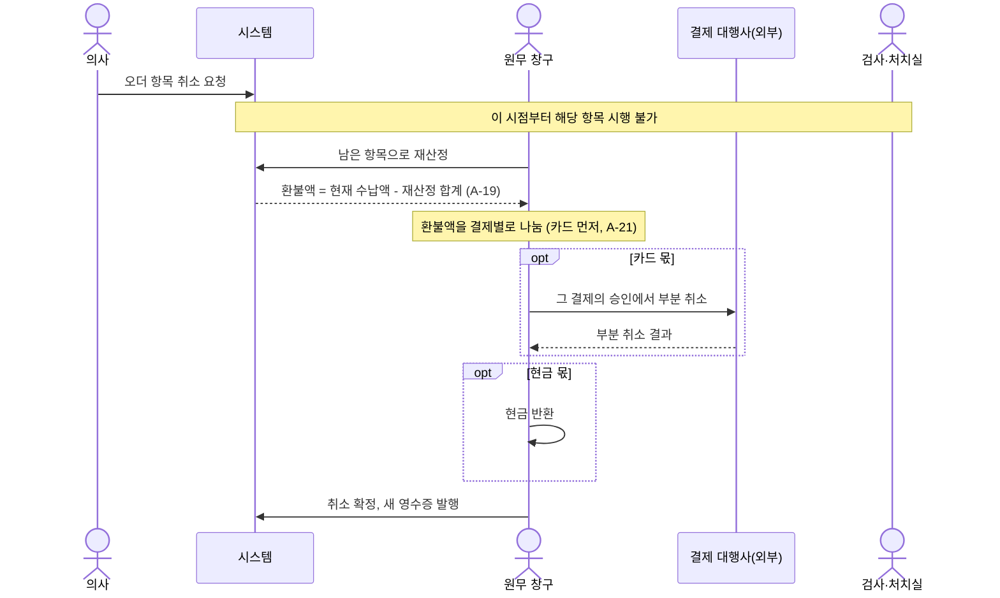
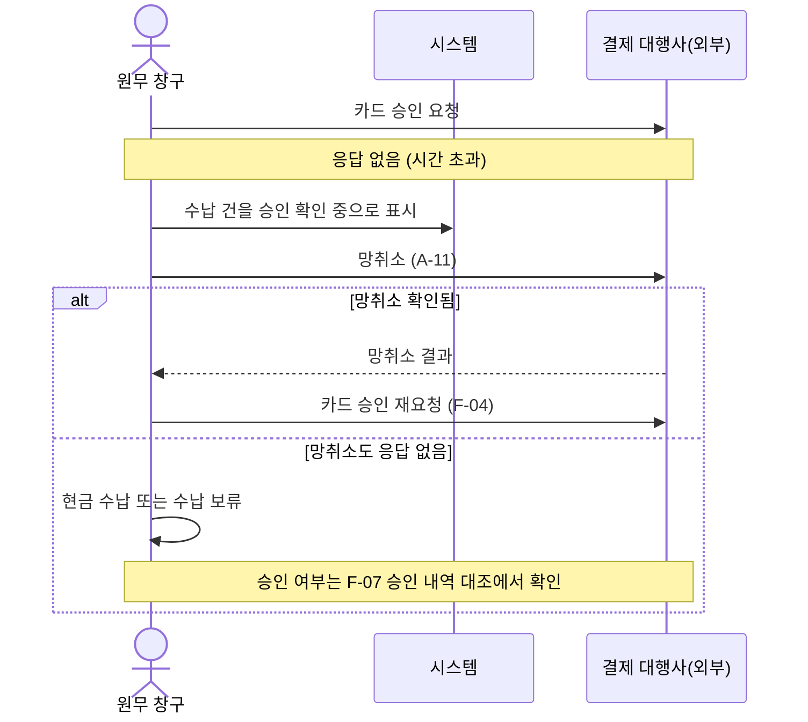
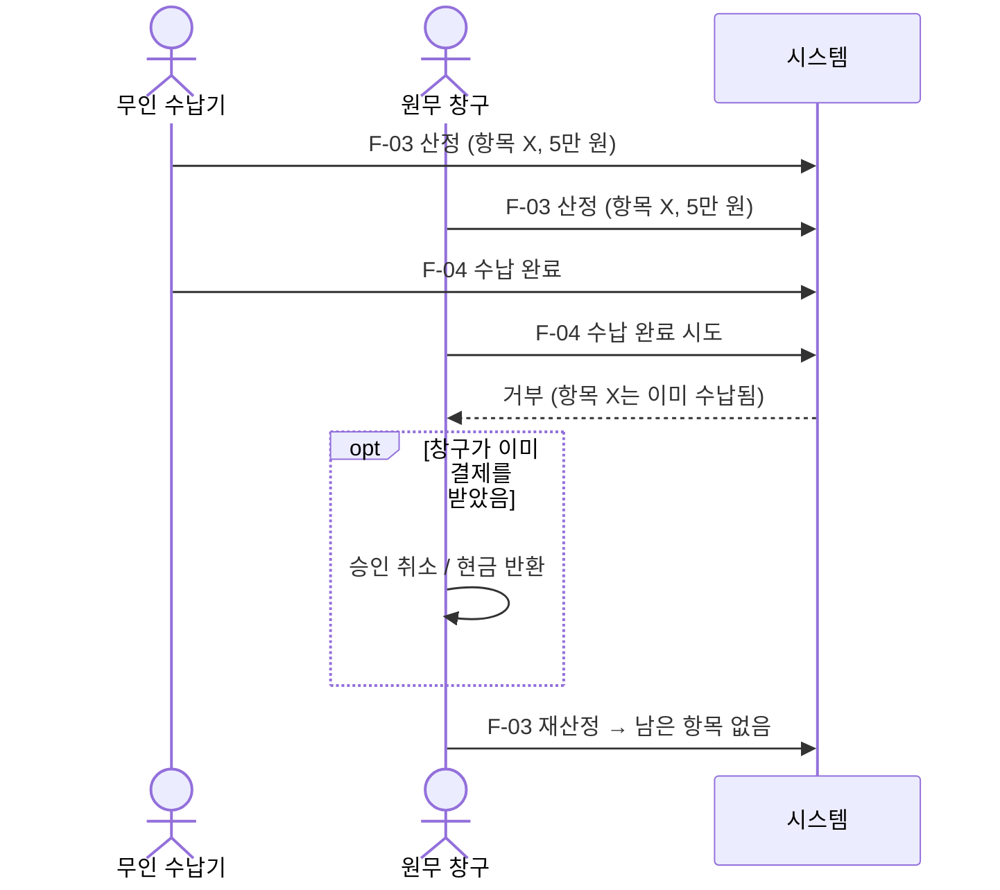
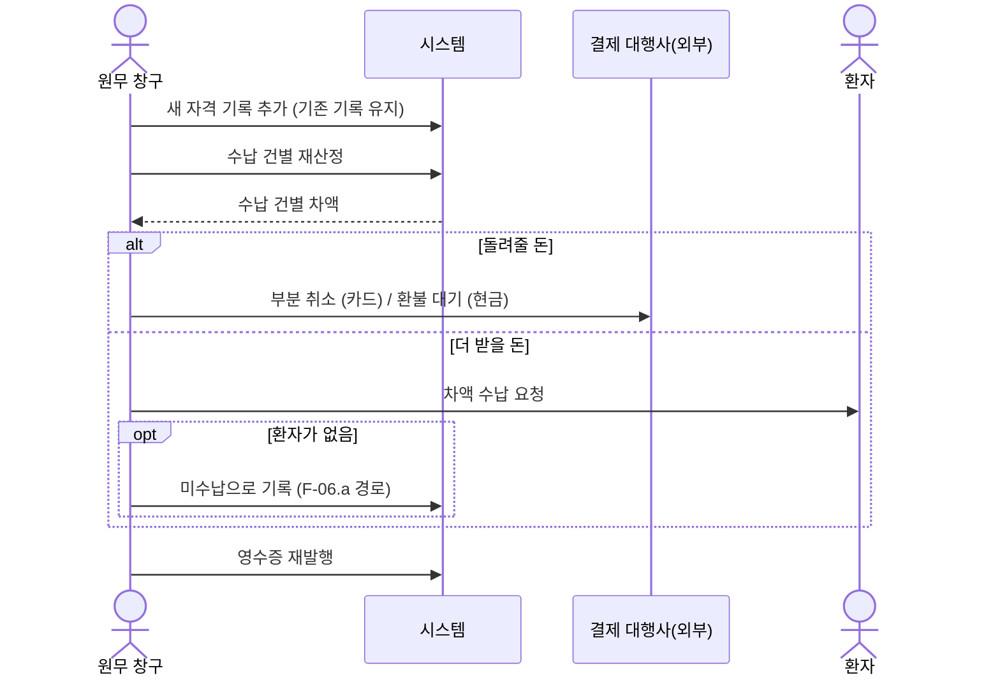

# 업무 흐름

상태: 초안 · 갱신: 2026-11-05

> 외래 환자가 접수하고 진료를 받은 뒤 진료비를 수납하기까지의 업무 흐름입니다.
---

## 1. 범위와 가정

**범위**
- 포함: 외래 접수 → 진료와 오더 → 진료비 산정 → 수납 → 영수증 발행 → 오더 시행 → 일 마감
- 제외: 입원 정산, 보험 청구(심평원), 예약, 원외처방 이후의 약국 업무, 후불 결제(등록 카드 자동 결제), 검사실 판단에 의한 수납 전 시행, 외래에서 입원으로 전환된 환자의 미수납분 이관, 받지 못한 미수납의 결손 처리, 잘못 기록한 시행의 되돌림(실시 취소), 장비 문제 등으로 인한 무료 재시행, 일부 금액만 깎아 주는 감액

**가정**

본 흐름은 실제 병원 운영 방식과 다소 차이가 있을 수 있으며, 특정 상황을 전제로 설계되었습니다. 따라서 전제 조건이 변경될 경우, 이를 참조하는 연관 단계도 함께 수정합니다.

| ID | 가정 | 참조 단계 |
| :--- | :--- | :--- |
| `A-01` | 진찰료와 검사·처치비는 진료가 끝난 뒤 수납한다. 검사·처치는 수납한 뒤에 시행한다(선수납). 단, 선시행 승인이 있는 항목은 수납 전에 시행할 수 있다. 선시행으로 이미 시행된 항목은 내원 당일 수납을 원칙으로 하며, 당일 수납되지 않으면 미수납으로 넘긴다. 선시행 승인만 있고 시행되지 않은 항목은 미수납이 아니다. | F-02, F-02.a, F-04, F-06, F-06.a |
| `A-02` | 한 내원 건에 수납이 여러 번 있을 수 있다. 수납할 때마다 그 시점까지 수납하지 않은 오더 항목을 묶는다. | F-03, F-04, F-06 |
| `A-03` | 본인부담률은 접수 시점에 확인한 자격으로 정한다. 단, 자격이 소급 변경되면 기존 자격 기록은 남기고 새 자격 기록을 추가하며, 그 뒤의 산정은 새 자격으로 한다. | F-01, F-03, F-04.d |
| `A-04` | 자격은 건강보험과 일반(비보험, 전액 본인부담) 두 가지만 다룬다. 의료급여, 산정특례, 감면은 다루지 않는다. | F-01, F-03 |
| `A-05` | 결제 수단은 카드와 현금만 다룬다. 카드 승인은 외부 결제 대행사가 한다. 예외로, 환불 대기 건은 환자가 요청하면 계좌로 보낼 수 있다. | F-04, F-04.a, F-07 |
| `A-06` | 수가는 적용 시작일이 있는 단가이며, 진료일에 유효한 단가를 적용한다. 야간·공휴일 가산 등 세부 계산 규칙은 다루지 않는다. | F-03 |
| `A-07` | 원외처방은 처방전만 발행하며 병원 수납 금액에 포함하지 않는다. | F-02, F-05 |
| `A-08` | 진찰료와, 진료실 안에서 바로 시행하는 수가 항목(신속항원검사, 혈당 검사 등)은 수가 항목 자체가 선시행 대상으로 정해져 있어, 의사가 따로 승인하지 않아도 선시행 승인 항목이 된다. | F-02, F-02.a |
| `A-09` | 카드 부분 취소는 환자가 없어도 원래 승인 정보(승인번호, 승인일, 금액)로 할 수 있다. | F-04.a |
| `A-10` | 의사는 오더 항목의 취소나 취소 요청을 철회할 수 없다. 다시 필요하면 새 오더를 낸다. | F-02.b, F-04.a |
| `A-11` | 카드 승인 응답을 받지 못하면 그 승인 요청에 대해 망취소를 보낸다. 카드로 다시 결제하는 것은 망취소가 확인된 뒤에만 한다. | F-04.b, F-07 |
| `A-12` | 끝난 마감은 고치지 않는다. 지난 날짜에 수납한 건을 취소·환불하면, 환불을 처리한 날 처리한 창구의 마감에 반영한다. 처리한 창구가 없는 자동 환불(F-06.b)은 원래 수납한 창구의 마감에 반영한다. | F-04.a, F-06.b, F-07 |
| `A-13` | 마감은 마감 시점까지 완료되었고 아직 어느 마감에도 속하지 않은 수납 건과 환불 건만 집계한다. 마감 시점에 진행 중이던 건은 완료된 뒤 다음 마감에 속한다. | F-07 |
| `A-14` | 수납 건은 한 내원 건에만 속한다. 이전 내원 건의 미수납은 새 내원 건의 수납에 합치지 않고, 이전 내원 건을 대상으로 한 별도의 수납 건으로 받는다. | F-04, F-06.a |
| `A-15` | 미수납이 있어도 진료를 제한하지 않는다. 접수할 때 알리기만 한다. | F-01, F-06.a |
| `A-16` | 진료일이 끝날 때까지 시행되지 않은 오더 항목은 효력을 잃는다. 수납하지 않은 항목은 그대로 소멸하고, 수납한 항목은 자동으로 취소하여 환불한다. | F-06.b |
| `A-17` | 자격 소급 변경은 양방향(일반 ↔ 건강보험, 본인부담률 변경)을 모두 다루며, 원무 직원이 증빙 또는 외부 기관 재조회로 확인한 경우에만 한다. | F-04.d |
| `A-18` | 시행된 오더 항목은 원칙적으로 환불하지 않는다. 예외로, 원무 책임자가 사유를 확인하고 승인한 경우에만 그 항목을 뺀 나머지로 다시 산정한 차액을 환불한다(A-19). | F-06.c |
| `A-19` | 수납 건의 현재 수납액은 원래 수납액에 그 수납 건에 대한 차액 수납액을 더하고, 그 수납 건에 대해 정해진 환불액을 뺀 값이다. 환불액은 정해진 순간 빼며, 아직 돌려주지 못한 환불 대기도 포함한다. 환불액과 차액 수납액은 언제나 현재 수납액과 재산정 합계의 차이로 구한다. | F-04.a, F-04.d, F-06.b, F-06.c |
| `A-20` | 한 수납 건을 여러 결제(카드 여러 장, 카드와 현금)로 나눠 받을 수 있다. 결제 합계가 본인부담 합계와 같아져야 수납이 완료된다. 결제 하나가 실패하면 이미 받은 결제는 두고 남은 금액만 다른 수단으로 받는다. 끝내 받지 못해 수납을 보류하면 그 수납 건에서 이미 받은 결제를 모두 되돌린다. | F-04, F-04.b, F-04.c, F-04.e |
| `A-21` | 환불액은 결제별로 나눠 돌려준다. 그 수납 건과 그것을 참조하는 차액 수납 건의 결제 가운데 카드 결제에서 먼저, 카드가 여러 장이면 나중에 승인된 카드부터 돌려주고, 모자라면 현금 결제에서 돌려준다. 결제마다 그 결제에서 아직 돌려주지 않은 금액을 넘겨 돌려주지 않는다. 카드 부분 취소는 환자가 없어도 할 수 있으므로(A-09) 환불 대기가 줄어든다. | F-04.a, F-04.d, F-06.b, F-06.c |
| `A-22` | 수납 건은 첫 결제를 시도할 때 생기며, 산정 하나를 바탕으로 한다. 한 산정을 바탕으로 한 수납 건은 하나뿐이다. 보류되거나 거부된 수납 건은 다시 열지 않으며, 다시 받으려면 새로 산정하고 새 수납 건을 만든다. | F-03, F-04, F-04.b, F-04.c, F-04.e |
| `A-23` | 결제를 받는 중인 수납 건이 정해진 시간이 지나도 완료되지 않으면 시스템이 수납을 보류하고 이미 받은 결제를 되돌린다. 정해진 시간은 미정(질문: 수납 건을 결제 받는 중으로 얼마나 둘 수 있는가?) | F-04.b, F-04.e |
| `A-24` | 카드 승인을 요청하기 전에 승인 요청 사실(수납 건, 금액, 요청 시각)을 먼저 남긴다. 응답이 남지 않은 승인 요청은 승인 확인 중으로 다룬다. | F-04, F-04.b |
| `A-25` | 승인 취소 요청에 응답이 없으면 같은 승인번호로 다시 요청할 수 있다. 취소는 승인번호를 가리키므로 다시 요청해도 이중으로 취소되지 않는다. 끝내 확인되지 않으면 일 마감의 승인 내역 대조에서 처리한다. | F-04.c, F-04.e, F-07 |

---

## 2. 정상 흐름 개요

| 단계 | 기록 단위 |
| :--- | :--- |
| F-01 | 내원 건 |
| F-02, F-06 | 오더 항목 |
| F-03 | 오더 항목별 산정 내역과 산정 합계 |
| F-04, F-05 | 수납 건 (한 내원 건에 여러 개 — A-02) |
| F-07 | 일자·창구별 마감 |

---

## 3. 정상 흐름

### F-01. 외래 접수
- **행위자**: 원무 직원 또는 환자(무인 접수기)
- **시작 조건**: 환자가 내원했다.
- **하는 일**: 환자 본인을 확인하고 진료과와 진료 의사를 정해 접수한다. 외부 기관에 보험 자격을 조회하여 그 결과를 내원 건에 남긴다(A-03, A-04). 이전 내원 건에 미수납(F-06.a)이나 환불 대기(F-04.a)가 있으면 환자에게 알린다. 미수납이 있어도 접수는 막지 않는다(A-15).
- **남는 기록**
  - 내원 건: 환자, 진료과, 진료 의사, 진료일, 접수 시각, 접수자
  - 내원 건의 자격: 보험 종류, 본인부담률, 확인 시각
- **다음 단계**: F-02

### F-02. 진료와 오더
- **행위자**: 의사
- **시작 조건**: 접수된 환자의 진료 차례가 되었다.
- **하는 일**: 진찰하고 필요한 검사·처치 오더를 낸다. 진찰 자체도 진찰료 오더 항목으로 남으며, 진찰과 함께 시행된 것으로 기록한다(선시행, A-08). 당일 진료 중에 결과가 필요한 검사는 선시행을 승인한다(A-01). 진료실 안에서 바로 하는 검사는 따로 승인하지 않아도 선시행 대상이다(A-08). 약은 원외처방으로 낸다(A-07). 진료를 마치면 진료 완료로 표시한다.
- **남는 기록**
  - 오더 항목: 내원 건, 수가 항목(진찰·검사·처치), 수량, 오더 의사, 오더 시각, 선시행 승인 여부(승인 의사 또는 수가 항목 기본값)
  - 원외처방: 내원 건, 약품, 용법, 일수
  - 시행 기록: 진찰료 항목, 시행자(진료 의사), 시행 시각, 시행 근거(선시행)
  - 진료 완료 시각
- **다음 단계**: F-03 (선시행 승인 항목은 F-02.a, 수납 전에 오더를 취소하면 F-02.b)

### F-03. 진료비 산정
- **행위자**: 시스템
- **시작 조건**: 환자가 수납을 요청했고, 내원 건에 아직 수납하지 않은 오더 항목이 있다.
- **하는 일**: 수납하지 않은 오더 항목을 모아(A-02) 항목별로 금액을 계산한다. 단가는 진료일에 유효한 수가(A-06), 본인부담률은 내원 건의 자격(A-03)에서 가져온다. 급여 항목은 본인부담률을 적용하고, 비급여 항목과 일반 자격 환자는 전액 본인부담이다.
- **남는 기록**
  - 산정 내역(항목별): 오더 항목, 적용 단가, 수량, 급여 구분, 총액, 본인부담액, 공단부담액
  - 산정 합계: 총액, 본인부담 합계, 공단부담 합계, 산정 시각
- **다음 단계**: F-04

### F-04. 수납
- **행위자**: 원무 직원 또는 환자(무인 수납기)
- **시작 조건**: 산정 합계가 나왔다(F-03).
- **하는 일**: 본인부담 합계를 안내하고 결제를 받는다(A-05). 결제는 카드 여러 장이나 카드와 현금으로 나눠 받을 수 있다(A-20). 카드는 승인 요청 사실을 먼저 남긴 뒤(A-24) 외부 결제 대행사에 승인을 요청하고, 현금은 받은 금액과 거스름돈을 확인한다. 결제 합계가 본인부담 합계와 같아지면 수납을 완료한다. 수납된 오더 항목은 이후 수납 대상에서 빠진다(A-02). 산정한 뒤 수납을 완료하기 전에 대상이 바뀌었으면 수납을 완료하지 않는다(F-04.c).
- **남는 기록**
  - 수납 건: 내원 건, 바탕 산정(A-22), 포함된 오더 항목, 수납액, 창구, 수납자, 시작 시각, 수납 시각(완료 시각)
  - 결제(수납 건마다 하나 이상): 수납 건, 수단, 금액, 카드 승인 요청 시각, 카드 승인번호, 승인 시각
- **다음 단계**: F-05 (대상이 바뀌었으면 F-04.c, 카드 승인이 거절되었으면 F-04.e)
- **현장 메모**: 카드 승인은 병원 밖에서 일어나고 수납 기록은 병원 안에 남는다. 승인 응답을 받지 못한 경우는 F-04.b에서 다룬다. 응답은 받았지만 병원이 수납 완료를 기록하지 못한 경우는 업무 흐름이 아니므로 `04-invariants.md`의 위반 시나리오로 다룬다. 승인 요청 사실은 요청 전에 남으므로(A-24), 이 경우에도 병원 쪽에 흔적이 남는다.

### F-05. 영수증 발행
- **행위자**: 시스템, 원무 직원
- **시작 조건**: 수납이 완료되었다(F-04).
- **하는 일**: 수납 건마다 진료비 영수증을 발행한다. 영수증에는 항목별 급여·비급여 구분과 본인부담·공단부담 금액이 들어간다. 원외처방이 있으면 처방전을 함께 출력한다(A-07).
- **남는 기록**
  - 영수증: 영수증 번호, 수납 건, 발행 시각
- **다음 단계**: 시행할 검사·처치가 있으면 F-06, 없으면 종료

### F-06. 오더 시행
- **행위자**: 검사실·처치실 직원
- **시작 조건**: 환자가 검사실 또는 처치실에 왔다.
- **하는 일**: 오더 항목이 수납되었거나 선시행 승인이 있는지 확인하고 시행한다(A-01). 둘 다 아닌 항목은 시행하지 않고 환자를 수납 창구로 안내한다. 취소가 요청된 항목은 수납되었더라도 시행하지 않는다(F-04.a).
- **남는 기록**
  - 시행 기록: 오더 항목, 시행자, 시행 시각, 시행 근거(수납 또는 선시행)
- **다음 단계**: 시행된 항목의 환불 요청은 F-06.c. 진료일이 끝날 때까지 시행되지 않은 항목은 F-06.b. 선시행 항목이면 F-03(수납, F-02.a). 결과를 보고 추가 진료가 필요하면 F-02(추가 오더 → 추가 수납, A-02). 아니면 종료

### F-07. 일 마감
- **행위자**: 원무 직원
- **시작 조건**: 창구 업무 종료 시각이 되었다. (환자별 흐름과 별개로 창구마다 하루 한 번 일어난다.)
- **하는 일**
  1. **집계**: 창구별로, 마감 시점까지 완료되었고 아직 어느 마감에도 속하지 않은 수납 건(차액 수납 건 포함)과 환불 건을 모아 집계하고, 이 건들을 이번 마감에 속하게 한다(A-13). 지난 날짜 수납의 환불도 처리한 날의 마감에 들어간다(A-12). 끝난 마감은 고치지 않는다.
  2. **현금 대조**: 현금 합계를 실제 보유 현금과 대조한다.
  3. **카드 대조**: 결제 대행사의 승인 내역과 병원의 결제 기록을 합계가 아니라 승인 건 단위로 짝을 맞춘다. 마감 시점 이후 완료되어 다음 마감에 속하는 건은 차이가 아니라 시차로 구분한다. 병원 수납 기록이나 취소 기록과 짝이 없는 승인(F-04.b, F-04.c, F-04.e)을 찾으면 그 승인을 취소한다(A-11). 승인 취소에 응답이 없던 결제도 여기서 취소되었는지 확인한다(A-25).
  4. **미결 확인**: 그날 선시행되었으나 아직 수납되지 않은 오더 항목(F-06.a), 받지 못한 자격 변경 차액(F-04.d), 아직 환불하지 못한 환불 대기 건(F-04.a)을 확인한다.
  5. 대조에서 설명되지 않는 차이가 있으면 차이 내역을 남긴다.
- **남는 기록**
  - 마감: 일자, 창구, 수납 합계, 환불 합계, 현금 합계, 카드 합계, 마감자, 마감 시각
  - 마감 소속: 마감, 이 마감에 속한 수납 건과 환불 건
  - 차이 내역: 대조 대상, 병원 기록 금액, 대조 금액, 차이
  - 시차 내역: 승인번호, 승인 시각, 속하게 될 다음 마감
  - 미수납 내역: 내원 건, 선시행된 오더 항목, 시행 시각, 미수납 사유
  - 환불 대기 내역: 대상 수납 건, 환불액, 대기 시작 시각
  - 짝 없는 승인 내역: 승인번호, 승인 금액, 승인 시각, 처리 결과(취소함, 확인 중)
- **다음 단계**: 없음
- **현장 메모**: 수납 시각만 보고 집계하면 마감 시점에 진행 중이던 건(예: 17:59에 시작해 승인 확인 중을 거쳐 18:02에 완료된 수납, F-04.b)이 어느 마감에도 들어가지 않거나 두 마감에 모두 들어갈 수 있다. 그래서 수납 시각이 아니라 마감 소속으로 집계한다(A-13). 레거시에서 "일일 보고서 금액이 맞지 않는다"는 문의가 나오는 전형적인 원인이다.

---

## 4. 대안 흐름

정상 흐름 단계에서 갈라지는 흐름을 `F-NN.a` 형식으로 기술합니다.

### F-02.a. 선시행 승인 항목의 시행
- **행위자**: 의사, 검사실·처치실 직원, 원무 직원
- **시작 조건**: 오더 항목에 선시행 승인이 있다(A-01, A-08).
- **하는 일**: 수납 전에 F-06을 먼저 진행한다. 진료실 안에서 하는 검사는 진료 중 그 자리에서 시행한다. 시행된 항목은 환자가 수납을 요청할 때 수납하지 않은 다른 항목과 함께 산정·수납된다(A-02).
- **남는 기록**
  - F-02의 오더 항목(선시행 승인 여부), F-06의 시행 기록(시행 근거: 선시행)
- **다음 단계**: F-03 → F-04 → F-05 (내원 당일 원칙). 당일 수납되지 않으면 F-06.a

### F-02.b. 수납 전 오더 취소
- **행위자**: 의사
- **시작 조건**: 수납되지도 시행되지도 않은 오더 항목을 의사가 취소한다. 선시행 승인이 있는 항목도 아직 시행되지 않았으면 여기에 해당한다.
- **하는 일**: 오더 항목을 취소한다. 오간 돈이 없으므로 환불 없이 바로 확정된다. 취소는 되돌릴 수 없으며, 다시 필요하면 새 오더를 낸다(A-10). 이미 시행된 항목(진찰료, 선시행 항목)은 이 흐름으로 취소할 수 없다. 그 항목을 산정해 수납하는 중이었다면 그 수납은 F-04.c에 따라 거부된다.
- **남는 기록**
  - 오더 취소: 오더 항목, 취소 의사, 취소 시각, 사유
- **다음 단계**: 없음. 수납하지 않은 다른 오더 항목은 그대로 F-03 대상이다.

### F-04.a. 시행 전 오더 취소와 부분 환불
- **행위자**: 의사, 원무 직원, 시스템
- **시작 조건**: 수납된 오더 항목을 시행하기 전에 의사가 그 항목의 취소를 요청했다.
- **하는 일**
  1. 의사가 오더 항목의 취소를 요청한다. 이 시점부터 그 항목은 시행할 수 없지만, 취소는 아직 확정되지 않았다. 취소 요청은 철회할 수 없다(A-10).
  2. 시스템이 남은 항목만으로 본인부담 합계를 다시 산정한다. 환불액은 그 수납 건의 현재 수납액에서 다시 산정한 합계를 뺀 차액이다(A-19). 원래 수납액을 기준으로 하면, 같은 수납 건에서 두 번째 환불을 할 때 첫 번째 환불액만큼 이중으로 돌려주게 된다. 앞선 취소의 환불이 아직 끝나지 않았어도(환불 대기 포함) 그 환불액은 이미 현재 수납액에서 빠져 있으므로 이중으로 돌려주지 않는다(A-19). 본인부담금은 합계 기준으로 끝전을 처리하므로, 취소 항목의 몫을 따로 떼어 계산하지 않는다.
  3. 환불액을 결제별로 나눈다. 카드 결제에서 먼저, 카드가 여러 장이면 나중에 승인된 카드부터 나누고, 모자라면 현금 결제에서 돌려준다(A-21). 원무 직원이 카드 몫은 그 결제의 원래 승인에서 부분 취소를 요청한다. 카드 부분 취소는 환자가 없어도 할 수 있으므로 취소 요청을 받는 대로 처리한다(A-09). 현금 몫은 환자에게 직접 돌려준다.
  4. 환불이 끝나면 오더 항목의 취소가 확정된다. 기존 영수증은 무효로 하고, 남은 항목으로 새 영수증을 발행한다. 원래 수납이 지난 날짜에 마감되었더라도 그 마감은 고치지 않고, 환불은 처리한 날의 마감에 반영된다(A-12).
- **남는 기록**
  - 취소 요청: 오더 항목, 요청 의사, 요청 시각, 사유
  - 환불: 대상 수납 건, 취소 항목, 환불 전 현재 수납액, 재산정 합계, 환불액, 결제별 환불액(대상 결제, 금액, 부분 취소 승인번호), 환불자, 환불 시각
  - 영수증: 기존 영수증의 무효 시각, 새 영수증 번호
  - 환불 대기: 대상 수납 건, 취소 항목, 환불액, 대기 사유, 대기 시작 시각 (환자가 와야 환불할 수 있는 경우)
  - 원래의 수납 건과 결제 기록은 고치지 않고 그대로 남는다.
- **다음 단계**: 남은 항목은 F-06. 현금 수납 건처럼 환자가 와야 환불할 수 있는데 환자가 창구에 오지 않으면, 기한 없이 환불 대기로 남는다. 환불 대기는 병원이 환자에게 돌려줄 돈이므로 자동으로 소멸시키지 않으며, 다음 내원 때 환불하거나 환자가 요청하면 계좌로 보낸다. 환불을 마치면 취소가 확정된다.

### F-04.b. 카드 승인 응답 없음
- **행위자**: 원무 직원, 결제 대행사(외부)
- **시작 조건**: 카드 승인을 요청했으나(F-04) 정해진 시간 안에 응답을 받지 못했다. 병원은 실제로 승인되었는지 알 수 없다.
- **하는 일**
  1. 수납 건을 승인 확인 중으로 둔다. 승인 확인 중인 동안 같은 오더 항목으로 다시 수납할 수 없다.
  2. 결제 대행사에 그 승인 요청의 망취소를 보낸다(A-11).
  3. 망취소가 확인되면 승인 없음으로 확정하고, F-04로 돌아가 다시 결제한다.
  4. 망취소도 확인되지 않으면 카드로 다시 결제하지 않는다. 남은 금액을 현금으로 받거나, 수납을 보류한다. 수납을 보류하면 그 수납 건에서 이미 받은 다른 결제는 모두 되돌린다(A-20, F-04.e). 보류한 항목 중 이미 시행된 항목(선시행)은 당일 수납되지 않으면 미수납이 되고(F-06.a), 시행되지 않은 항목은 수납되지 않은 오더로 남는다(F-06.b).
  5. 승인 여부를 끝내 확인하지 못한 건은 일 마감(F-07) 때 결제 대행사의 승인 내역과 대조한다. 짝이 없는 승인이 있으면 그 승인을 취소한다.
- **남는 기록**
  - 승인 요청: 수납 건, 금액, 요청 시각, 응답 여부
  - 망취소: 대상 승인 요청, 요청 시각, 결과(확인됨, 확인 안 됨)
  - 승인 확인 중: 수납 건, 결제, 시작 시각, 종료 시각, 종료 사유(승인 없음 확정, 현금 수납, 수납 보류)
  - 수납 보류: F-04.e와 같다.
- **다음 단계**: 망취소가 확인되면 F-04. 확인되지 않으면 현금 수납(F-04) 또는 수납 보류. 짝이 없는 승인은 F-07에서 처리한다.

### F-04.c. 산정 이후 수납 대상 변경
- **행위자**: 원무 직원 또는 환자(무인 수납기), 시스템
- **시작 조건**: 산정(F-03)한 뒤 수납을 완료하기 전에 수납 대상이 바뀌었다. 다음 두 경우가 있다.
  - 동시 수납: 다른 창구나 무인 수납기에서 같은 오더 항목의 수납이 먼저 완료되었다.
  - 오더 변경: 의사가 그 내원 건에 오더 항목을 추가하거나 취소했거나, 진료일이 지나 오더 항목이 소멸했다(F-06.b).
- **하는 일**
  1. 수납을 완료하지 않고 거부한다. 같은 오더 항목은 두 번 수납되지 않으며, 산정 이후 바뀐 대상으로 수납이 완료되지 않는다.
  2. 이미 받은 결제가 있으면 모두 되돌린다. 카드 결제는 승인을 취소하고, 현금 결제는 돌려준다(A-20). 승인 취소에 응답이 없으면 같은 승인번호로 다시 요청하고, 끝내 확인되지 않으면 일 마감(F-07)의 승인 내역 대조에서 처리한다(A-25).
  3. 현재 오더 기준으로 다시 산정한다(F-03). 수납하지 않은 항목이 남아 있지 않으면 수납할 것이 없다고 안내한다.
  4. 거부를 언제 알게 되는지는 정하지 않는다. 미정(질문: 수납을 시작할 때 알리는가, 완료하려 할 때 알리는가? → 동시성 제어 ADR에서 결정)
- **남는 기록**
  - 수납 거부: 내원 건, 거부 사유(동시 수납, 오더 변경), 거부 시점의 산정 시각, 거부 시각, 창구
  - 결제 되돌림: 대상 결제, 카드 승인 취소 결과 또는 현금 반환 (이미 받은 결제가 있는 경우)
- **다음 단계**: 수납하지 않은 항목이 남아 있으면 F-03, 없으면 종료

### F-04.d. 자격 소급 변경
- **행위자**: 원무 직원, 시스템
- **시작 조건**: 이미 수납한 내원 건의 자격이 접수 때와 달랐음이 확인되었다(A-17). 예: 일반으로 수납했는데 건강보험 자격이 확인됨, 건강보험으로 수납했는데 자격이 없었음이 확인됨.
- **하는 일**
  1. 원무 직원이 새 자격을 확인한다. 기존 자격 기록은 남기고 새 자격 기록을 추가한다(A-03).
  2. 시스템이 그 내원 건의 수납 건마다, 현재 수납된 상태로 남아 있는 항목을 새 자격으로 다시 산정한다. 단가는 진료일 기준 그대로다(A-06). 본인부담금은 수납 건의 합계 기준으로 끝전을 처리하므로 수납 건별로 다시 산정한다.
  3. 수납 건마다 차액(현재 수납액 − 재산정 합계, A-19)을 구한다.
     - 차액이 양수(돌려줄 돈)이면 F-04.a의 3 ~ 4단계와 같이 환불한다. 결제별로 나누는 순서는 A-21을 따르며, 카드 몫은 원래 승인에서 부분 취소하고(A-09), 현금 몫은 환불 대기로 남긴다.
     - 차액이 음수(더 받을 돈)이면 그 차액을 그 내원 건의 새 수납 건으로 받는다(A-14). 이 차액 수납 건은 원래 수납 건을 참조하고, 원래 수납 건의 현재 수납액에 더해진다(A-19). 일반 수납 건과 같이 마감에 속한다(A-13). 환자가 없으면 미수납으로 남기고 F-06.a와 같은 경로로 해소한다(A-15).
  4. 수납 건마다 기존 영수증을 무효로 하고 새 영수증을 발행한다.
  5. 아직 수납하지 않은 항목은 이후 새 자격으로 산정된다.
- **남는 기록**
  - 자격 변경: 내원 건, 이전 자격, 새 자격, 확인 근거(증빙, 재조회), 확인자, 확인 시각
  - 재산정 내역(수납 건별): 수납 건, 현재 수납액, 재산정 합계, 차액
  - 환불 또는 환불 대기: F-04.a와 같다.
  - 차액 수납 건: 내원 건, 참조하는 원래 수납 건, 차액, 결제, 창구, 수납자, 수납 시각 (받지 못하면 미수납 내역, 사유: 자격 변경 차액)
  - 영수증: 기존 영수증의 무효 시각, 새 영수증 번호
- **다음 단계**: 없음. 미정(질문: 수납 후 언제까지 소급 변경을 받아 주는가?)

### F-04.e. 카드 승인 거절과 수납 보류
- **행위자**: 원무 직원 또는 환자(무인 수납기), 결제 대행사(외부), 시스템
- **시작 조건**: 수납 중 카드 승인이 거절되었다. 응답은 받았으나 승인되지 않은 경우이며, 응답을 받지 못한 경우는 F-04.b에서 다룬다. 여러 결제로 나눠 받는 중이면 앞서 받은 결제가 있을 수 있다(A-20).
- **하는 일**
  1. 이미 받은 결제는 그대로 두고, 남은 금액만 다른 카드나 현금으로 받는다(A-20).
  2. 결제 합계가 본인부담 합계와 같아지면 수납을 완료한다(F-04).
  3. 남은 금액을 끝내 받지 못하면 수납을 보류한다. 결제 일부만 받은 채 정해진 시간이 지나도 수납이 완료되지 않으면 시스템이 보류한다(A-23). 그 수납 건에서 이미 받은 결제는 모두 되돌린다. 카드 결제는 승인을 취소하고, 현금 결제는 돌려준다. 승인 취소에 응답이 없으면 같은 승인번호로 다시 요청하고, 끝내 확인되지 않으면 일 마감(F-07)의 승인 내역 대조에서 처리한다(A-25).
  4. 보류한 항목 가운데 이미 시행된 항목(선시행)은 당일 수납되지 않으면 미수납이 되고(F-06.a), 시행되지 않은 항목은 수납되지 않은 오더로 남는다(F-06.b).
- **남는 기록**
  - 승인 거절: 수납 건, 결제 금액, 거절 사유, 거절 시각
  - 수납 보류: 수납 건, 보류 사유, 되돌린 결제(대상 결제, 카드 승인 취소 결과 또는 현금 반환), 보류자, 보류 시각
- **다음 단계**: 남은 금액을 받으면 F-05. 수납을 보류하면 F-06.a 또는 F-06.b.
- **현장 메모**: 결제 일부만 받은 수납 건이 완료되지도 보류되지도 않은 채 남으면, 돈은 들어왔는데 수납된 항목은 없는 상태가 된다. A-23의 자동 보류가 이를 막으며, 자동 보류가 제때 일어나지 않은 경우는 `04-invariants.md`에서 다룬다.

### F-06.a. 선시행 항목의 당일 미수납
- **행위자**: 원무 직원
- **시작 조건**: 선시행된 오더 항목이 내원 당일 수납되지 않았다(A-01). 원인은 다음과 같이 여럿일 수 있다.
  - 환자 사정: 결제 수단 없음, 카드 한도 초과, 보호자 추후 결제, 수납 없이 귀가
  - 병원 사정: 검사가 늦게 끝나 창구 업무 종료, 결제 대행사 장애, 자격 확인 보류로 금액 미확정
- **하는 일**: 일 마감(F-07) 때 그날 선시행되었으나 수납되지 않은 항목을 확인하고, 사유와 함께 미수납으로 남긴다. 당일 수납되지 않은 것 자체는 오류가 아니며, 미수납으로 기록되지 않은 채 남는 것이 문제다. 미수납은 이미 시행되었거나 금액이 확정되어 병원이 받아야 할 돈만 가리킨다. 시행되지 않고 수납되지도 않은 오더는 받을 돈이 아니므로 미수납이 아니다(F-06.b).
- **남는 기록**
  - 미수납 내역: 내원 건, 선시행된 오더 항목, 시행 시각, 미수납 사유, 확인 시각
- **다음 단계**: 미수납은 수납되거나 결손 처리될 때까지 없어지지 않는다. 결손 처리는 범위 밖이다.
  - 그 사이 원무과는 환자에게 미수납을 안내할 수 있다.
  - 환자가 다시 내원하면 접수(F-01) 때 미수납을 알린다. 진료는 제한하지 않는다(A-15).
  - 수납할 때는 이전 내원 건을 대상으로 F-03 ~ F-05를 따로 진행한다(A-14). 산정에는 이전 내원 건의 진료일 수가(A-06)와 그 내원 건의 자격(A-03)을 쓴다. 새 내원 건의 수납과 같은 자리에서 이어서 할 수 있다.

### F-06.b. 진료일이 지난 미시행 오더
- **행위자**: 시스템, 원무 직원
- **시작 조건**: 진료일이 끝났는데 시행되지 않은 오더 항목이 있다(A-16). 진찰료와 진료실 즉석 검사는 진료 중에 시행된 것으로 기록되므로 해당하지 않는다(A-08).
- **하는 일**
  1. 수납하지 않은 항목은 소멸시킨다. 받을 돈이 없으므로 미수납이 아니다. 그 항목을 대상으로 진행 중인 수납이 있으면 그 수납은 F-04.c에 따라 거부되고, 이미 받은 결제는 되돌린다. 다시 필요하면 의사가 새 오더를 낸다.
  2. 수납한 항목은 시스템이 취소를 요청하고, F-04.a의 2 ~ 4단계와 같이 차액을 다시 산정해 환불한다. 결제별로 나누는 순서는 A-21을 따르며, 카드 몫은 환자 없이 바로 부분 취소하고(A-09), 현금 몫은 환불 대기로 남긴다.
  3. 자동 환불은 처리한 창구가 없으므로 원래 수납한 창구의 환불로 보아, 그 창구의 다음 마감에 속한다(A-12, A-13).
- **남는 기록**
  - 오더 소멸: 오더 항목, 소멸 시각, 사유(진료일 경과)
  - 취소 요청: 오더 항목, 요청자(시스템), 요청 시각, 사유(진료일 경과)
  - 환불 또는 환불 대기: F-04.a와 같다.
- **다음 단계**: 없음. 환자가 다음에 검사를 원하면 새 오더(F-02)부터 진행한다.
- **현장 메모**: 진료일이 끝나는 바로 그 무렵에 시행된 항목은, 시행 기록이 늦게 남으면 시행되었는데도 자동 취소·환불될 수 있다. 이 경계는 `04-invariants.md`에서 다룬다.

### F-06.c. 시행 후 예외 환불
- **행위자**: 원무 직원, 원무 책임자
- **시작 조건**: 이미 시행된 오더 항목에 대해 환자가 환불을 요청했다. 예: 설명 부족 민원, 병원 쪽 잘못.
- **하는 일**
  1. 원무 직원이 환불 요청과 사유를 접수한다.
  2. 원무 책임자가 사유를 확인하고 승인하거나 거절한다(A-18). 거절하면 환불하지 않고 끝난다.
  3. 승인되면 F-04.a의 2 ~ 4단계와 같이 환불한다. 그 항목을 뺀 나머지로 수납 건을 다시 산정해 현재 수납액과의 차액을 환불하고(A-19), 결제별로 나누는 순서는 A-21을 따라 카드 몫은 부분 취소(A-09), 현금 몫은 환불 대기로 남기며, 영수증을 다시 발행한다. 환불은 처리한 날의 마감에 속한다(A-12).
  4. 시행 기록은 그대로 남는다. 그 항목은 시행되었고 환불된 항목이 된다.
- **남는 기록**
  - 예외 환불 요청: 오더 항목, 요청 사유, 접수자, 접수 시각
  - 승인: 승인자(원무 책임자), 결과(승인, 거절), 판단 사유, 승인 시각
  - 환불 또는 환불 대기, 영수증: F-04.a와 같다.
- **다음 단계**: 없음
