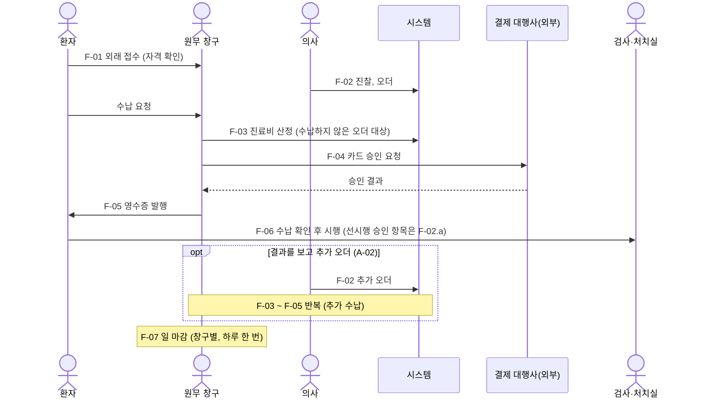
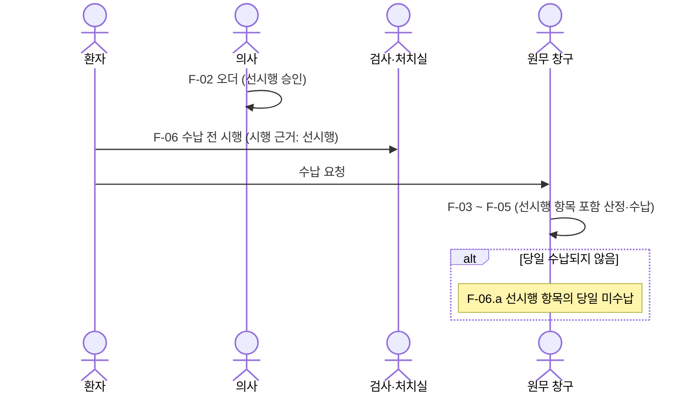
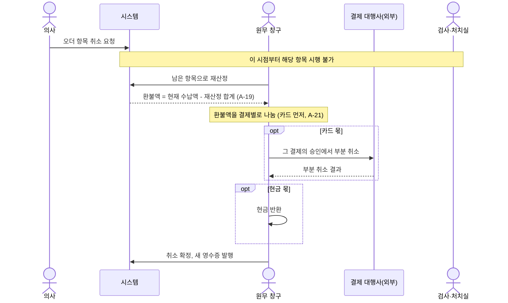
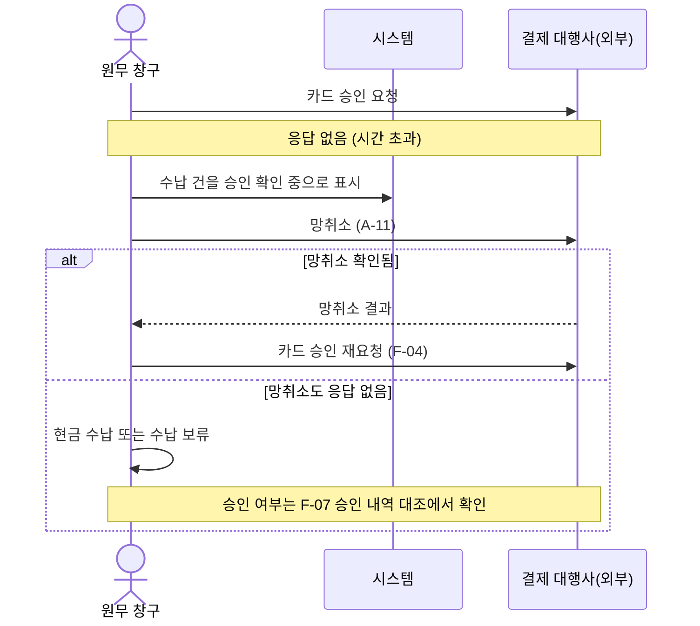
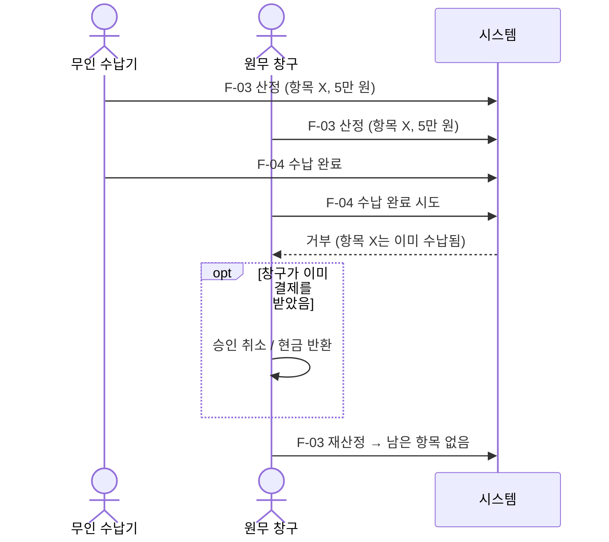
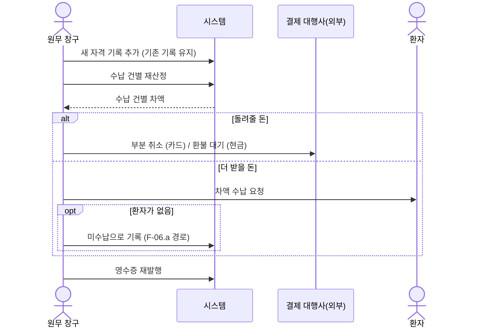

# 업무 흐름

상태: 초안 · 갱신: 2026-11-12

> 외래 환자가 접수한 뒤 진료를 받고 진료비를 수납하기까지의 업무 흐름입니다.
---

## 1. 범위와 가정

**범위**
- 포함: 외래 접수 → 진료와 오더 → 진료비 산정 → 수납 → 영수증 발행 → 오더 시행 → 일 마감
- 제외: 입원 정산, 보험 청구(심평원), 예약, 원외처방 이후의 약국 업무, 후불 결제(등록 카드 자동 결제), 검사실 판단에 의한 수납 전 시행, 외래에서 입원으로 전환된 환자의 미수납분 이관, 받지 못한 미수납의 결손 처리, 환불 대기와 새 수납의 상계, 잘못 기록한 시행의 되돌림(실시 취소), 장비 문제 등으로 인한 무료 재시행, 일부 금액만 깎아 주는 감액, 잘못 입력한 수가의 정정

**가정**

본 흐름은 실제 병원 운영 방식과 다소 차이가 있을 수 있으며, 특정 상황을 전제로 설계되었습니다. 따라서 전제 조건이 변경될 경우, 이를 참조하는 연관 단계도 함께 수정합니다.

| ID | 가정 | 참조 단계 |
| :--- | :--- | :--- |
| `A-01` | 진찰료와 검사·처치비는 진료 종료 후 수납한다. 검사·처치는 수납 완료 후 시행을 원칙으로 한다(선수납). 단, 선시행 승인이 있는 항목은 수납 전에도 시행할 수 있다. 선시행으로 이미 시행된 항목은 내원 당일 수납을 원칙으로 하며, 당일 수납되지 않으면 미수납으로 처리한다. 선시행 승인만 있고 아직 시행되지 않은 항목은 미수납 대상이 아니다. | F-02, F-02.a, F-04, F-06, F-06.a |
| `A-02` | 한 내원 건에 여러 번의 수납이 발생할 수 있다. 수납할 때마다 그때까지 수납되지 않은 오더 항목들을 묶어 처리한다. | F-03, F-04, F-06 |
| `A-03` | 본인부담률은 접수 시점에 확인된 자격을 기준으로 정한다. 단, 자격이 소급 변경되면 기존 자격 기록은 보존한 채 새 자격 기록을 추가하며, 이후 산정은 새 자격을 적용한다. | F-01, F-03, F-04.d |
| `A-04` | 자격은 건강보험과 일반(비보험, 전액 본인부담) 두 가지만 다룬다. 의료급여, 산정특례, 감면은 다루지 않는다. | F-01, F-03 |
| `A-05` | 결제 수단은 카드와 현금만 다룬다. 카드 승인은 외부 결제 대행사가 처리한다. 예외적으로 환불 대기 건은 환자 요청 시 계좌로 송금할 수 있다. | F-04, F-04.a, F-07 |
| `A-06` | 수가는 적용 시작일이 관리되는 단가이며, 진료일 기준 유효한 단가를 적용한다. 야간·공휴일 가산 등 세부 계산 규칙은 다루지 않는다. | F-03 |
| `A-07` | 원외처방은 처방전만 발행하며 병원 수납 금액에는 포함하지 않는다. | F-02, F-05 |
| `A-08` | 진찰료 및 진료실 내 즉석 시행 항목(신속항원검사, 혈당 검사 등)은 수가 항목 자체에 선시행 기본값이 지정되어 있어, 의사의 별도 승인 없이도 선시행 승인 항목으로 처리된다. | F-02, F-02.a |
| `A-09` | 카드 부분 취소는 환자가 현장에 없어도 기존 승인 정보(승인번호, 승인일, 금액)로 처리할 수 있다. | F-04.a |
| `A-10` | 의사는 오더 항목의 취소 또는 취소 요청을 철회할 수 없다. 다시 필요한 경우 새 오더를 발행해야 한다. | F-02.b, F-04.a |
| `A-11` | 카드 승인 응답을 받지 못하면 해당 승인 요청에 대해 망취소를 전송한다. 카드로 재결제하는 것은 망취소가 확인된 이후에만 가능하다. | F-04.b, F-07 |
| `A-12` | 이미 완료된 마감은 수정하지 않는다. 과거 날짜에 수납된 건을 취소·환불할 경우, 각 환불 몫은 이를 처리한 날짜와 처리한 창구의 마감에 반영한다(A-26). 처리 창구가 없는 자동 환불(F-06.b)은 당초 수납했던 창구의 마감에 반영한다. | F-04.a, F-06.b, F-07 |
| `A-13` | 마감은 마감 시점까지 완료되었으며 아직 어떤 마감에도 속하지 않은 수납 건과 환불 몫만 집계한다. 마감 시점에 진행 중이던 건은 완료된 후 다음 마감에 반영된다. | F-07 |
| `A-14` | 수납 건은 하나의 내원 건에만 속한다. 이전 내원 건의 미수납금은 새 내원 건의 수납에 합치지 않고, 이전 내원 건을 대상으로 한 별도의 수납 건으로 수납한다. | F-04, F-06.a |
| `A-15` | 미수납 내역이 있어도 진료를 제한하지 않으며, 접수 시 안내만 진행한다. | F-01, F-06.a |
| `A-16` | 진료일 종료 시점까지 시행되지 않은 오더 항목은 효력을 잃는다. 수납되지 않은 항목은 그대로 소멸하고, 수납된 항목은 자동 취소 후 환불 처리한다. | F-06.b |
| `A-17` | 자격 소급 변경은 양방향(일반 ↔ 건강보험, 본인부담률 변경)을 모두 다루며, 원무 직원이 증빙 자료나 외부 기관 재조회를 통해 확인한 경우에만 처리한다. | F-04.d |
| `A-18` | 이미 시행된 오더 항목은 원칙적으로 환불하지 않는다. 예외적으로 원무 책임자가 사유를 검토해 승인한 경우에 한해, 해당 항목을 제외한 나머지 항목으로 재산정한 차액을 환불한다(A-19). | F-06.c |
| `A-19` | 수납 건의 현재 수납액은 최초 수납액에 해당 수납 건에 대한 차액 수납액을 더하고, 확정된 환불액을 차감한 금액이다. 환불액은 확정되는 즉시 차감되며, 아직 환급되지 않은 환불 대기 금액도 포함한다. 환불액과 차액 수납액은 항상 현재 수납액과 재산정 합계 간의 차액으로 산출한다. | F-04.a, F-04.d, F-06.b, F-06.c |
| `A-20` | 한 수납 건을 여러 결제(다중 카드, 카드+현금 등)로 나누어 받을 수 있다. 결제 합계가 본인부담 합계와 일치해야 수납이 완료된다. 일부 결제가 실패하면 이미 성공한 결제는 유지하고 잔액만 다른 수단으로 수납한다. 끝내 결제를 완료하지 못해 수납을 보류하면 해당 수납 건에서 기결제된 금액을 모두 되돌린다(승인 취소·반환). | F-04, F-04.b, F-04.c, F-04.e |
| `A-21` | 환불액은 결제별로 분할하여 반환한다. 해당 수납 건과 이를 참조하는 차액 수납 건의 결제 내역 중 카드 결제를 우선 환불하며(다중 카드인 경우 최근 승인된 카드부터 역순 환불), 부족한 경우 현금 결제에서 환불한다. 각 결제에서 잔여 환불 가능 금액을 초과하여 환불할 수 없다. 카드 부분 취소는 환자 내원 없이도 가능하므로(A-09) 환불 대기 발생을 최소화할 수 있다. | F-04.a, F-04.d, F-06.b, F-06.c |
| `A-22` | 수납 건은 최초 결제를 시도할 때 생성되며 단일 산정 결과를 바탕으로 한다. 하나의 산정을 바탕으로 생성되는 수납 건은 오직 하나뿐이다. 보류되거나 거부된 수납 건은 재활성화하지 않으며, 재수납 시에는 새로 산정을 진행해 신규 수납 건을 생성한다. | F-03, F-04, F-04.b, F-04.c, F-04.e |
| `A-23` | 결제 진행 중인 수납 건이 지정된 시간 내에 완료되지 않으면 시스템이 수납을 자동 보류하고 기처리된 결제를 모두 되돌린다. 제한 시간은 미정(질문: 결제 진행 상태의 유효 시간은 얼마인가?). | F-04.b, F-04.e |
| `A-24` | 카드 승인을 요청하기 전에 승인 요청 내역(수납 건, 금액, 요청 시각)을 먼저 기록한다. 응답이 기록되지 않은 승인 요청은 '승인 확인 중' 상태로 관리한다. | F-04, F-04.b |
| `A-25` | 승인 취소 요청에 응답이 없으면 동일한 승인번호로 재요청할 수 있다. 취소는 승인번호 단위로 처리되므로 재요청하더라도 이중 취소되지 않는다. 끝까지 확인되지 않은 건은 일 마감 단계의 승인 내역 대조에서 처리한다. | F-04.c, F-04.e, F-07 |
| `A-26` | 환불은 취소 요청, 자격 소급 변경 차액, 진료일 경과 소멸, 예외 환불 한 건마다 하나씩 발생하며, 결제별 환불 몫으로 나뉜다. 각 환불 몫은 처리가 완료된 날짜와 처리 창구의 마감에 귀속된다. 처리 창구가 없는 자동 환불 몫은 당초 수납했던 창구의 마감에 귀속된다. | F-04.a, F-04.d, F-06.b, F-06.c, F-07 |
| `A-27` | 부분 취소 요청에 응답이 없으면, 재요청 전에 결제 대행사에 잔여 승인 금액을 조회하여 아직 취소되지 않았음을 확인한 후에만 재요청한다. 부분 취소는 기존 승인에서 금액을 차감하는 방식이므로 단순 재요청 시 이중 취소될 위험이 있다. 잔여 금액 조회마저 불가능한 경우 일 마감의 승인 내역 대조에서 처리한다. | F-04.a, F-07 |
| `A-28` | 적용을 시작한 수가는 고치거나 지우지 않는다. 단가가 바뀌면 새 적용 시작일로 새 단가를 추가하고, 더 쓰지 않는 수가 항목은 사용 종료일을 둔다. 잘못 입력한 단가의 정정은 다루지 않는다. | F-02, F-03, F-04.d |
| `A-29` | 환자 등록과 진료과·진료 의사 기준 정보는 다루지 않는다. 내원 건은 환자 번호, 진료과 코드, 진료 의사 번호를 다른 시스템에서 받은 값으로만 가진다. | F-01 |
| `A-30` | 건강보험 자격의 끝전은 법정 기준을 따른다. 급여 항목 총액의 합에서 10원 미만을 버린 값이 요양급여비용총액이다. 본인일부부담금은 요양급여비용총액 × 본인부담률에서 100원 미만을 버린 값이다(외래). 공단부담금은 요양급여비용총액에서 본인일부부담금을 뺀 값이다. 그래서 두 절사의 성격이 다르다. 본인일부부담금에서 버린 금액은 사라지지 않고 공단 몫으로 옮겨 가므로, 실제 부담 비율은 명목 본인부담률보다 조금 낮다. 총액에서 버린 금액은 누구에게도 청구하지 않으므로 병원이 받는 진료비가 그만큼 줄어든다. 비급여는 요양급여가 아니므로 전액 환자가 부담하고 끝전을 처리하지 않는다. 절사 단위는 한 곳에서만 정의한다. 근거: 국민건강보험법 시행령 별표 2(외래 본인일부부담금의 100원 미만 제외), 요양급여비용 청구방법 고시의 단수계산(10원 미만), 심평원 세부작성요령(2024.6.28.) 병원급 외래 예시. 종별·대상자별 예외는 다루지 않는다. | F-03, F-04.a |
| `A-31` | 일반(비보험) 자격의 진료는 요양급여가 아니므로 A-30의 끝전 처리를 적용하지 않는다. 모든 항목 총액의 합을 그대로 본인부담 합계로 하고, 공단부담금은 0이다. | F-03 |
| `A-32` | 산정 내역에는 항목별 본인부담금·공단부담금을 남기지 않는다. 법정 계산은 항목이 아니라 요양급여비용총액 단위로 하기 때문이다. 영수증에서 항목군별(진찰료, 검사료 등)로 나누어 보여 주는 방법은 영수증(F-05)을 다룰 때 정한다. | F-03, F-05 |

---

## 2. 정상 흐름 개요

| 단계 | 기록 단위 |
| :--- | :--- |
| F-01 | 내원 건 |
| F-02, F-06 | 오더 항목 |
| F-03 | 오더 항목별 산정 내역과 산정 합계 |
| F-04, F-05 | 수납 건 (한 내원 건에 여러 개 — A-02) |
| F-07 | 일자·창구별 마감 |

---

## 3. 정상 흐름

### F-01. 외래 접수
- **행위자**: 원무 직원 또는 환자(무인 접수기)
- **시작 조건**: 환자가 내원했다.
- **하는 일**: 환자 본인을 확인하고 진료과와 진료 의사를 지정하여 접수한다. 외부 기관 조회를 통해 보험 자격을 확인하고 그 결과를 내원 건에 기록한다(A-03, A-04). 이전 내원 건에 미수납(F-06.a)이나 환불 대기(F-04.a) 내역이 있으면 환자에게 안내한다. 단, 미수납 내역이 있더라도 접수를 제한하지는 않는다(A-15).
- **남는 기록**
  - 내원 건: 환자, 진료과, 진료 의사, 진료일, 접수 시각, 접수자
  - 내원 건의 자격: 보험 종류, 본인부담률, 확인 시각
- **다음 단계**: F-02

### F-02. 진료와 오더
- **행위자**: 의사
- **시작 조건**: 접수된 환자의 진료 차례가 되었다.
- **하는 일**: 환자를 진찰하고 필요한 검사·처치 오더를 발행한다. 진찰 행위 자체도 진찰료 오더 항목으로 생성되며, 진찰과 동시에 시행된 것으로 기록한다(선시행, A-08). 당일 진료 중 결과 확인이 필요한 검사는 선시행을 승인한다(A-01). 진료실 내에서 즉석 시행하는 검사는 별도 승인 없이도 선시행 대상이 된다(A-08). 약제 처방이 필요하면 원외처방전을 발행한다(A-07). 진료를 마치면 진료 완료 상태로 표시한다.
- **남는 기록**
  - 오더: 내원 건, 오더 의사, 오더 시각. 한 번에 낸 오더 항목들을 묶는다.
  - 오더 항목: 오더, 수가 항목(진찰·검사·처치), 수량, 선시행 승인 여부와 그 근거(의사 지정 또는 수가 항목 기본값)
  - 원외처방: 내원 건, 약품, 용법, 일수
  - 시행 기록: 진찰료 항목, 시행자(진료 의사), 시행 시각, 시행 근거(선시행)
  - 진료 완료 시각
- **다음 단계**: F-03 (선시행 승인 항목은 F-02.a, 수납 전에 오더를 취소하면 F-02.b)

### F-03. 진료비 산정
- **행위자**: 시스템
- **시작 조건**: 환자가 수납을 요청했고, 내원 건에 아직 수납하지 않은 오더 항목이 있다.
- **하는 일**: 아직 수납되지 않은 오더 항목들을 모아(A-02) 항목별 금액을 계산한다. 단가는 진료일 기준 유효 수가(A-06)를 적용하고, 본인부담률은 내원 건의 자격 정보(A-03)에서 가져온다. 본인부담률은 급여 항목 합계에 적용하고 법정 기준으로 끝전을 처리한다(A-30). 비급여 항목과 일반(비보험) 자격 환자는 전액 본인부담으로 산정한다(A-31).
- **남는 기록**
  - 산정 내역(항목별): 오더 항목, 적용 단가, 수량, 급여 구분, 총액(A-32)
  - 산정 합계: 총액, 본인부담 합계, 공단부담 합계, 끝전 처리 전후 금액, 계산에 쓴 자격, 산정 시각
- **다음 단계**: F-04

### F-04. 수납
- **행위자**: 원무 직원 또는 환자(무인 수납기)
- **시작 조건**: 산정 합계가 산출되었다(F-03).
- **하는 일**: 산출된 본인부담 합계를 안내하고 결제를 진행한다(A-05). 결제는 다중 카드 또는 카드·현금 혼용 등 분할 결제가 가능하다(A-20). 카드 결제는 승인 요청 내역을 먼저 기록한 뒤(A-24) 외부 결제 대행사에 승인을 요청하며, 현금 결제는 수령액과 거스름돈을 확인하여 처리한다. 결제 합계가 본인부담 합계와 일치하면 수납을 완료한다. 수납 완료된 오더 항목은 이후 수납 대상에서 제외된다(A-02). 산정 이후 수납 완료 전까지 수납 대상에 변동이 생기면 수납을 완료하지 않고 거부 처리한다(F-04.c).
- **남는 기록**
  - 수납 건: 내원 건, 바탕 산정(A-22), 포함된 오더 항목, 수납액, 창구, 수납자, 시작 시각, 수납 시각(완료 시각)
  - 결제(수납 건마다 하나 이상): 수납 건, 수단, 금액, 카드 승인 요청 시각, 카드 승인번호, 승인 시각
- **다음 단계**: F-05 (대상이 바뀌었으면 F-04.c, 카드 승인이 거절되었으면 F-04.e)
- **현장 메모**: 카드 승인은 병원 외부 결제 대행사에서 처리되고 수납 기록은 병원 내부 시스템에 보관된다. 승인 응답을 받지 못한 예외 상황은 F-04.b에서 다룬다. 승인 응답을 수신했으나 병원 시스템에 수납 완료를 기록하지 못한 장애 상황은 정상 업무 흐름이 아니므로 `04-invariants.md`의 위반 시나리오(C-09)에서 다룬다. 승인 요청 내역은 대행사 호출 전에 미리 기록되므로(A-24), 이러한 장애가 발생해도 병원 쪽에 추적 기록이 남는다.

### F-05. 영수증 발행
- **행위자**: 시스템, 원무 직원
- **시작 조건**: 수납이 완료되었다(F-04).
- **하는 일**: 수납 건마다 진료비 영수증을 발행한다. 영수증에는 항목별 급여·비급여 구분과 본인부담·공단부담 금액이 명시된다. 원외처방이 있는 경우 처방전을 함께 출력한다(A-07).
- **남는 기록**
  - 영수증: 영수증 번호, 수납 건, 발행 시각
- **다음 단계**: 시행할 검사·처치가 있으면 F-06, 없으면 종료

### F-06. 오더 시행
- **행위자**: 검사실·처치실 직원
- **시작 조건**: 환자가 검사실 또는 처치실에 내방했다.
- **하는 일**: 오더 항목의 수납 완료 여부 또는 선시행 승인 여부를 확인한 후 시행한다(A-01). 두 조건 모두 해당하지 않는 항목은 시행하지 않고 환자를 수납 창구로 안내한다. 취소 요청된 항목은 수납되었더라도 시행하지 않는다(F-04.a).
- **남는 기록**
  - 시행 기록: 오더 항목, 시행자, 시행 시각, 시행 근거(수납 또는 선시행)
- **다음 단계**: 시행된 항목에 대한 환불 요청은 F-06.c. 진료일 종료 시점까지 시행되지 않은 항목은 F-06.b. 선시행 항목은 수납을 위해 F-03으로 이동(F-02.a). 결과 확인 후 추가 진료가 필요하면 F-02(추가 오더 발행 → 추가 수납, A-02). 그 외에는 업무 종료.

### F-07. 일 마감
- **행위자**: 원무 직원
- **시작 조건**: 창구 업무 종료 시각이 되었다. (환자별 흐름과 별개로 창구마다 하루 한 번 진행된다.)
- **하는 일**
  1. **집계**: 창구별로 마감 시점까지 완료되었으며 아직 어떤 마감에도 포함되지 않은 수납 건(차액 수납 건 포함)과 환불 몫을 취합해 집계하고, 이번 마감에 귀속시킨다(A-13, A-26). 과거 날짜 수납 건의 환불도 실제 처리한 날짜의 마감에 반영한다(A-12). 이미 완료된 마감은 수정하지 않는다.
  2. **현금 대조**: 현금 수납 합계를 창구의 실제 보유 현금(시재금)과 대조한다.
  3. **카드 대조**: 결제 대행사의 승인 내역과 병원의 결제 기록을 총액이 아닌 개별 승인 건 단위로 1:1 대조한다. 마감 시점 이후 완료되어 다음 마감으로 넘어가는 건은 오류가 아닌 '시차'로 구분한다. 병원 수납/취소 기록과 대조되지 않는 '짝 없는 승인'(F-04.b, F-04.c, F-04.e)이 발견되면 해당 승인을 취소한다(A-11). 이전에 승인 취소 응답을 받지 못했던 결제 건도 이 단계에서 취소 여부를 최종 확인한다(A-25).
  4. **미결 확인**: 당일 선시행되었으나 아직 수납되지 않은 오더 항목(F-06.a), 자격 소급 변경 후 아직 수납받지 못한 차액(F-04.d), 아직 환자에게 지급하지 못한 환불 대기금(F-04.a)을 확인한다.
  5. 대조 과정에서 시차 등으로 규명되지 않는 불일치가 있으면 차이 내역으로 기록한다.
- **남는 기록**
  - 마감: 일자, 창구, 수납 합계, 환불 합계, 현금 합계, 카드 합계, 마감자, 마감 시각
  - 마감 소속: 마감, 이 마감에 속한 수납 건과 환불 몫
  - 차이 내역: 대조 대상, 병원 기록 금액, 대조 금액, 차이
  - 시차 내역: 승인번호, 승인 시각, 속하게 될 다음 마감
  - 미수납 내역: 내원 건, 선시행된 오더 항목, 시행 시각, 미수납 사유
  - 환불 대기 내역: 대상 수납 건, 대상 환불 몫, 금액, 대기 시작 시각
  - 짝 없는 승인 내역: 승인번호, 승인 금액, 승인 시각, 처리 결과(취소함, 확인 중)
- **다음 단계**: 없음
- **현장 메모**: 수납 일시만을 기준으로 집계하면 마감 경계에 걸친 건(예: 17:59 결제 시작 → 승인 확인 중 → 18:02 완료, F-04.b)이 마감에서 누락되거나 이중 집계될 위험이 있다. 따라서 수납 일시가 아니라 명시적인 '마감 소속' 속성을 기준으로 집계한다(A-13). 레거시 시스템에서 "일일 정산 보고서와 금액이 맞지 않는다"는 문의가 발생하는 대표적인 원인이다.

---

## 4. 대안 흐름

정상 흐름 단계에서 갈라지는 흐름을 `F-NN.a` 형식으로 기술합니다.

### F-02.a. 선시행 승인 항목의 시행
- **행위자**: 의사, 검사실·처치실 직원, 원무 직원
- **시작 조건**: 오더 항목에 선시행 승인이 있다(A-01, A-08).
- **하는 일**: 수납 전에 검사·처치(F-06)를 먼저 진행한다. 진료실 내 즉석 검사는 진료 중에 즉시 시행한다. 이미 시행된 항목은 환자가 수납을 요청할 때 수납되지 않은 다른 항목들과 함께 산정·수납된다(A-02).
- **남는 기록**
  - F-02의 오더 항목(선시행 승인 여부), F-06의 시행 기록(시행 근거: 선시행)
- **다음 단계**: F-03 → F-04 → F-05 (내원 당일 원칙). 당일 수납되지 않으면 F-06.a

### F-02.b. 수납 전 오더 취소
- **행위자**: 의사
- **시작 조건**: 아직 수납되지 않고 시행되지도 않은 오더 항목을 의사가 취소한다. 선시행 승인이 있는 항목이라도 아직 시행되지 않았다면 여기에 해당한다.
- **하는 일**: 오더 항목을 취소한다. 수납된 금액이 없으므로 환불 절차 없이 즉시 취소가 확정된다. 확정된 취소는 번복할 수 없으며, 다시 필요한 경우 새 오더를 발행해야 한다(A-10). 이미 시행된 항목(진찰료, 선시행 항목 등)은 이 흐름으로 취소할 수 없다. 해당 오더 항목을 포함하여 결제가 진행 중이던 수납 건이 있다면 F-04.c에 따라 수납이 거부된다.
- **남는 기록**
  - 오더 취소: 오더 항목, 취소 의사, 취소 시각, 사유
- **다음 단계**: 없음. 수납되지 않은 다른 오더 항목은 그대로 F-03 대상이다.

### F-04.a. 시행 전 오더 취소와 부분 환불
- **행위자**: 의사, 원무 직원, 시스템
- **시작 조건**: 수납 완료된 오더 항목을 시행하기 전에 의사가 해당 항목의 취소를 요청했다.
- **하는 일**
  1. 의사가 오더 항목의 취소를 요청한다. 요청 시점부터 해당 항목은 시행 불가 상태가 되지만, 아직 취소가 최종 확정된 것은 아니다. 취소 요청은 철회할 수 없다(A-10).
  2. 시스템이 남은 항목만으로 본인부담 합계를 다시 산정한다. 환불액은 해당 수납 건의 현재 수납액에서 재산정한 합계를 뺀 차액이다(A-19). 최초 수납액을 기준으로 계산하면, 동일 수납 건에서 2차 환불이 일어날 때 1차 환불액이 이중으로 환급되는 문제가 발생한다. 선행 취소의 환불이 아직 완료되지 않았더라도(환불 대기 포함) 그 환불액은 이미 현재 수납액에서 차감 반영되어 있으므로 이중 환급 위험이 없다(A-19). 본인부담금은 합계 기준으로 끝전을 처리하므로, 취소 항목의 금액만 따로 떼어 계산하지 않고 전체 재산정 방식을 사용한다.
  3. 환불액을 결제별로 나눈다. 카드 결제에서 먼저, 카드가 여러 장이면 최근에 승인된 카드부터 역순으로 배분하고, 모자라면 현금 결제에서 환불한다(A-21). 카드 환불 몫은 원무 직원이 해당 결제의 당초 승인에 대해 부분 취소를 요청한다. 카드 부분 취소는 환자가 현장에 없어도 처리할 수 있으므로 취소 요청을 받는 즉시 진행한다(A-09). 부분 취소 응답이 오지 않으면 잔여 금액을 조회해 미취소 상태를 확인한 후에만 재요청한다(A-27). 현금 환불 몫은 환자에게 직접 교부한다.
  4. 모든 환불 몫의 처리가 완료되면 오더 항목의 취소가 최종 확정된다. 기존 영수증은 무효화하고, 남은 항목으로 새 영수증을 발행한다. 원래 수납이 과거 날짜에 마감되었더라도 해당 마감 기록은 수정하지 않으며, 각각의 환불 몫은 실제 처리가 완료된 날의 마감에 반영된다(A-12, A-26).
- **남는 기록**
  - 취소 요청: 오더 항목, 요청 의사, 요청 시각, 사유
  - 환불: 대상 수납 건, 취소 항목, 환불 전 현재 수납액, 재산정 합계, 환불액, 환불액 확정 시각
  - 환불 몫(결제마다): 대상 결제, 금액, 부분 취소 승인번호 또는 현금 반환·계좌 송금, 처리자, 처리 창구, 처리 시각
  - 영수증: 기존 영수증의 무효 시각, 새 영수증 번호
  - 환불 대기: 대상 환불 몫, 금액, 대기 사유, 대기 시작 시각 (환자 대면이 필요한 경우)
  - 원래의 수납 건과 결제 기록은 수정하지 않고 그대로 유지된다.
- **다음 단계**: 남은 항목은 F-06(오더 시행). 현금 수납 건처럼 환자가 내원해야 환불할 수 있는데 환자가 창구에 오지 않으면 기한 없이 '환불 대기'로 남는다. 환불 대기는 병원이 환자에게 반환해야 할 채무이므로 자동으로 소멸시키지 않으며, 다음 내원 시 환불하거나 환자 요청 시 계좌로 송금한다. 새 수납 건과 상계하지 않는다. 모든 환불 몫의 처리를 완료하면 오더 취소가 확정된다.

### F-04.b. 카드 승인 응답 없음
- **행위자**: 원무 직원, 결제 대행사(외부)
- **시작 조건**: 카드 승인을 요청했으나(F-04) 정해진 시간 안에 응답을 받지 못했다. 병원은 실제로 승인되었는지 알 수 없다.
- **하는 일**
  1. 수납 건을 '승인 확인 중' 상태로 둔다. 승인 확인 중인 동안에는 동일한 오더 항목으로 다시 수납할 수 없다.
  2. 결제 대행사에 해당 승인 요청에 대한 망취소를 보낸다(A-11).
  3. 망취소가 확인되면 '승인 없음'으로 확정하고, F-04로 돌아가 결제를 다시 진행한다.
  4. 망취소 결과조차 확인되지 않으면 카드로 다시 결제하지 않는다. 남은 금액을 현금으로 받거나 수납을 보류한다. 수납을 보류하면 해당 수납 건에서 이미 처리된 다른 결제는 모두 되돌린다(A-20, F-04.e). 보류한 항목 중 이미 시행된 항목(선시행)은 당일 수납되지 않으면 미수납으로 전환되고(F-06.a), 아직 시행되지 않은 항목은 미수납 오더로 남는다(F-06.b).
  5. 승인 여부를 끝내 확인하지 못한 건은 일 마감(F-07) 때 결제 대행사의 승인 내역과 대조한다. 짝 없는 승인이 확인되면 해당 승인을 취소한다.
- **남는 기록**
  - 승인 요청: 수납 건, 금액, 요청 시각, 응답 여부
  - 망취소: 대상 승인 요청, 요청 시각, 결과(확인됨, 확인 안 됨)
  - 승인 확인 중: 수납 건, 결제, 시작 시각, 종료 시각, 종료 사유(승인 없음 확정, 현금 수납, 수납 보류)
  - 수납 보류: F-04.e와 같다.
- **다음 단계**: 망취소가 확인되면 F-04. 확인되지 않으면 현금 수납(F-04) 또는 수납 보류. 짝 없는 승인은 F-07에서 처리한다.

### F-04.c. 산정 이후 수납 대상 변경
- **행위자**: 원무 직원 또는 환자(무인 수납기), 시스템
- **시작 조건**: 산정(F-03)을 마친 뒤 수납을 완료하기 전에 수납 대상이 바뀌었다. 다음 두 경우가 있다.
  - 동시 수납: 다른 창구나 무인 수납기에서 같은 오더 항목의 수납이 먼저 완료되었다.
  - 오더 변경: 의사가 해당 내원 건에 오더 항목을 추가 또는 취소했거나, 진료일이 지나 오더 항목이 소멸했다(F-06.b).
- **하는 일**
  1. 수납을 완료하지 않고 거부한다. 같은 오더 항목은 두 번 수납되지 않으며, 산정 시점과 대상이 달라진 상태로는 수납을 완료하지 않는다.
  2. 이미 처리된 결제가 있으면 모두 되돌린다. 카드 결제는 승인을 취소하고, 현금 결제는 반환한다(A-20). 승인 취소 응답이 없으면 동일한 승인번호로 재요청하며, 끝까지 확인되지 않은 건은 일 마감(F-07)의 승인 내역 대조에서 처리한다(A-25).
  3. 현재 유효한 오더를 기준으로 다시 산정한다(F-03). 수납할 오더 항목이 남아 있지 않으면 수납 대상이 없다고 안내한다.
  4. 거부 통보 시점은 현재 미정이다. 미정(ADR-0003: 수납 시작 시점에 알리는가, 완료하려 할 때 알리는가?).
- **남는 기록**
  - 수납 거부: 내원 건, 거부 사유(동시 수납, 오더 변경), 거부 시점의 산정 시각, 거부 시각, 창구
  - 결제 되돌림: 대상 결제, 카드 승인 취소 결과 또는 현금 반환 (이미 받은 결제가 있는 경우)
- **다음 단계**: 수납하지 않은 항목이 남아 있으면 F-03, 없으면 종료

### F-04.d. 자격 소급 변경
- **행위자**: 원무 직원, 시스템
- **시작 조건**: 이미 수납한 내원 건의 자격이 접수 때와 달랐음이 확인되었다(A-17). 예: 일반으로 수납했는데 건강보험 자격이 확인됨, 건강보험으로 수납했는데 자격이 없었음이 확인됨.
- **하는 일**
  1. 원무 직원이 새 자격을 확인한다. 기존 자격 기록은 보존한 채 새 자격 기록을 추가한다(A-03).
  2. 시스템이 해당 내원 건의 수납 건마다, 현재 수납된 상태로 남아 있는 항목을 새 자격으로 다시 산정한다. 단가는 진료일 기준 그대로 유지한다(A-06). 본인부담금은 수납 건의 합계 기준으로 끝전을 처리하므로 수납 건별로 다시 산정한다.
  3. 수납 건마다 차액(현재 수납액 − 재산정 합계, A-19)을 산출한다.
     - 차액이 양수(돌려줄 환불액 발생)이면 F-04.a의 3~4단계와 같이 환불한다. 결제별 배분 순서는 A-21을 따르며, 카드 몫은 원래 승인에서 부분 취소하고(A-09), 현금 몫은 환불 대기로 남긴다.
     - 차액이 음수(더 받을 추가액 발생)이면 그 차액을 해당 내원 건의 신규 '차액 수납 건'으로 수납한다(A-14). 이 차액 수납 건은 원래 수납 건을 참조하며, 원래 수납 건의 현재 수납액에 합산된다(A-19). 마감 처리 역시 일반 수납 건과 동일하게 적용된다(A-13). 환자가 부재중이면 미수납으로 등록하고 F-06.a와 같은 경로로 해소한다(A-15).
  4. 수납 건마다 기존 영수증을 무효화하고 새 영수증을 재발행한다.
  5. 아직 수납되지 않은 오더 항목은 향후 새 자격을 기준으로 산정된다.
- **남는 기록**
  - 자격 변경: 내원 건, 이전 자격, 새 자격, 확인 근거(증빙, 재조회), 확인자, 확인 시각
  - 재산정 내역(수납 건별): 수납 건, 현재 수납액, 재산정 합계, 차액
  - 환불 또는 환불 대기: F-04.a와 같다.
  - 차액 수납 건: 내원 건, 참조하는 원래 수납 건, 차액, 결제, 창구, 수납자, 수납 시각 (받지 못하면 미수납 내역, 사유: 자격 변경 차액)
  - 영수증: 기존 영수증의 무효 시각, 새 영수증 번호
- **다음 단계**: 없음. 미정(질문: 수납 후 언제까지 소급 변경을 받아 주는가?)

### F-04.e. 카드 승인 거절과 수납 보류
- **행위자**: 원무 직원 또는 환자(무인 수납기), 결제 대행사(외부), 시스템
- **시작 조건**: 수납 중 카드 승인이 거절되었다. 응답은 받았으나 승인되지 않은 경우이며, 응답을 받지 못한 경우는 F-04.b에서 다룬다. 여러 결제로 나누어 받는 중이면 앞서 성공한 결제가 있을 수 있다(A-20).
- **하는 일**
  1. 이미 승인된 결제는 그대로 두고, 남은 금액만 다른 카드나 현금으로 추가 결제받는다(A-20).
  2. 결제 합계가 본인부담 합계와 일치하면 수납을 완료한다(F-04).
  3. 남은 금액을 끝내 받지 못하면 수납을 보류한다. 결제 일부만 받은 채 정해진 시간이 지나도 수납이 완료되지 않으면 시스템이 자동으로 보류한다(A-23). 해당 수납 건에서 이미 처리된 결제는 모두 되돌린다. 카드 결제는 승인을 취소하고, 현금 결제는 반환한다. 승인 취소 응답이 없으면 동일한 승인번호로 재요청하며, 끝까지 확인되지 않은 건은 일 마감(F-07)의 승인 내역 대조에서 처리한다(A-25).
  4. 보류한 항목 가운데 이미 시행된 항목(선시행)은 당일 수납되지 않으면 미수납으로 전환되고(F-06.a), 아직 시행되지 않은 항목은 미수납 오더로 남는다(F-06.b).
- **남는 기록**
  - 승인 거절: 수납 건, 결제 금액, 거절 사유, 거절 시각
  - 수납 보류: 수납 건, 보류 사유, 되돌린 결제(대상 결제, 카드 승인 취소 결과 또는 현금 반환), 보류자, 보류 시각
- **다음 단계**: 남은 금액을 받으면 F-05. 수납을 보류하면 F-06.a 또는 F-06.b.
- **현장 메모**: 결제 일부만 받은 수납 건이 완료되지도 보류되지도 않은 채 방치되면, 돈은 입금되었으나 정작 수납 완료된 항목은 없는 불일치 상태가 된다. A-23의 자동 보류 메커니즘이 이를 방지하며, 자동 보류가 제때 일어나지 않은 장애 상황은 `04-invariants.md`에서 다룬다.

### F-06.a. 선시행 항목의 당일 미수납
- **행위자**: 원무 직원
- **시작 조건**: 선시행된 오더 항목이 내원 당일 수납되지 않았다(A-01). 원인은 다음과 같이 여럿일 수 있다.
  - 환자 사정: 결제 수단 없음, 카드 한도 초과, 보호자 추후 결제, 수납 없이 귀가
  - 병원 사정: 검사가 늦게 끝나 창구 업무 종료, 결제 대행사 장애, 자격 확인 보류로 금액 미확정
- **하는 일**: 일 마감(F-07) 때 그날 선시행되었으나 수납되지 않은 항목들을 확인하고, 사유와 함께 '미수납 내역'으로 등록한다. 당일 수납되지 못한 상황 자체는 정상적인 진료 과정에서 발생할 수 있는 일이며, 이를 미수납으로 기록하지 않은 채 누락하는 것이 문제다. 미수납은 이미 시행되었거나 금액이 확정되어 병원이 받아야 할 정당한 채권만을 가리킨다. 시행되지도 않고 수납되지도 않은 오더 항목은 청구 대상이 아니므로 미수납이 아니다(F-06.b).
- **남는 기록**
  - 미수납 내역: 내원 건, 선시행된 오더 항목, 시행 시각, 미수납 사유, 확인 시각
- **다음 단계**: 미수납 내역은 사후 수납되거나 결손 처리되기 전까지 영구 보존된다. (결손 처리는 범위 밖)
  - 그 사이 원무과는 환자에게 미수납을 안내할 수 있다.
  - 환자가 다시 내원하면 접수(F-01) 때 미수납 내역을 알린다. 단, 진료는 제한하지 않는다(A-15).
  - 미수납금을 수납할 때는 이전 내원 건을 대상으로 F-03 ~ F-05를 별도로 진행한다(A-14). 산정에는 이전 내원 건의 진료일 당시 수가(A-06)와 당시 자격(A-03)을 적용한다. 새 내원 건의 수납 창구에서 이어서 수납하는 것도 가능하다.

### F-06.b. 진료일이 지난 미시행 오더
- **행위자**: 시스템, 원무 직원
- **시작 조건**: 진료일이 종료되었는데 시행되지 않은 오더 항목이 있다(A-16). 진찰료와 진료실 즉석 검사는 진료 중에 이미 시행된 것으로 기록되므로 해당하지 않는다(A-08).
- **하는 일**
  1. 수납되지 않은 항목은 소멸(EXPIRED) 처리한다. 청구할 금액이 없으므로 미수납이 아니다. 해당 항목을 대상으로 결제가 진행 중인 수납 건이 있다면 F-04.c에 따라 수납이 거부되고, 이미 처리된 결제는 모두 되돌린다. 다시 필요하면 의사가 새 오더를 발행해야 한다.
  2. 수납 완료된 항목은 시스템이 자동으로 취소를 요청하고, F-04.a의 2~4단계와 같이 차액을 다시 산정해 환불한다. 결제별 배분 순서는 A-21을 따르며, 카드 몫은 환자 대면 없이 바로 부분 취소하고(A-09), 현금 몫은 환불 대기로 등록한다.
  3. 자동 환불은 물리적 처리 창구가 없으므로 당초 수납했던 창구의 환불로 간주하여, 해당 창구의 다음 마감에 귀속시킨다(A-12, A-13).
- **남는 기록**
  - 오더 소멸: 오더 항목, 소멸 시각, 사유(진료일 경과)
  - 취소 요청: 오더 항목, 요청자(시스템), 요청 시각, 사유(진료일 경과)
  - 환불 또는 환불 대기: F-04.a와 같다.
- **다음 단계**: 없음. 환자가 추후 검사를 원하면 새 오더(F-02)부터 다시 진행한다.
- **현장 메모**: 진료일 마감 직전 시점에 시행된 항목의 경우, 검사실의 시행 기록 입력이 지연되면 실제로 시행되었음에도 자동 취소·환불될 수 있다. 이 시차 경계 문제는 `04-invariants.md`의 위반 시나리오(C-16)에서 다룬다.

### F-06.c. 시행 후 예외 환불
- **행위자**: 원무 직원, 원무 책임자
- **시작 조건**: 이미 시행된 오더 항목에 대해 환자가 환불을 요청했다. 예: 설명 부족에 따른 민원, 병원 측 귀책사유 등.
- **하는 일**
  1. 원무 직원이 환불 요청과 사유를 접수한다.
  2. 원무 책임자가 사유를 검토하여 승인하거나 거절한다(A-18). 거절하면 환불 절차를 진행하지 않고 종결한다.
  3. 승인되면 F-04.a의 2~4단계와 동일하게 환불을 진행한다. 해당 항목을 제외한 잔여 항목으로 수납 건을 다시 산정해 현재 수납액과의 차액을 환불하고(A-19), 결제별 배분 순서(A-21)에 따라 카드 몫은 부분 취소(A-09), 현금 몫은 환불 대기로 처리하며 영수증을 재발행한다. 이 환불은 실제 처리한 날의 마감에 귀속된다(A-12).
  4. 기존 시행 기록은 그대로 유지된다. 해당 항목은 '시행 완료 후 환불된 항목'으로 이력이 보존된다.
- **남는 기록**
  - 예외 환불 요청: 오더 항목, 요청 사유, 접수자, 접수 시각
  - 승인: 승인자(원무 책임자), 결과(승인, 거절), 판단 사유, 승인 시각
  - 환불 또는 환불 대기, 영수증: F-04.a와 같다.
- **다음 단계**: 없음
