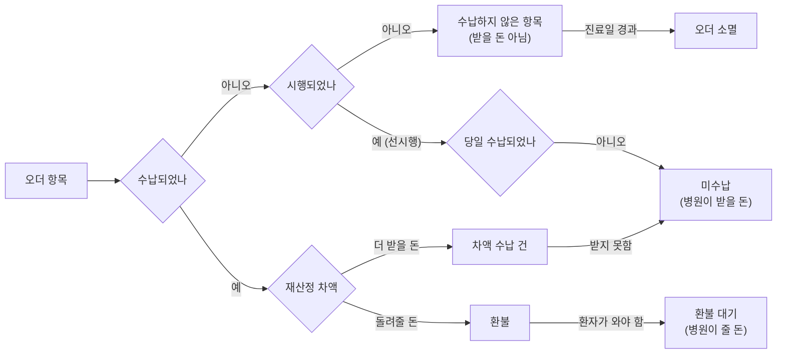

# 용어 사전

상태: 초안 · 갱신: 2026-11-12

> [업무 흐름](01-flow.md)에 등장하는 주요 용어 중, 혼동하기 쉽거나 특정 의미로 한정해 사용하는 개념을 정의합니다.  
> 상태 전이표와 불변식은 이 문서의 정의를 그대로 따릅니다.
---

## 목차
- [1. 접수와 자격](#1-접수와-자격)
- [2. 오더와 시행](#2-오더와-시행)
- [3. 산정](#3-산정)
- [4. 수납과 결제](#4-수납과-결제)
- [5. 취소와 환불](#5-취소와-환불)
- [6. 받을 돈과 돌려줄 돈](#6-받을-돈과-돌려줄-돈)
- [7. 마감](#7-마감)
- [8. 열린 질문](#8-열린-질문)

---

## 1. 접수와 자격

| 용어 | 영문 코드명 | 정의 | 혼동 주의 (비교 대상) | 소유 모듈 |
| :--- | :--- | :--- | :--- | :--- |
| 내원 건 | `Visit` | 환자가 한 진료일에 한 진료과로 접수하여 생성되는 진료 단위로, 오더 항목·산정·수납 건이 모두 하나의 내원 건에 귀속된다(F-01). | '접수'는 내원 건을 생성하는 행위이며, 내원 건은 그 결과로 생기는 엔티티다. 같은 날 두 진료과에 접수하면 내원 건이 둘이 된다. 한 내원 건에 수납 건이 여러 개 존재할 수 있지만(A-02), 단일 수납 건이 둘 이상의 내원 건에 걸쳐 생성될 수는 없다(A-14). | `reception` |
| 접수 | `Registration` | 환자 본인을 확인하고 진료과와 진료 의사를 지정하여 내원 건을 생성하는 절차다(F-01). | 접수 시 미수납이나 환불 대기 내역을 안내하지만, 미수납 내역이 있더라도 접수를 제한하지는 않는다(A-15). | `reception` |
| 진료일 | `VisitDate` | 내원 건의 진료 날짜로, 수가 적용(A-06), 선시행 항목의 당일 수납(A-01), 미시행 오더의 소멸(A-16)을 판단하는 기준이다. | 수납일·환불일·마감 일자와 구분된다. 이전 내원 건의 미수납금을 오늘 수납하는 경우, 산정 금액은 해당 내원 건의 진료일 당시 수가와 자격을 기준으로 계산하지만 수납 건 자체는 오늘 마감에 귀속된다(F-06.a, A-13). 진료일 종료 시점은 현재 미정이다. 미정(질문: 진료일 종료 시점은 자정인가, 해당 진료과 창구의 업무 종료 시점인가?). | `reception` |
| 자격 | `Eligibility` | 내원 건에 적용되는 보험 유형(건강보험, 일반) 및 본인부담률로, 접수 시 외부 기관 조회를 통해 확인한다(A-03, A-04). | 환자의 현재 실시간 자격이 아니라 해당 내원 건에 스냅샷으로 남긴 기록이다. 자격 변동 시 기존 기록을 수정하지 않고 새 기록을 추가하며, 이후의 산정은 가장 최신 기록을 기준으로 적용한다(A-03). | `reception` |
| 자격 소급 변경 | `RetroactiveEligibilityChange` | 이미 수납이 완료된 내원 건의 자격이 접수 당시와 달랐음을 원무 직원이 증빙 자료나 재조회를 통해 확인하고, 새 자격 기록을 추가하는 작업이다(F-04.d, A-17). | 수납 전에 자격을 정정하는 경우는 새 자격 기록만 추가하면 되고 정산 차액이 발생하지 않으므로 소급 변경 흐름에 해당하지 않는다. 반면 수납 후 소급 변경은 기존 수납 건별로 재산정을 유발하며 환불이나 추가 차액 수납 건을 발생시킨다. | `reception` |
| 수가 항목 | `FeeItem` | 진찰·검사·처치 등 병원이 진료비를 청구할 수 있는 의료 행위의 마스터 단위로, 급여 구분과 선시행 기본값 속성을 가진다(A-08). | '오더 항목'은 특정 내원 건에 대해 의사가 처방한 개별 지시이고, '수가 항목'은 그 지시가 참조하는 마스터 데이터의 행위 항목이다. | `master` |
| 수가 | `FeePrice` | 수가 항목의 단가로, 적용 시작일이 있으며 진료일에 유효한 것을 적용한다(A-06). | 새로운 단가가 고시되더라도 이전 진료일의 산정 금액은 변경되지 않는다. 적용을 시작한 수가는 고치거나 지우지 않는다(A-28). 이를 보장하는 참조 방식은 미정이다. 미정(ADR-0001: 산정 내역이 수가 단가를 어떻게 참조하는가?). | `master` |
| 급여 구분 | `CoverageType` | 수가 항목이 건강보험 적용 대상(급여)인지 비적용 대상(비급여)인지를 구분한 값이다. | 급여 구분은 의료 행위 항목 자체의 속성이고, 자격은 환자의 보험 조건이다. 따라서 일반(비보험) 자격 환자는 급여 항목을 진료받더라도 전액 본인부담으로 산정된다(F-03). | `master` |
| 본인부담률 | `CopayRate` | 급여 항목 금액 가운데 환자가 부담하는 비율로, 내원 건의 자격에서 정해진다(A-03). | 비급여 항목에는 적용하지 않는다(전액 본인부담). | `reception` |

## 2. 오더와 시행

| 용어 | 영문 코드명 | 정의 | 혼동 주의 (비교 대상) | 소유 모듈 |
| :--- | :--- | :--- | :--- | :--- |
| 오더 | `MedicalOrder` | 의사가 한 내원 건에 대해 한 번에 낸 처방으로, 오더 의사와 오더 시각을 가지며 하나 이상의 오더 항목을 묶는다(F-02). | 상태를 갖지 않고, 만든 뒤 바뀌지 않는다. 산정·수납·시행·취소는 모두 오더 항목 단위로 일어나며, 오더 항목이 모두 취소되어도 오더는 그때 그 처방을 냈다는 기록으로 남는다. 오더 의사와 오더 시각은 항목이 아니라 처방 한 번의 속성이므로 항목과 나누어 둔다. 코드명은 SQL 예약어 `ORDER`를 피해 `MedicalOrder`로 한다. | `order` |
| 오더 항목 | `OrderItem` | 의사가 내원 건에 대해 특정 수가 항목과 수량을 지정하여 처방한 지시 단위로, 산정·수납·시행·취소의 기준 단위다(F-02). | 진찰 행위 자체도 진찰료 오더 항목으로 기록된다(F-02). 원외처방은 오더 항목에 해당하지 않는다(A-07). 오더 항목은 하나의 [오더](#오더)에 속하고, 내원 건은 오더를 거쳐 정해진다. 상태는 수량 전체에 한 번에 적용된다. 수량의 일부만 취소하거나 시행할 수 없으며, 수량을 바꾸려면 취소한 뒤 새로 발행한다. | `order` |
| 원외처방 | `OutpatientPrescription` | 병원 외부 약국에서 조제받도록 발행하는 처방전이다(A-07). | 병원 수납 대상 금액에 포함되지 않으며, 처방전은 영수증 발행 시 함께 출력된다(F-05). | `order` |
| 선수납 | — | 검사·처치는 진료비를 먼저 수납한 후에 시행한다는 원칙이다(A-01). | 원칙일 뿐이며, 선시행 승인이 있는 항목은 예외적으로 수납 전에도 시행할 수 있다. | `order` |
| 선시행 승인 | `executableBeforePayment` (`OrderItem`의 속성) | 오더 항목을 수납 전에 먼저 시행할 수 있도록 부여된 권한으로, 의사가 직접 지정하거나 수가 항목 기본값으로 설정된다(A-01, A-08). | 결제 대행사의 '카드 승인'과 다른 개념이다. 혼동을 방지하기 위해 영문 코드명에 `Approval` 대신 `executableBeforePayment`를 사용한다. 선시행 승인만 있고 아직 시행되지 않은 항목은 수납 청구 대상이 아니므로 미수납이 아니다(A-01). 발행할 때 오더 항목에 정해 두고 근거(의사 지정 `DOCTOR`, 수가 항목 기본값 `FEE_ITEM_DEFAULT`)를 함께 남긴다. 나중에 수가 항목의 기본값이 바뀌어도 이미 낸 오더 항목의 승인은 바뀌지 않는다. | `order` |
| 선시행 | `PreExecution` | 선시행 승인을 근거로 진료비 수납 전에 오더 항목을 먼저 시행하는 행위다(F-02.a). | 선시행 승인은 사전 허용 권한이고, 선시행은 실제 시행이 완료된 사실이다. 선시행된 항목은 내원 당일 수납이 원칙이며, 당일 수납되지 않으면 미수납으로 전환된다(F-06.a). | `order` |
| 시행 | `Execution` | 검사실이나 처치실에서 오더 항목의 의료 행위를 실제로 완료한 사실이며, 시행 근거(수납 완료 또는 선시행)와 함께 기록된다(F-06). | 수납과 시행은 독립적으로 발생하는 별개의 사건이다. 따라서 수납 후 미시행 항목(F-06.b), 선시행 후 미수납 항목(F-06.a), 시행 후 예외 환불 항목(F-06.c)이 모두 발생할 수 있다. 한 번 기록된 시행 사실은 환불되더라도 삭제하지 않는다. 잘못 기록된 시행을 되돌리는 일(실시 취소)은 본 시스템 범위에서 다루지 않는다. | `order` |

## 3. 산정

| 용어 | 영문 코드명 | 정의 | 혼동 주의 (비교 대상) | 소유 모듈 |
| :--- | :--- | :--- | :--- | :--- |
| 산정 | `Invoice` | 내원 건에서 아직 수납되지 않은 오더 항목들을 모아 항목별 금액과 본인부담 합계를 계산하는 절차다(F-03). | 산정은 청구 금액을 산출할 뿐 실제 결제가 발생하는 것은 아니다. 산정 완료 후 수납 대상 오더 항목이 변경되면 기존 산정 결과로는 수납을 완료할 수 없다(F-04.c). | `billing` |
| 산정 내역 | `InvoiceLine` | 산정 대상 오더 항목별 적용 단가, 수량, 급여 구분, 총액(단가 × 수량)의 계산 내역이다(F-03). | 항목마다 본인부담금과 공단부담금을 나누지 않는다(A-32). 나누는 계산과 끝전 처리는 산정 합계 단위로 한다(A-30). | `billing` |
| 산정 합계 | `total` (`Invoice`의 속성) | 단일 산정 결과로 집계된 총액, 본인부담 합계, 공단부담 합계다(F-03). | 수납 건의 수납 대상 금액은 산정 합계의 '본인부담 합계'로 결정된다. 취소나 자격 변경에 따른 재계산 합계는 '재산정 합계'로 구분하여 칭한다. | `billing` |
| 재산정 | `Recalculation` | 이미 완료된 수납 건에 대해 잔여 항목만을 대상으로 하거나 변경된 자격을 적용하여 재산정 합계를 다시 산출하는 작업이다(F-04.a, F-04.d, F-06.c). | 재산정은 항상 기존 완료 수납 건 하나를 대상으로 한다. F-04.c에서 수납 거부 후 수행하는 '다시 산정'은 미수납 항목에 대한 신규 산정(F-03)이며 재산정이 아니다. | `billing` |
| 본인부담금 | `PatientShare` | 산정된 금액 가운데 환자가 납부해야 하는 몫으로, 수납 대상 금액이다. | 급여 항목의 본인부담(법령상 '본인일부부담금')과 비급여 항목 전액을 합한 것이다(A-30). 일반 자격이면 모든 항목 총액의 합이다(A-31). 수납 건(`Payment`)이나 개별 결제 라인(`PaymentLine`)과 혼동되지 않도록 영문 코드명에 `Payment` 대신 `PatientShare`를 사용한다. | `billing` |
| 공단부담금 | `InsurerShare` | 산정된 금액 가운데 건강보험공단이 부담하는 몫이다. | 병원이 환자에게 직접 받는 돈이 아니며, 보험 청구(심평원)는 본 시스템 범위 밖이다. 영수증에는 참고 내역으로 표시한다(F-05). | `billing` |
| 끝전 처리 | `Rounding` | 법정 기준에 따라 금액의 끝자리를 버리는 작업으로, 개별 항목이 아닌 합계 기준으로 적용한다(F-04.a). 요양급여비용총액은 10원 미만, 외래 본인일부부담금은 100원 미만을 버린다(A-30). | 본인일부부담금에서 버린 금액은 공단부담금으로 옮겨 가고, 총액에서 버린 금액은 누구에게도 청구하지 않는다. 비급여와 일반 자격에는 적용하지 않는다(A-30, A-31). 합계 기준 절사이므로 오더 항목 하나를 취소할 때 해당 항목 금액만 따로 떼어 환불하지 않고, 수납 건 전체를 재산정하여 차액을 산출한다. | `billing` |

## 4. 수납과 결제

| 용어 | 영문 코드명 | 정의 | 혼동 주의 (비교 대상) | 소유 모듈 |
| :--- | :--- | :--- | :--- | :--- |
| 수납 건 | `Payment` | 산정된 본인부담금을 정당하게 받았음을 내원 건에 기록한 엔티티로, 최초 결제 시도 시 생성되며 단일 산정 결과를 기반으로 한다(F-04, A-22). | '결제'가 카드 승인 등 대금 수수를 위한 지불 수단 처리(외부 연동 포함)라면, '수납'은 진료비를 완납받았음을 확정하는 병원 내부 장부 기록이다. 완료된 수납 건은 직접 수정하지 않으며, 사후 변동은 환불 기록 및 차액 수납 건으로 관리한다(F-04.a). | `payment` |
| 차액 수납 건 | `AdjustmentPayment` | 자격 소급 변경으로 발생한 추가 징수액을 수납하기 위해, 원 수납 건을 참조하여 생성하는 신규 수납 건이다(F-04.d). | 추가 오더에 대해 생성되는 일반 추가 수납 건(A-02)과 구별된다. 차액 수납 건은 새로운 오더 항목을 포함하지 않으며 오직 원 수납 건의 정산 차액만 수납한다. 마감 귀속은 일반 수납 건과 동일하게 처리된다(A-13). | `payment` |
| 현재 수납액 | `netPaidAmount` (`Payment`의 속성) | 수납 건의 최초 수납액에 차액 수납액을 더하고, 확정된 환불액(환급 대기 중인 금액 포함)을 차감한 순 수납 잔액이다(A-19). | '최초 수납액'은 수납 완료 시점의 확정 금액으로 불변이다. 추가 환불액이나 차액 수납액은 항상 '현재 수납액'을 기준으로 계산해야 한다. 최초 수납액을 기준으로 삼으면 2차 환불 시 이전 환불액이 이중 차감되는 결함이 생긴다(F-04.a). | `payment` |
| 결제 | `PaymentLine` | 수납 건의 청구 금액 중 일부 또는 전부를 단일 결제 수단(카드 또는 현금)으로 승인·수납 처리한 개별 결제 라인이다(F-04, A-05, A-20). | 수납 건과의 차이는 위 '수납 건' 행을 참조한다. 완료된 수납 건의 부분 취소는 결제 라인의 상태를 변경하지 않고 별도의 '환불' 기록으로 관리된다. 한 수납 건에는 하나 이상의 결제 라인이 연결될 수 있으며(다중 카드, 카드+현금 혼용), 결제 라인들의 합계가 본인부담 합계와 일치해야 수납이 완료된다(A-20). 환불 시에는 카드 결제분을 우선 환급한다(A-21). | `payment` |
| 카드 승인 | `CardApproval` | 외부 결제 대행사가 카드 결제 요청을 승인하고 승인번호를 발급한 결과다(F-04). | 카드 승인은 외부 시스템에서 발생한 결과다. 승인이 완료되었더라도 병원 내부에서 수납이 최종 완료되지 못할 수 있다(F-04.c). 오더의 '선시행 승인'이나 예외 환불의 '원무 책임자 승인'과 구별해야 한다. | `payment` |
| 승인 요청 | `REQUESTED` (`PaymentLine`의 상태) | 카드 결제의 승인을 결제 대행사에 요청하고 응답을 대기 중인 상태로, 요청 전문을 보내기 전에 해당 내역을 먼저 기록한다(F-04, A-24). | 응답이 기록되지 않은 승인 요청은 '승인 확인 중' 상태로 관리한다. 따라서 시스템 장애로 병원이 결과를 수신하지 못해도 승인 시도 흔적이 남는다. | `payment` |
| 승인 확인 중 | `APPROVAL_UNKNOWN` (`PaymentLine`의 상태) | 카드 결제 승인 요청 후 응답을 받지 못해 정상 승인 여부를 알 수 없는 상태로, 확인이 끝날 때까지 해당 수납 건은 완료할 수 없다(F-04.b). | 응답 수신 후 거절된 '승인 거절'과 구분된다. 승인 확인 중 상태인 동안에는 동일한 오더 항목으로 다시 수납을 진행할 수 없다. | `payment` |
| 승인 거절 | `DECLINED` (`PaymentLine`의 상태) | 결제 대행사가 카드 결제 요청을 거절한 결과다(F-04.e). | 승인 확인 중은 응답이 없어 승인 여부를 알 수 없지만, 승인 거절은 승인되지 않았음이 명확히 확인된 상태다. 따라서 망취소 절차 없이 잔여 금액을 다른 수단으로 수납할 수 있다(A-20). | `payment` |
| 수납 거부 | `PaymentRejection` | 산정 이후 수납 대상 오더에 변동이 발생하여, 병원 시스템이 해당 수납의 완료 처리를 거절하고 중단하는 조치다(F-04.c). | 결제 대행사가 카드를 거절하는 '승인 거절'과 다르다. 수납 거부는 데이터 정합성을 위해 병원 시스템이 자체적으로 내리는 결정이며, 이미 처리된 결제는 승인 취소·반환한다. | `payment` |
| 수납 보류 | `HELD` (`Payment`의 상태) | 결제를 전액 완납받지 못해 수납 건을 미완료 상태로 종결하는 조치로, 이미 처리된 결제는 모두 되돌리고(승인 취소/현금 반환) 오더 항목은 미수납 상태로 되돌린다(F-04.b, F-04.e, A-20). 결제 진행 상태로 일정 시간이 경과하면 시스템이 자동으로 보류한다(A-23). 보류된 수납 건은 재사용할 수 없다(A-22). | 수납 보류 자체는 미수납 채권이 아니다. 보류된 항목 중 이미 시행 완료된 항목에 한해, 내원 당일 최종 수납되지 않았을 때 비로소 미수납으로 전환된다(F-06.a). | `payment` |
| 영수증 | `Receipt` | 수납 건마다 발행하며 항목별 급여·비급여 구분과 본인부담금·공단부담금 내역을 증빙하는 문서다(F-05). | 환불이나 자격 소급 변경이 발생하면 기존 영수증을 무효화하고 새 영수증을 발행한다. 한 수납 건에 영수증 이력이 여러 건 남을 수 있지만 유효한 영수증은 항상 하나다. | `payment` |

## 5. 취소와 환불

"취소"는 대상에 따라 다섯 가지로 구분됩니다. 오더 도메인의 취소는 오더 항목의 효력을 무효화하며, 결제 도메인의 취소는 결제 대행사의 카드 승인을 무효화합니다.

| 용어 | 영문 코드명 | 정의 | 혼동 주의 (비교 대상) | 소유 모듈 |
| :--- | :--- | :--- | :--- | :--- |
| 오더 취소 | `OrderCancellation` | 수납되지 않고 시행되지도 않은 오더 항목을 의사가 직접 무효화하는 행위로, 환불 절차가 필요 없으므로 즉시 취소가 확정된다(F-02.b). | 수납 완료된 항목은 단순 오더 취소가 아니라 '취소 요청' 절차를 거친다. 이미 시행된 항목은 취소할 수 없다. 확정된 취소는 번복할 수 없다(A-10). | `order` |
| 취소 요청 | `CancellationRequest` | 수납은 되었으나 아직 시행되지 않은 오더 항목에 대해 무효화를 신청하는 절차다. 요청 시점부터 즉시 시행이 금지되며, 환불 처리가 완료되어야 취소가 최종 확정된다(F-04.a). | 취소 요청과 취소 확정은 시간적으로 분리된 사건이다. 요청 접수 후 확정 전까지(환불 대기 기간 포함) 해당 항목은 절대 시행할 수 없다. 취소 요청은 의사가 하거나 진료일 경과 시 시스템이 자동으로 수행한다(F-06.b). 한 번 접수된 취소 요청은 철회할 수 없다(A-10). | `order` |
| 오더 소멸 | `EXPIRED` (`OrderItem`의 상태) | 진료일 종료 시점까지 수납도 시행도 되지 않은 미결 오더 항목이 시스템 규칙에 따라 자동으로 효력을 상실하는 상태다(A-16). | 오더 취소는 의사의 능동적 행위이고, 오더 소멸은 진료일 종료에 따라 시스템이 처리한다. 수납된 미시행 항목은 소멸하지 않고 시스템의 취소 요청과 자동 환불 절차를 거친다(F-06.b). 소멸 대상 항목을 포함하여 진행 중이던 수납 건은 거부된다(F-04.c). | `order` |
| 망취소 | `Reversal` | 승인 응답을 받지 못한 카드 승인 요청에 대해, 대행사 측의 승인 여부를 무효화(승인 취소)하기 위해 결제 대행사로 전송하는 전문이다(A-11). | VAN/PG 결제 업계에서 승인 결과를 알 수 없는 비정상 거래를 취소하는 Reversal 전문에 해당한다. 일반 승인 취소는 성공한 승인을 대상으로 취소하지만, 망취소는 승인 성공 여부 자체가 불확실한 거래를 무효화한다. 망취소 결과가 확인되기 전에는 동일 카드로 재승인을 요청할 수 없다(A-11). | `payment` |
| 승인 취소 | `ApprovalCancellation` | 기승인된 카드 승인 전액을 취소하는 작업으로, 수납이 거부(F-04.c) 또는 보류(F-04.b, F-04.e)되거나 대조 시 짝 없는 승인이 발견되었을 때(F-07) 수행한다. | '부분 취소'가 정상 완료된 수납 건에 대한 환불 수단이라면, '승인 취소'는 수납이 최종 성립되지 못한 미완료 승인을 취소하는 수단이다. 승인 취소 응답이 없으면 동일한 승인번호로 재요청할 수 있으며(A-25), 그동안 해당 결제 라인은 `CANCEL_UNKNOWN` 상태가 된다. | `payment` |
| 부분 취소 | `PartialCancellation` | 원 카드 승인 건에서 환불 대상 금액만큼만 차감 취소하는 것으로, 카드로 결제된 수납 건의 환불 수단이다(A-09). | '환불'이 대금을 반환했다는 도메인 사건이라면, '부분 취소'는 카드 결제에 대해 이를 실행하는 기술적 수단이다. 환자가 현장에 내원하지 않아도 원격 처리가 가능하다(A-09). 다중 결제로 수납된 건은 A-21의 우선순위에 따라 대상 결제 라인을 선택하여 부분 취소한다. 전체 승인 취소와 달리 잔여 한도에서 차감하는 방식이므로, 무작정 재요청하면 이중 취소될 위험이 있다. 따라서 응답이 없으면 반드시 잔여 금액을 먼저 조회한 후 재요청해야 한다(A-27). | `payment` |
| 결제 되돌림 | — | 수납 건이 정상 완료되지 못하고 보류·거부될 때, 해당 건으로 기처리된 결제를 원상 복구(카드 승인 취소, 현금 반환)하는 절차다(F-04.c, F-04.e, A-20). | '환불'과 구별된다. 결제 되돌림은 수납이 성립하기 전의 미완료 결제를 취소하는 것으로 결제 라인의 상태(`CANCELLED`, `RETURNED`)로 귀결되지만, 환불은 이미 정상 완료된 수납 건에서 대금을 반환하는 별도의 도메인 사건이다. | `payment` |
| 환불 | `Refund` | 수납 건의 현재 수납액에서 재산정 합계를 차감한 차액을 환자에게 환급한 도메인 엔티티로, 원 수납 건과 독립적으로 생성되며 결제별 환불 몫으로 구성된다(F-04.a, A-19, A-26). | 오더 취소가 처방의 효력을 무효화하는 것이라면, 환불은 수납 대금을 반환하는 회계적 사건이다. 환불은 기존 수납 건의 데이터를 직접 변경하지 않으며, 각각의 환불 몫은 처리가 완료된 당일의 마감에 귀속된다(A-12, A-26). | `payment` |
| 환불 몫 | `RefundLine` | 전체 환불액 중 특정 결제 라인에서 차감 반환되는 세부 단위다. 카드 결제는 해당 승인의 부분 취소로 처리하고, 현금 결제는 즉시 반환하거나 환불 대기로 등록한다(A-21, A-26). | 일 마감에 귀속되는 정산 단위는 상위 '환불'이 아니라 개별 '환불 몫'이다. 동일한 환불 건이더라도 카드 몫은 오늘 즉시 처리되고 현금 몫은 환자 내원 시점(예: 다음 주)에 완료되어 각각 서로 다른 마감에 속할 수 있다. | `payment` |
| 시행 후 예외 환불 | `ExceptionalRefund` | 이미 시행 완료된 오더 항목에 대해 원무 책임자의 특별 승인을 받아 예외적으로 진료비를 환불하는 절차다(F-06.c, A-18). | 기존 시행 기록은 삭제되지 않고 영구 보존된다. 해당 항목은 오더 취소 상태가 아니라 '시행 완료 후 예외 환불된' 특수 이력으로 관리된다. | `payment` |

## 6. 받을 돈과 돌려줄 돈

수납되지 않은 돈과 돌려주지 못한 돈은 이름이 비슷하지만, 돈의 방향(채권 vs 채무)과 소멸 여부가 다릅니다.

| 용어 | 영문 코드명 | 정의 | 혼동 주의 (비교 대상) | 소유 모듈 |
| :--- | :--- | :--- | :--- | :--- |
| 수납하지 않은 항목 | — | 아직 어떤 완료 수납 건에도 포함되지 않았으며 취소·소멸되지 않은 유효 오더 항목으로, 다음 진료비 산정의 대상이다(A-02). | 미수납 채권이 아니다. 아직 시행되지 않았다면 병원이 청구할 채권이 아니며, 진료일이 지나면 그대로 자동 소멸한다(A-16). | `payment` |
| 미수납 | `Receivable` | 이미 의료 행위가 시행되었거나 추가 정산 금액이 확정되어 병원이 청구권을 갖지만 아직 수납받지 못한 채권이다(F-06.a). | 선시행 완료 항목이 당일 수납되지 않은 경우(F-06.a)와, 자격 소급 변경으로 발생한 추가 징수액을 즉시 수납하지 못한 경우(F-04.d) 두 가지 경로로만 발생한다. 단순 미수납 오더, 수납 보류 건, 선시행 승인만 있고 미시행된 항목은 미수납이 아니다. 발생한 미수납 채권은 사후 수납되거나 결손 처리가 될 때까지 소멸하지 않는다. | `payment` |
| 환불 대기 | `PENDING` (`RefundLine`의 상태) | 환불액은 확정되었으나 환자 대면 확인이나 계좌 정보 등이 필요하여 아직 환자에게 지급하지 못한 미지급 환급금이다(F-04.a). | 미수납(병원이 받을 채권)과 반대되는 병원의 환급 채무다. 유효 기한이 없으며 시스템에 의해 자동으로 소멸하지 않는다. 환자의 다음 내원 시 반환하거나 환자 요청 시 계좌로 송금한다(A-05). 신규 수납 금액과 임의로 상계 처리하지 않는다. | `payment` |

## 7. 마감

| 용어 | 영문 코드명 | 정의 | 혼동 주의 (비교 대상) | 소유 모듈 |
| :--- | :--- | :--- | :--- | :--- |
| 창구 | `Counter` | 수납과 환불 업무를 처리하고 독립적으로 일 마감을 진행하는 창구 단위다(F-07). | 물리적 처리 창구가 없는 시스템 자동 환불(F-06.b)은 당초 수납을 진행했던 원 창구의 실적으로 귀속된다(A-12). 무인 수납기를 독립 창구로 마감할지는 현재 미정이다. 미정(질문: 무인 수납기도 각각 하나의 창구로 마감하는가?). | `master` |
| 일 마감 | `DailyClosing` | 창구별로 1일 1회, 그때까지 완료되었고 아직 어떤 마감에도 속하지 않은 수납 건과 환불 몫을 취합해 대조하고 확정하는 정산 절차다(F-07, A-13, A-26). | 거래 일시 기준의 단순 조회가 아니라 명시적인 '마감 소속' 속성을 기준으로 묶는다. 이미 확정된 마감은 수정하지 않으며, 과거 수납 건에 대한 환불도 실제 처리가 완료된 당일의 마감에 반영된다(A-12). | `reconciliation` |
| 마감 소속 | `closing` (`Payment`·`RefundLine`의 속성) | 수납 건이나 환불 몫이 특정 일자의 어떤 창구 마감에 귀속되었는지를 나타낸다(F-07). | 수납 완료 시각과 구별된다. 예를 들어 17:59에 시작해 18:02에 완료된 수납 건은 시작 시각이 아니라 완료 후 처음 돌아오는 마감에 속한다(F-07 현장 메모). | `payment` |
| 대조 | `Reconciliation` | 병원의 장부 기록을 실제 창구 보유 현금(시재금)이나 결제 대행사의 승인 내역과 맞춰 검증하는 일이다(F-07). | 카드 대조는 총액 합계가 아니라 승인 건 단위로 1:1 매칭한다. `reconciliation` 모듈 명칭은 이 용어에서 유래했다. | `reconciliation` |
| 시차 | `TimingGap` | 마감 시점 이후 완료되어 다음 마감에 속할 거래 등으로 인해 발생하는, 원인이 합리적으로 규명되는 일시적 불일치다(F-07). | 오류성 불일치인 '차이'와 달리 정상적인 흐름에서 발생한다. 다음 마감에서 정상적으로 해소되어야 한다. | `reconciliation` |
| 차이 | `Discrepancy` | 대조 과정에서 시차 등으로도 규명되지 않는 불일치로, 차이 내역으로 기록하여 원인을 추적해야 한다(F-07). | 시차는 기다리면 다음 마감에서 자연 해소되지만, 차이는 원인을 직접 규명해야 한다. | `reconciliation` |
| 짝 없는 승인 | `UnmatchedApproval` | 결제 대행사의 승인 내역에는 존재하지만 병원의 정상 수납 기록이나 취소 기록과 매칭되지 않는 고아 승인이다(F-07). | 장부 금액 불일치인 차이와 달리, 실물 승인이 남아 있는 상태이므로 발견 즉시 해당 승인을 취소한다(A-11). 주로 통신 타임아웃에 따른 승인 확인 중(F-04.b)이나 수납 거부(F-04.c) 시의 취소 누락 등에서 발생한다. | `reconciliation` |

---

## 8. 열린 질문

용어를 정의하면서 업무 흐름에서 아직 확정되지 않은 의사결정 사항들을 정리했습니다. 결정되면 해당 용어 정의와 `01-flow.md`를 함께 갱신합니다.

| 용어 | 질문 | 영향 받는 흐름 |
| :--- | :--- | :--- |
| [진료일](#진료일) | 진료일이 끝나는 시점은 자정인가, 그 진료과 창구의 업무 종료인가? | F-06.a, F-06.b |
| ~~[끝전 처리](#끝전-처리)~~ | ~~본인부담 합계를 몇 원 단위로 처리하는가?~~ 결정: 법정 기준(요양급여비용총액 10원 미만, 외래 본인일부부담금 100원 미만 절사)(A-30) | F-03, F-04.a |
| ~~[결제](#결제)~~ | ~~한 수납 건을 카드와 현금, 또는 카드 여러 장으로 나눠 받을 수 있는가?~~ 결정: 허용(A-20), 환불 순서는 카드 먼저(A-21) | F-04, F-04.a, F-04.b, F-04.e |
| [접수](#접수) | 접수 취소를 허용하는가? 허용한다면 오더가 생기기 전까지만인가? | F-01, F-02 |
| [자격](#자격) | 접수 때 외부 기관 자격 조회가 실패하면 일반으로 접수하고 나중에 정정하는가, 접수를 보류하는가? | F-01 |
| [창구](#창구) | 무인 수납기도 각각 하나의 창구로 마감하는가? | F-04, F-07 |
| [부분 취소](#부분-취소) | 카드 부분 취소가 거절되면 현금이나 계좌로 돌려주는가? | F-04.a |
| [수가](#수가) | 산정 내역이 수가를 어떻게 가리키는가? (ADR-0001) | F-03, F-04.d |
