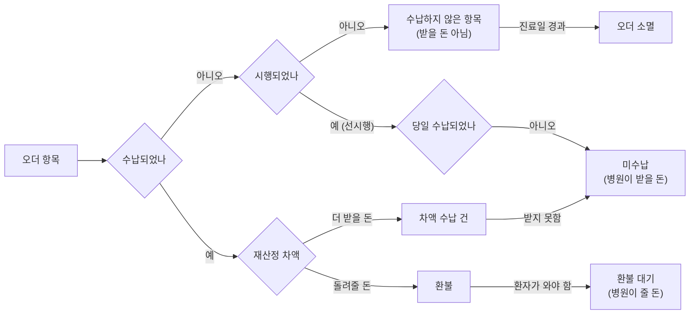

# 용어 사전

상태: 초안 · 갱신: 2026-11-05

> [업무 흐름](01-flow.md)에 나오는 용어 가운데, 섞여 쓰이기 쉽거나 뜻을 좁혀 쓰는 말을 정의합니다.  
> 상태 전이표와 불변식은 이 문서의 정의를 그대로 따릅니다.
---

## 목차
- [1. 접수와 자격](#1-접수와-자격)
- [2. 오더와 시행](#2-오더와-시행)
- [3. 산정](#3-산정)
- [4. 수납과 결제](#4-수납과-결제)
- [5. 취소와 환불](#5-취소와-환불)
- [6. 받을 돈과 돌려줄 돈](#6-받을-돈과-돌려줄-돈)
- [7. 마감](#7-마감)
- [8. 열린 질문](#8-열린-질문)

---

## 1. 접수와 자격

| 용어 | 영문 코드명 | 정의 | 혼동 주의 (비교 대상) | 소유 모듈 |
| :--- | :--- | :--- | :--- | :--- |
| 내원 건 | `Visit` | 환자가 한 진료일에 한 진료과로 접수하여 생기는 진료 단위로, 오더 항목·산정·수납 건이 모두 하나의 내원 건에 속한다(F-01). | '접수'는 내원 건을 만드는 행위이고, 내원 건은 그 결과다. 같은 날 두 진료과에 접수하면 내원 건이 둘이다. 한 내원 건에 수납 건이 여러 개 있을 수 있지만(A-02), 수납 건 하나가 두 내원 건에 걸치지는 않는다(A-14). | `미정` (모듈 계획에 접수를 맡는 모듈이 없음) |
| 접수 | `Registration` | 환자 본인을 확인하고 진료과와 진료 의사를 정해 내원 건을 만드는 일이다(F-01). | 접수 때 미수납이나 환불 대기를 알리지만, 미수납이 있어도 접수를 막지 않는다(A-15). | `미정` |
| 진료일 | `VisitDate` | 내원 건의 진료 날짜로, 수가 적용(A-06), 선시행 항목의 당일 수납(A-01), 미시행 오더의 소멸(A-16)을 판단하는 기준이다. | 수납일·환불일·마감 일자와 다를 수 있다. 지난 내원 건의 미수납을 오늘 받으면, 금액은 그 내원 건의 진료일 수가와 자격으로 산정하지만 수납 건은 오늘 마감에 속한다(F-06.a, A-13). 진료일이 끝나는 시점은 정하지 않았다. 미정(질문: 진료일이 끝나는 시점은 자정인가, 그 진료과 창구의 업무 종료인가?) | `미정` |
| 자격 | `Eligibility` | 내원 건에 적용하는 보험 종류(건강보험, 일반)와 본인부담률로, 접수 때 외부 기관 조회로 확인한다(A-03, A-04). | 환자의 지금 자격이 아니라 그 내원 건에 대해 남긴 기록이다. 바뀌면 기존 기록을 고치지 않고 새 기록을 추가하며, 이후 산정은 가장 나중의 기록을 쓴다(A-03). | `master` |
| 자격 소급 변경 | `RetroactiveEligibilityChange` | 이미 수납한 내원 건의 자격이 접수 때와 달랐음을 원무 직원이 증빙이나 재조회로 확인하여 새 자격 기록을 추가하는 일이다(F-04.d, A-17). | 수납 전에 자격을 바로잡는 것은 새 자격 기록만 추가하면 되며, 차액이 없으므로 소급 변경 흐름을 타지 않는다. 소급 변경은 수납 건마다 재산정과 환불 또는 차액 수납 건을 낳는다. | `master` |
| 수가 항목 | `FeeItem` | 진찰·검사·처치처럼 병원이 진료비를 받을 수 있는 행위의 종류로, 급여 구분과 선시행 기본값을 가진다(A-08). | '오더 항목'은 특정 내원 건에 대해 의사가 낸 지시이고, 수가 항목은 그 지시가 가리키는 목록의 한 줄이다. | `master` |
| 수가 | `FeePrice` | 수가 항목의 단가로, 적용 시작일이 있으며 진료일에 유효한 것을 적용한다(A-06). | 새 단가가 생겨도 그 이전 진료일의 산정 금액은 바뀌지 않는다. 이를 어떻게 지킬지는 정하지 않았다. 미정(질문: 산정 내역이 수가를 어떻게 가리키는가? → 마스터 참조 방식 ADR에서 결정) | `master` |
| 급여 구분 | `CoverageType` | 수가 항목이 건강보험 적용 대상(급여)인지 아닌지(비급여)를 나눈 것이다. | 급여 구분은 항목의 성질이고, 자격은 환자 쪽 조건이다. 일반 자격 환자는 급여 항목도 전액 본인부담이다(F-03). | `master` |
| 본인부담률 | `CopayRate` | 급여 항목 금액 가운데 환자가 내는 비율로, 내원 건의 자격에서 정해진다(A-03). | 비급여 항목에는 적용하지 않는다(전액 본인부담). | `master` |

## 2. 오더와 시행

| 용어 | 영문 코드명 | 정의 | 혼동 주의 (비교 대상) | 소유 모듈 |
| :--- | :--- | :--- | :--- | :--- |
| 오더 항목 | `OrderItem` | 의사가 내원 건에 대해 수가 항목 하나를 수량과 함께 지시한 것으로, 산정·수납·시행·취소의 단위다(F-02). | 진찰 자체도 진찰료 오더 항목으로 남는다(F-02). 원외처방은 오더 항목이 아니다(A-07). 여러 항목을 묶은 '오더'라는 단위는 따로 다루지 않는다. | `order` |
| 원외처방 | `OutpatientPrescription` | 병원 밖 약국에서 조제하도록 발행하는 처방전이다(A-07). | 병원 수납 금액에 들어가지 않는다. 처방전은 영수증과 함께 출력할 뿐이다(F-05). | `order` |
| 선수납 | — | 검사·처치는 수납한 뒤에 시행한다는 원칙이다(A-01). | 원칙일 뿐이며, 선시행 승인이 있는 항목은 예외로 수납 전에 시행할 수 있다. | `order` |
| 선시행 승인 | `executableBeforePayment` (`OrderItem`의 속성) | 오더 항목을 수납 전에 시행해도 된다는 허락으로, 의사가 주거나 수가 항목 기본값으로 붙는다(A-01, A-08). | '카드 승인'과 다른 말이다. 섞이지 않도록 영문 코드명에 `Approval`을 쓰지 않는다. 승인만 있고 아직 시행되지 않은 항목은 받을 돈이 아니므로 미수납이 아니다(A-01). | `order` |
| 선시행 | `PreExecution` | 선시행 승인을 근거로 수납 전에 오더 항목을 시행한 것이다(F-02.a). | 선시행 승인은 허락이고, 선시행은 실제로 시행한 사실이다. 선시행된 항목은 내원 당일 수납이 원칙이며, 당일 받지 못하면 미수납이 된다(F-06.a). | `order` |
| 시행 | `Execution` | 검사·처치실에서 오더 항목을 실제로 한 사실로, 시행 근거(수납 또는 선시행)와 함께 남는다(F-06). | 수납과 시행은 따로 일어나는 사실이다. 수납했지만 시행하지 않은 항목(F-06.b), 시행했지만 수납하지 않은 항목(F-06.a), 시행했지만 환불한 항목(F-06.c)이 모두 있을 수 있다. 시행 기록은 환불되어도 지우지 않는다. 잘못 기록한 시행을 되돌리는 일(실시 취소)은 다루지 않는다. | `order` |

## 3. 산정

| 용어 | 영문 코드명 | 정의 | 혼동 주의 (비교 대상) | 소유 모듈 |
| :--- | :--- | :--- | :--- | :--- |
| 산정 | `Invoice` | 내원 건의 수납하지 않은 항목을 모아 항목별 금액과 합계를 계산하는 일이다(F-03). | 산정은 금액을 정할 뿐 돈이 오가지 않는다. 산정한 뒤 수납 대상이 바뀌면 그 산정으로는 수납을 완료할 수 없다(F-04.c). | `billing` |
| 산정 내역 | `InvoiceLine` | 산정 대상 오더 항목 하나의 적용 단가, 수량, 급여 구분, 총액, 본인부담금, 공단부담금이다(F-03). | 본인부담금은 항목별로 구하지만, 끝전 처리는 항목이 아니라 산정 합계에 한다. | `billing` |
| 산정 합계 | `total` (`Invoice`의 속성) | 한 번의 산정에서 나온 총액, 본인부담 합계, 공단부담 합계다(F-03). | 수납 건의 수납액은 산정 합계의 본인부담 합계에서 나온다. 재산정에서 나온 합계는 '재산정 합계'라고 따로 부른다. | `billing` |
| 재산정 | `Recalculation` | 이미 완료된 수납 건을 남은 항목만으로, 또는 새 자격으로 다시 계산해 재산정 합계를 구하는 일이다(F-04.a, F-04.d, F-06.c). | 재산정은 언제나 수납 건 하나를 대상으로 한다. F-04.c에서 수납이 거부된 뒤 '다시 산정'하는 것은 아직 수납하지 않은 항목의 새 산정(F-03)이며 재산정이 아니다. | `billing` |
| 본인부담금 | `PatientShare` | 산정된 금액 가운데 환자가 내는 몫으로, 수납 대상 금액이다. | 수납 건(`Payment`), 결제(`PaymentLine`)와 섞이지 않도록 영문 코드명에 `Payment`를 쓰지 않는다. | `billing` |
| 공단부담금 | `InsurerShare` | 산정된 금액 가운데 건강보험이 내는 몫이다. | 병원이 환자에게 받는 돈이 아니며, 보험 청구는 범위 밖이다. 영수증에는 표시한다(F-05). | `billing` |
| 끝전 처리 | `Rounding` | 본인부담 합계의 원 단위 끝자리를 정리하는 일로, 항목별이 아니라 합계 기준으로 한다(F-04.a). | 합계 기준이므로, 항목 하나를 취소할 때 그 항목의 몫을 떼어 환불하지 않고 수납 건 전체를 재산정해 차액을 구한다. 끝전 단위는 정하지 않았다. 미정(질문: 본인부담 합계를 몇 원 단위로 처리하는가?) | `billing` |

## 4. 수납과 결제

| 용어 | 영문 코드명 | 정의 | 혼동 주의 (비교 대상) | 소유 모듈 |
| :--- | :--- | :--- | :--- | :--- |
| 수납 건 | `Payment` | 산정된 본인부담금을 받았다는 사실을 내원 건에 기록한 것으로, 첫 결제를 시도할 때 생기며 산정 하나를 바탕으로 한다(F-04, A-22). | '결제'는 카드 승인처럼 돈을 받는 수단의 처리로 병원 밖에서도 일어나고, '수납'은 병원이 진료비를 받았다는 병원 안의 기록이다. 완료된 수납 건은 고치지 않으며, 이후의 변화는 환불과 차액 수납 건으로 남는다(F-04.a). | `payment` |
| 차액 수납 건 | `AdjustmentPayment` | 자격 소급 변경으로 더 받을 차액을 받기 위해, 원래 수납 건을 참조하여 만드는 새 수납 건이다(F-04.d). | 추가 오더를 수납하는 일반 수납 건(A-02, 흐름 개요의 '추가 수납')과 다르다. 차액 수납 건은 새 오더 항목을 포함하지 않고 원래 수납 건의 차액만 받는다. 일반 수납 건처럼 마감에 속한다(A-13). | `payment` |
| 현재 수납액 | `netPaidAmount` (`Payment`의 속성) | 수납 건의 원래 수납액에 차액 수납액을 더하고, 정해진 환불액(아직 돌려주지 못한 환불 대기 포함)을 뺀 금액이다(A-19). | '원래 수납액'은 수납 건을 완료할 때 기록한 금액으로 바뀌지 않는다. 환불액과 차액 수납액은 언제나 현재 수납액을 기준으로 구한다. 원래 수납액을 기준으로 하면 두 번째 환불에서 이중으로 돌려준다(F-04.a). | `payment` |
| 결제 | `PaymentLine` | 수납 건의 금액 가운데 일부 또는 전부를 카드나 현금 중 한 가지 수단으로 받은 처리다(F-04, A-05, A-20). | 수납 건과의 차이는 위 '수납 건' 행을 본다. 완료된 수납 건의 부분 취소는 결제의 상태를 바꾸지 않고 환불의 사실로 남는다. 한 수납 건에 결제가 하나 이상 붙으며(카드 여러 장, 카드와 현금), 결제 합계가 본인부담 합계와 같아야 수납이 완료된다(A-20). 환불은 카드 결제에서 먼저 돌려준다(A-21). | `payment` |
| 카드 승인 | `CardApproval` | 결제 대행사가 카드 결제를 허락하고 승인번호를 준 결과다(F-04). | 카드 승인은 병원 밖의 사실이다. 승인을 받았어도 수납이 완료되지 않을 수 있다(F-04.c). '선시행 승인', 시행 후 예외 환불의 '원무 책임자 승인'과 다른 말이다. | `payment` |
| 승인 요청 | `REQUESTED` (`PaymentLine`의 상태) | 카드 결제의 승인을 결제 대행사에 요청하고 응답을 기다리는 것으로, 요청을 보내기 전에 그 사실을 먼저 남긴다(F-04, A-24). | 응답이 남지 않은 승인 요청은 승인 확인 중으로 다룬다. 그래서 병원이 기록을 남기지 못한 승인도 흔적이 남는다. | `payment` |
| 승인 확인 중 | `APPROVAL_UNKNOWN` (`PaymentLine`의 상태) | 카드 결제 하나의 승인 응답을 받지 못해 승인되었는지 알 수 없는 처지로, 그동안 그 결제가 속한 수납 건은 완료할 수 없다(F-04.b). | 응답을 받고 거절된 '승인 거절'과 다르다. 승인 확인 중인 동안 같은 오더 항목으로 다시 수납할 수 없다. | `payment` |
| 승인 거절 | `DECLINED` (`PaymentLine`의 상태) | 결제 대행사가 응답하여 카드 결제를 허락하지 않은 것이다(F-04.e). | 승인 확인 중은 응답이 없어 승인 여부를 모르고, 승인 거절은 승인되지 않았음을 안다. 그래서 망취소 없이 남은 금액을 다른 수단으로 받을 수 있다(A-20). | `payment` |
| 수납 거부 | `PaymentRejection` | 산정한 뒤 수납 대상이 바뀌어 병원이 그 수납을 완료하지 않는 것이다(F-04.c). | 결제 대행사가 카드를 거절하는 '승인 거절'과 다르다. 수납 거부는 병원이 스스로 하는 판단이며, 이미 받은 승인은 승인 취소한다. | `payment` |
| 수납 보류 | `HELD` (`Payment`의 상태) | 결제를 끝까지 받지 못해 수납 건을 완료하지 않고 끝내는 것으로, 이미 받은 결제는 모두 되돌리고 항목은 수납하지 않은 채로 둔다(F-04.b, F-04.e, A-20). 결제를 받는 중으로 정해진 시간이 지나면 시스템이 자동으로 보류한다(A-23). 보류된 수납 건은 다시 열지 않는다(A-22). | 수납 보류는 미수납이 아니다. 보류한 항목 가운데 이미 시행된 항목만, 당일 수납되지 않으면 미수납이 된다(F-06.a). | `payment` |
| 영수증 | `Receipt` | 수납 건마다 발행하며 항목별 급여 구분과 본인부담금·공단부담금을 담는 증빙이다(F-05). | 환불이나 자격 소급 변경이 있으면 기존 영수증을 무효로 하고 새 영수증을 발행한다. 한 수납 건에 영수증이 여러 장 생길 수 있지만, 무효가 아닌 영수증은 하나다. | `payment` |

## 5. 취소와 환불

"취소"는 대상에 따라 다섯 가지로 나뉩니다. 오더 쪽 취소는 오더 항목의 효력을, 카드 쪽 취소는 결제 대행사의 승인을 없앱니다.

| 용어 | 영문 코드명 | 정의 | 혼동 주의 (비교 대상) | 소유 모듈 |
| :--- | :--- | :--- | :--- | :--- |
| 오더 취소 | `OrderCancellation` | 수납되지도 시행되지도 않은 오더 항목을 의사가 무효로 하는 것으로, 환불이 없으므로 바로 확정된다(F-02.b). | 수납된 항목은 오더 취소가 아니라 취소 요청을 거친다. 이미 시행된 항목은 취소할 수 없다. 되돌릴 수 없다(A-10). | `order` |
| 취소 요청 | `CancellationRequest` | 수납되었으나 시행되지 않은 오더 항목을 무효로 해 달라는 요청으로, 요청한 때부터 시행할 수 없고 환불이 끝나야 취소가 확정된다(F-04.a). | 취소 요청과 취소 확정은 다른 시점이다. 그 사이(환불 대기 포함)에도 항목은 시행할 수 없다. 의사가 하거나, 진료일이 지나면 시스템이 한다(F-06.b). 철회할 수 없다(A-10). | `order` |
| 오더 소멸 | `EXPIRED` (`OrderItem`의 상태) | 진료일이 끝날 때까지 수납도 시행도 되지 않은 오더 항목이 저절로 효력을 잃는 것이다(A-16). | 오더 취소는 의사의 행위이고, 소멸은 시간이 지나서 생긴다. 수납된 미시행 항목은 소멸하지 않고, 시스템의 취소 요청과 환불을 거친다(F-06.b). 소멸하는 항목을 대상으로 진행 중인 수납은 거부된다(F-04.c). | `order` |
| 망취소 | `Reversal` | 응답을 받지 못한 카드 승인 요청을 무효로 해 달라고 결제 대행사에 보내는 것이다(A-11). | 카드 업계에서 결과를 알 수 없는 승인을 되돌리는 reversal에 해당한다. 승인 취소는 승인된 것을 알고 취소하고, 망취소는 승인 여부를 모르는 요청을 무효로 한다. 망취소가 확인되기 전에는 카드로 다시 결제하지 않는다(A-11). | `payment` |
| 승인 취소 | `ApprovalCancellation` | 이미 받은 카드 승인 전액을 취소하는 것으로, 수납이 거부되었거나(F-04.c) 보류되었을 때(F-04.b, F-04.e), 짝 없는 승인을 찾았을 때(F-07) 한다. | 부분 취소는 완료된 수납 건의 환불 수단이고, 승인 취소는 수납이 성립하지 않은 승인을 없앤다. 승인 취소에 응답이 없으면 같은 승인번호로 다시 요청할 수 있으며(A-25), 그동안 결제는 `CANCEL_UNKNOWN` 상태다. | `payment` |
| 부분 취소 | `PartialCancellation` | 원래 카드 승인에서 환불액만큼만 취소하는 것으로, 카드로 받은 수납 건의 환불 수단이다(A-09). | '환불'은 돈을 돌려준 사실이고, 부분 취소는 카드에서 그것을 하는 방법이다. 환자가 없어도 할 수 있다(A-09). 여러 결제로 받은 수납 건은 A-21의 순서로 결제를 골라 부분 취소한다. | `payment` |
| 결제 되돌림 | — | 수납 건이 완료되지 않고 보류·거부될 때, 이미 받은 결제를 카드는 승인 취소하고 현금은 돌려주는 것이다(F-04.c, F-04.e, A-20). | 환불과 다르다. 결제 되돌림은 수납이 성립하기 전의 일로 결제의 상태(`CANCELLED`, `RETURNED`)로 남고, 환불은 완료된 수납 건에서 돌려주는 일로 환불의 사실로 남는다. | `payment` |
| 환불 | `Refund` | 수납 건의 현재 수납액에서 재산정 합계를 뺀 차액을 환자에게 돌려준 사실로, 원래 수납 건과 별개의 환불 건으로 남는다(F-04.a, A-19). | 오더 취소는 항목의 효력을 없애고, 환불은 돈을 돌려준다. 환불 건은 원래 수납 건을 고치지 않으며, 처리한 날의 마감에 속한다(A-12). | `payment` |
| 시행 후 예외 환불 | `ExceptionalRefund` | 이미 시행된 오더 항목을 원무 책임자의 승인을 받아 예외로 환불하는 것이다(F-06.c, A-18). | 시행 기록은 그대로 남으며, 그 항목은 취소된 것이 아니라 '시행되었고 환불된' 항목이 된다. | `payment` |

## 6. 받을 돈과 돌려줄 돈

수납되지 않은 돈과 돌려주지 못한 돈은 이름이 비슷하지만, 돈의 방향과 소멸 여부가 다릅니다.

| 용어 | 영문 코드명 | 정의 | 혼동 주의 (비교 대상) | 소유 모듈 |
| :--- | :--- | :--- | :--- | :--- |
| 수납하지 않은 항목 | — | 아직 어느 수납 건에도 포함되지 않았고 취소되거나 소멸하지 않은 오더 항목으로, 다음 산정의 대상이다(A-02). | 미수납이 아니다. 시행되지 않았다면 받을 돈이 아니며, 진료일이 지나면 소멸한다(A-16). | `order` |
| 미수납 | `Receivable` | 이미 시행되었거나 금액이 확정되어 병원이 받아야 하는데 받지 못한 돈이다(F-06.a). | 선시행된 항목을 당일 받지 못한 경우(F-06.a)와, 자격 소급 변경의 추가 차액을 받지 못한 경우(F-04.d) 두 가지로 생긴다. 수납하지 않은 항목, 수납 보류, 선시행 승인만 있는 항목은 미수납이 아니다. 수납되거나 결손 처리될 때까지 없어지지 않는다. | `payment` |
| 환불 대기 | `PENDING` (`Refund`의 상태) | 환불액이 정해졌지만 환자가 와야 돌려줄 수 있어 아직 돌려주지 못한 돈이다(F-04.a). | 미수납과 방향이 반대다(병원이 줄 돈). 기한 없이 남으며 자동으로 소멸시키지 않는다. 다음 내원 때 돌려주거나, 환자가 요청하면 계좌로 보낸다(A-05). | `payment` |

## 7. 마감

| 용어 | 영문 코드명 | 정의 | 혼동 주의 (비교 대상) | 소유 모듈 |
| :--- | :--- | :--- | :--- | :--- |
| 창구 | `Counter` | 수납과 환불을 처리하고 따로 마감하는 단위다(F-07). | 처리한 창구가 없는 자동 환불(F-06.b)은 원래 수납한 창구의 것으로 본다(A-12). 무인 수납기를 창구로 볼지는 정하지 않았다. 미정(질문: 무인 수납기도 각각 하나의 창구로 마감하는가?) | `미정` |
| 일 마감 | `DailyClosing` | 창구별로 하루 한 번, 그때까지 완료되었고 아직 어느 마감에도 속하지 않은 수납 건과 환불 건을 모아 대조하고 확정하는 일이다(F-07, A-13). | 날짜로 묶는 집계가 아니라 마감 소속으로 묶는다. 끝난 마감은 고치지 않으며, 지난 날짜 수납 건의 환불도 처리한 날의 마감에 들어간다(A-12). | `reconciliation` |
| 마감 소속 | `closing` (`Payment`·`Refund`의 속성) | 수납 건이나 환불 건이 어느 마감에 들어갔는지를 나타낸다(F-07). | 수납 시각과 다르다. 17:59에 시작해 18:02에 완료된 수납 건은 수납 시각이 아니라 완료 후 처음 돌아오는 마감에 속한다(F-07 현장 메모). | `reconciliation` |
| 대조 | `Reconciliation` | 병원의 기록을 실제 보유 현금이나 결제 대행사의 승인 내역과 맞춰 보는 일이다(F-07). | 카드 대조는 합계가 아니라 승인 건 단위로 짝을 맞춘다. `reconciliation` 모듈 이름은 이 용어에서 왔다. | `reconciliation` |
| 시차 | `TimingGap` | 마감 시점 이후 완료되어 다음 마감에 속할 건 때문에 생기는, 설명되는 불일치다(F-07). | '차이'와 달리 오류가 아니다. 다음 마감에서 짝이 맞아야 한다. | `reconciliation` |
| 차이 | `Discrepancy` | 대조에서 시차로도 설명되지 않는 불일치로, 차이 내역으로 남긴다(F-07). | 시차는 기다리면 해소되고, 차이는 원인을 찾아야 한다. | `reconciliation` |
| 짝 없는 승인 | `UnmatchedApproval` | 결제 대행사의 승인 내역에는 있지만 병원의 수납 기록이나 취소 기록과 짝이 없는 승인이다(F-07). | 금액 불일치인 차이와 달리, 찾으면 그 승인을 취소한다(A-11). 주로 승인 확인 중(F-04.b)이나 수납 거부(F-04.c)에서 생긴다. | `reconciliation` |

---

## 8. 열린 질문

용어를 정의하면서 업무 흐름에서 정하지 않은 것이 드러났습니다. 정해지면 해당 용어와 `01-flow.md`를 함께 갱신합니다.

| 용어 | 질문 | 영향 받는 흐름 |
| :--- | :--- | :--- |
| [진료일](#진료일) | 진료일이 끝나는 시점은 자정인가, 그 진료과 창구의 업무 종료인가? | F-06.a, F-06.b |
| [끝전 처리](#끝전-처리) | 본인부담 합계를 몇 원 단위로 처리하는가? | F-03, F-04.a |
| ~~[결제](#결제)~~ | ~~한 수납 건을 카드와 현금, 또는 카드 여러 장으로 나눠 받을 수 있는가?~~ 결정: 허용(A-20), 환불 순서는 카드 먼저(A-21) | F-04, F-04.a, F-04.b, F-04.e |
| [창구](#창구) | 무인 수납기도 각각 하나의 창구로 마감하는가? | F-04, F-07 |
| [수가](#수가) | 산정 내역이 수가를 어떻게 가리키는가? (마스터 참조 방식 ADR에서 결정) | F-03, F-04.d |
