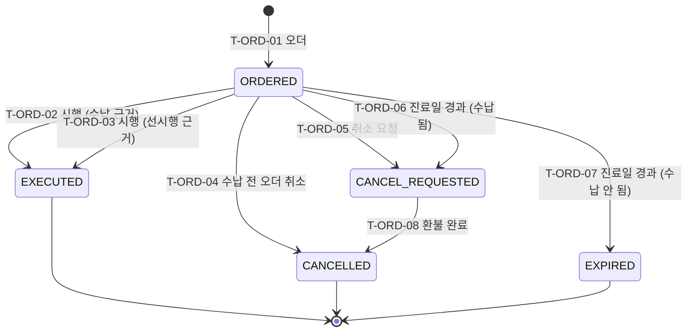
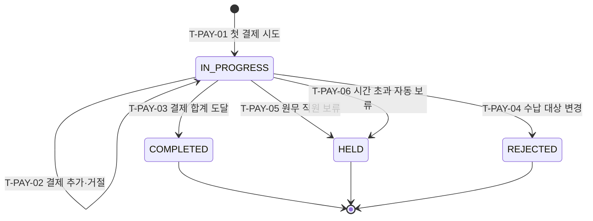
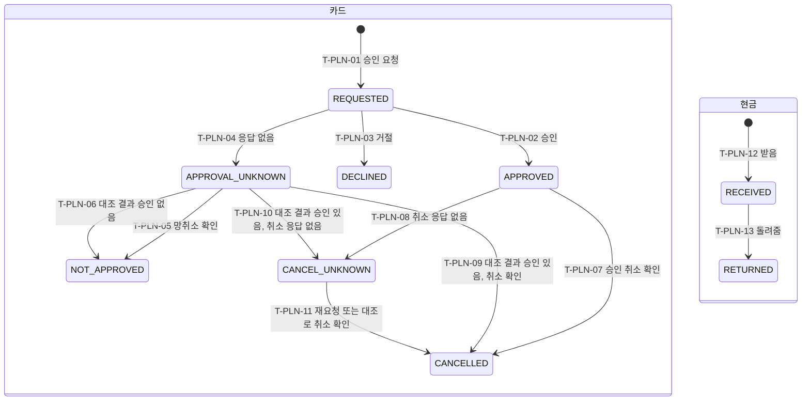

# 상태 전이표

상태: 초안 · 갱신: 2026-11-05

> [업무 흐름](01-flow.md)에서 상태를 갖는 대상의 생명주기를 정의합니다.  
> 상태도와 표가 다르면 **표가 우선**합니다. 용어는 [용어 사전](02-glossary.md)을 따릅니다.

- **관련 INV 칸**: `04-invariants.md`를 쓰기 전이므로, 지금은 불변식 후보를 짧은 문장으로 적습니다. 불변식 ID가 정해지면 ID로 바꿉니다.
- **가드 조건**: 다른 대상의 사실(예: 수납 건)을 확인하는 조건은 그 사실이 어디에 있는지 함께 적습니다. 그 확인을 언제 어떻게 하는지는 읽기 경로·동시성 제어 ADR에서 정합니다.

---

## 목차
- [대상 목록](#대상-목록)
- [오더 항목 OrderItem](#오더-항목-orderitem)
- [수납 건 Payment](#수납-건-payment)
- [결제 PaymentLine](#결제-paymentline)

---

## 대상 목록

| 대상 | 약어 | 상태 | 비고 |
| :--- | :--- | :--- | :--- |
| [오더 항목](02-glossary.md#오더-항목) `OrderItem` | `ORD` | 작성함 | |
| [수납 건](02-glossary.md#수납-건) `Payment` | `PAY` | 작성함 | 차액 수납 건도 같은 상태표를 따른다. |
| [결제](02-glossary.md#결제) `PaymentLine` | `PLN` | 작성함 | 카드와 현금의 생명주기가 다르다. |
| [환불](02-glossary.md#환불) `Refund` | `RFD` | 미작성 | |
| [일 마감](02-glossary.md#일-마감) `DailyClosing` | `CLS` | 미작성 | |

---

## 오더 항목 OrderItem

### 0. 모델링 결정

오더 항목에는 서로 따로 움직이는 축이 셋 있습니다. 수납(수납 안 됨 → 수납됨), 시행(시행 안 됨 → 시행됨), 효력(유효 → 취소·소멸)입니다. 이 가운데 **수납 축은 오더 항목의 상태로 두지 않습니다.**

- 어떤 오더 항목이 수납되었는지는 "그 항목을 포함한 완료된 수납 건이 있는가"로만 판단합니다. 수납 여부를 기록하는 곳은 수납 건 하나뿐입니다.
- 레거시에서는 오더에 수납 여부를 따로 표시해, 수납 건과 오더의 표시가 어긋나는 일(취소됐는데 수납됨, 수납 건은 없는데 수납됨)이 정합성 문의의 단골 원인이었습니다. 기록하는 곳을 하나로 두어 이 어긋남이 구조적으로 생기지 않게 합니다.
- 대신 "수납되었는가"를 확인하는 가드 조건은 다른 대상(수납 건)의 사실을 확인하게 됩니다. 이 확인 방법은 미정(질문: 오더 항목의 전이가 수납 건의 사실을 어떻게 확인하는가? → 읽기 경로·동시성 제어 ADR에서 결정)
- 같은 이유로 선시행 항목의 미수납, 시행 후 예외 환불(F-06.c)은 오더 항목의 상태를 바꾸지 않습니다. 각각 미수납 내역과 환불의 사실입니다.

### 1. 상태 목록

| 상태 | 의미 | 종료 상태 여부 (Y/N) |
| :--- | :--- | :--- |
| `OrderItem.ORDERED` | 오더되었고 아직 시행·취소·소멸되지 않았다. 수납 여부와는 관계없다. | N |
| `OrderItem.EXECUTED` | 시행되었다. 시행 근거(수납 또는 선시행)가 시행 기록에 남는다. 잘못 기록한 시행을 되돌리는 일은 다루지 않는다. | Y |
| `OrderItem.CANCEL_REQUESTED` | 수납된 항목의 취소가 요청되어 환불이 끝나기를 기다린다. 시행할 수 없다. | N |
| `OrderItem.CANCELLED` | 취소가 확정되었다. | Y |
| `OrderItem.EXPIRED` | 진료일이 끝날 때까지 수납도 시행도 되지 않아 효력을 잃었다. | Y |

### 2. 정상/허용 전이표

| 전이 ID | 현재 상태 | 트리거 이벤트 | 행위자 | 가드 조건 (전제) | 다음 상태 | 남는 기록 | 관련 INV |
| :--- | :--- | :--- | :--- | :--- | :--- | :--- | :--- |
| `T-ORD-01` | (없음) | 오더 발행 (F-02) | 의사 | 내원 건이 접수되어 있다. 수가 항목에 진료일에 유효한 수가가 있다(A-06). | `ORDERED` | 오더 항목(선시행 승인 여부 포함) | 후보: 오더 항목은 접수된 내원 건 하나에만 속한다. |
| `T-ORD-02` | `ORDERED` | 시행 (F-06) | 검사·처치실 직원 | 이 항목을 포함한 완료된 수납 건이 있다(수납 건의 사실). | `EXECUTED` | 시행 기록(시행 근거: 수납) | 후보: 수납도 선시행 승인도 없는 항목은 시행할 수 없다. |
| `T-ORD-03` | `ORDERED` | 선시행 (F-02, F-02.a) | 검사·처치실 직원, 진료 의사(진찰료와 진료실 즉석 검사) | 선시행 승인이 있다(A-01, A-08). 진찰료는 오더 발행과 함께 이 전이를 거친다. | `EXECUTED` | 시행 기록(시행 근거: 선시행) | 후보: 선시행된 항목은 당일 수납되거나 미수납으로 기록된다. |
| `T-ORD-04` | `ORDERED` | 수납 전 오더 취소 (F-02.b) | 의사 | 이 항목을 포함한 완료된 수납 건이 없다(수납 건의 사실). 진행 중인 수납이 있으면 그 수납은 거부된다(F-04.c). | `CANCELLED` | 오더 취소 | 후보: 취소된 항목은 수납 건에 포함될 수 없다. |
| `T-ORD-05` | `ORDERED` | 취소 요청 (F-04.a) | 의사 | 이 항목을 포함한 완료된 수납 건이 있다(수납 건의 사실). | `CANCEL_REQUESTED` | 취소 요청. 수납 건 쪽에 정해진 환불액(A-19) | 후보: 취소 요청된 항목은 시행할 수 없다. |
| `T-ORD-06` | `ORDERED` | 진료일 경과 (F-06.b) | 시스템 | 진료일이 끝났다. 이 항목을 포함한 완료된 수납 건이 있다(수납 건의 사실). | `CANCEL_REQUESTED` | 취소 요청(요청자: 시스템, 사유: 진료일 경과) | 후보: 진료일이 지난 미시행 항목은 시행될 수 없다. |
| `T-ORD-07` | `ORDERED` | 진료일 경과 (F-06.b) | 시스템 | 진료일이 끝났다. 이 항목을 포함한 완료된 수납 건이 없다(수납 건의 사실). 진행 중인 수납이 있으면 그 수납은 거부된다(F-04.c). | `EXPIRED` | 오더 소멸 | 후보: 소멸한 항목은 수납 건에 포함될 수 없다. |
| `T-ORD-08` | `CANCEL_REQUESTED` | 환불 완료 (F-04.a) | 시스템 | 이 취소로 정해진 환불이 결제별로 모두 끝났다(환불의 사실). 환불 대기가 남아 있으면 전이하지 않는다. | `CANCELLED` | 취소 확정 시각, 새 영수증(F-04.a) | 후보: 취소가 확정된 항목의 환불은 모두 끝나 있다. |

- 자격 소급 변경(F-04.d), 시행 후 예외 환불(F-06.c), 미수납 기록(F-06.a)은 오더 항목의 상태를 바꾸지 않는다.
- 선시행 승인은 상태가 아니라 오더 항목의 속성(`executableBeforePayment`)이다.

### 3. 허용하지 않는 전이 (명시적 금지)

| 현재 상태 | 시도된 이벤트 | 거부 이유 | 관련 INV |
| :--- | :--- | :--- | :--- |
| `ORDERED` | 수납도 선시행 승인도 없이 시행 | 선수납이 원칙이다(A-01). 환자를 수납 창구로 안내한다(F-06). | 후보: 수납도 선시행 승인도 없는 항목은 시행할 수 없다. |
| `ORDERED` | 완료된 수납 건에 포함된 항목을 오더 취소(T-ORD-04 경로) | 돈이 오간 항목은 환불을 거쳐야 하므로 취소 요청(T-ORD-05)으로만 취소한다. | 후보: 환불 없이 취소된 항목은 수납 건에 포함되어 있지 않다. |
| `ORDERED`, `EXECUTED` | 이미 완료된 수납 건에 포함된 항목을 다른 수납 건에 포함 | 같은 오더 항목은 두 번 수납되지 않는다(F-04.c). | 후보: 오더 항목은 완료된 수납 건 하나에만 포함된다. |
| `CANCEL_REQUESTED` | 시행 | 취소가 요청된 항목은 수납되었더라도 시행하지 않는다(F-06). | 후보: 취소 요청된 항목은 시행할 수 없다. |
| `CANCEL_REQUESTED` | 취소 요청 철회 | 취소 요청은 철회할 수 없다. 다시 필요하면 새 오더를 낸다(A-10). | — |
| `CANCEL_REQUESTED` | 다른 수납 건에 포함 | 이미 수납되어 환불을 기다리는 항목이다. | 후보: 오더 항목은 완료된 수납 건 하나에만 포함된다. |
| `EXECUTED` | 오더 취소 또는 취소 요청 | 시행된 항목은 취소하지 않는다. 환불은 원무 책임자 승인을 거친 예외 환불(F-06.c, A-18)로만 한다. | 후보: 시행된 항목은 취소될 수 없다. |
| `EXECUTED` | 다시 시행 | 한 오더 항목은 한 번만 시행된다. 다시 필요하면 새 오더를 낸다. | 후보: 오더 항목의 시행 기록은 하나다. |
| `EXECUTED` | 시행 되돌림(실시 취소) | 범위 밖이다(01-flow 범위). | — |
| `CANCELLED` | 시행, 취소 철회, 수납 건에 포함 | 종료 상태다. 취소는 되돌릴 수 없다(A-10). | 후보: 취소된 항목은 시행되거나 수납 건에 포함될 수 없다. |
| `EXPIRED` | 시행, 수납 건에 포함 | 종료 상태다. 다시 필요하면 새 오더를 낸다(F-06.b). | 후보: 소멸한 항목은 시행되거나 수납 건에 포함될 수 없다. |

---

## 수납 건 Payment

### 0. 모델링 결정

- 수납 건은 첫 결제를 시도할 때 생기며, 산정 하나를 바탕으로 한다. 한 산정을 바탕으로 한 수납 건은 하나뿐이다(A-22).
- 보류(`HELD`)되거나 거부(`REJECTED`)된 수납 건은 다시 열지 않는다. 다시 받으려면 새로 산정하고 새 수납 건을 만든다(A-22).
- 완료(`COMPLETED`)된 수납 건은 고치지 않는다. 완료 뒤의 변화는 환불과 차액 수납 건으로 남고, 그 결과는 현재 수납액(A-19)으로만 나타난다. 전액 환불되어도 상태는 `COMPLETED`다.
- 결제 하나하나의 승인 확인 중·거절·승인 취소는 결제(`PaymentLine`)의 상태다. 수납 건은 그 결과를 가드 조건으로만 확인한다.
- 차액 수납 건(`AdjustmentPayment`)도 같은 상태표를 따른다. 포함하는 오더 항목이 없고 원래 수납 건을 참조한다는 점만 다르다. 환자가 없으면 차액 수납 건을 만들지 않고 미수납으로 남긴다(F-04.d).

### 1. 상태 목록

| 상태 | 의미 | 종료 상태 여부 (Y/N) |
| :--- | :--- | :--- |
| `Payment.IN_PROGRESS` | 결제를 받는 중이다. 결제 합계가 아직 본인부담 합계보다 적거나, 승인 확인 중인 결제가 있다. | N |
| `Payment.COMPLETED` | 결제 합계가 본인부담 합계와 같아져 수납이 완료되었다. 이 시점에 포함된 오더 항목이 수납된 것이 된다. | Y |
| `Payment.HELD` | 다 받지 못해 보류했다. 이미 받은 결제는 되돌린다. | Y |
| `Payment.REJECTED` | 산정한 뒤 수납 대상이 바뀌어 거부했다. 이미 받은 결제는 되돌린다. | Y |

### 2. 정상/허용 전이표

| 전이 ID | 현재 상태 | 트리거 이벤트 | 행위자 | 가드 조건 (전제) | 다음 상태 | 남는 기록 | 관련 INV |
| :--- | :--- | :--- | :--- | :--- | :--- | :--- | :--- |
| `T-PAY-01` | (없음) | 첫 결제 시도 (F-04) | 원무 직원 또는 환자(무인 수납기) | 바탕이 될 산정이 있다(F-03). 그 산정을 바탕으로 한 다른 수납 건이 없다(A-22). 산정 대상 항목이 모두 `OrderItem.ORDERED` 또는 `OrderItem.EXECUTED`다(오더 항목의 사실). | `IN_PROGRESS` | 수납 건(내원 건, 바탕 산정, 창구, 시작 시각), 첫 결제 | 후보: 한 산정을 바탕으로 한 수납 건은 하나뿐이다. |
| `T-PAY-02` | `IN_PROGRESS` | 결제 추가 또는 카드 승인 거절 (F-04, F-04.e) | 원무 직원 또는 환자(무인 수납기) | 결제를 더해도 결제 합계가 본인부담 합계를 넘지 않는다(A-20). 망취소가 확인되지 않은 결제가 있으면 카드 결제를 더하지 않는다(A-11). | `IN_PROGRESS` | 결제(승인, 거절, 현금) | 후보: 결제 합계는 본인부담 합계를 넘지 않는다. |
| `T-PAY-03` | `IN_PROGRESS` | 결제 합계 도달 (F-04) | 원무 직원 또는 환자(무인 수납기) | 결제 합계가 본인부담 합계와 같다. 결제 합계는 승인된 카드 결제(`APPROVED`)와 받은 현금(`RECEIVED`)만 센다. 응답을 기다리거나 승인 확인 중인 결제가 없다(결제의 사실). 산정한 뒤 수납 대상이 바뀌지 않았다: 포함할 항목이 다른 완료된 수납 건에 없고, 취소·취소 요청·소멸되지 않았고, 오더가 추가되지 않았다(오더 항목과 다른 수납 건의 사실). | `COMPLETED` | 수납 시각(완료 시각), 영수증(F-05) | 후보: 완료된 수납 건의 결제 합계는 본인부담 합계와 같다. 후보: 오더 항목은 완료된 수납 건 하나에만 포함된다. |
| `T-PAY-04` | `IN_PROGRESS` | 수납 대상 변경 (F-04.c) | 시스템 | 산정한 뒤 동시 수납, 오더 추가·취소, 오더 소멸 가운데 하나가 일어났다(오더 항목과 다른 수납 건의 사실). 언제 알리는지는 미정(질문: 수납을 시작할 때 알리는가, 완료하려 할 때 알리는가? → 동시성 제어 ADR에서 결정) | `REJECTED` | 수납 거부, 결제 되돌림 | 후보: 거부된 수납 건에는 되돌리지 않은 결제가 남지 않는다. |
| `T-PAY-05` | `IN_PROGRESS` | 원무 직원의 수납 보류 (F-04.b, F-04.e) | 원무 직원 | 남은 금액을 받지 못했거나, 망취소가 확인되지 않아 카드로 다시 받을 수 없다. | `HELD` | 수납 보류, 결제 되돌림 | 후보: 보류된 수납 건에는 되돌리지 않은 결제가 남지 않는다. |
| `T-PAY-06` | `IN_PROGRESS` | 시간 초과 (A-23) | 시스템 | 시작한 뒤 정해진 시간이 지났다. | `HELD` | 수납 보류(사유: 시간 초과), 결제 되돌림 | 후보: 결제를 받는 중인 수납 건은 정해진 시간보다 오래 남지 않는다. |

- 결제 되돌림은 결제마다 일어난다. 카드 결제는 승인 취소, 현금 결제는 반환이다. 승인 여부를 모르는 결제는 망취소와 일 마감(F-07)의 대조에서 처리된다. 결제 쪽 전이는 결제(`PaymentLine`) 절에서 다룬다.
- 환불, 차액 수납 건, 영수증 재발행은 수납 건의 상태를 바꾸지 않는다. 현재 수납액만 바뀐다(A-19).
- 마감 소속은 상태가 아니라 속성(`closing`)이다. `COMPLETED`된 수납 건만 마감에 속한다(A-13).

### 3. 허용하지 않는 전이 (명시적 금지)

| 현재 상태 | 시도된 이벤트 | 거부 이유 | 관련 INV |
| :--- | :--- | :--- | :--- |
| (없음) | 이미 수납 건이 있는 산정으로 새 수납 건 시작 | 한 산정을 바탕으로 한 수납 건은 하나뿐이다(A-22). 다시 받으려면 새로 산정한다. | 후보: 한 산정을 바탕으로 한 수납 건은 하나뿐이다. |
| (없음) | 취소·취소 요청·소멸된 항목을 포함한 산정으로 수납 건 시작 | 효력이 없거나 이미 수납된 항목이다(T-ORD 금지 전이). | 후보: 취소·소멸된 항목은 수납 건에 포함될 수 없다. |
| `IN_PROGRESS` | 승인 확인 중인 결제가 있는 채로 완료 | 승인되었는지 모르는 돈으로 수납을 완료할 수 없다(F-04.b). | 후보: 완료된 수납 건의 결제는 모두 승인되었거나 현금이다. |
| `IN_PROGRESS` | 결제 합계가 본인부담 합계와 다른 채로 완료 | 수납은 결제 합계가 본인부담 합계와 같아야 완료된다(A-20). | 후보: 완료된 수납 건의 결제 합계는 본인부담 합계와 같다. |
| `IN_PROGRESS` | 망취소가 확인되지 않았는데 카드 결제 추가 | 같은 금액이 두 번 승인될 수 있다(A-11). | 후보: 망취소가 확인되지 않은 승인 요청이 있는 수납 건에는 새 카드 결제가 없다. |
| `IN_PROGRESS` | 산정 이후 대상이 바뀐 채로 완료 | 같은 항목이 두 번 수납되거나, 효력 없는 항목이 수납된다(F-04.c). | 후보: 오더 항목은 완료된 수납 건 하나에만 포함된다. |
| `COMPLETED` | 결제 추가·수정, 포함 항목 변경 | 완료된 수납 건은 고치지 않는다. 변화는 환불(F-04.a)과 차액 수납 건(F-04.d)으로 남긴다. | 후보: 완료된 수납 건의 결제와 포함 항목은 바뀌지 않는다. |
| `COMPLETED` | 거부 또는 보류 | 완료 뒤의 대상 변경은 취소 요청과 환불(F-04.a)로 처리한다. | — |
| `HELD`, `REJECTED` | 결제 추가, 완료, 다시 열기 | 종료 상태다. 다시 받으려면 새로 산정하고 새 수납 건을 만든다(A-22). | 후보: 보류·거부된 수납 건은 마감에 속하지 않는다. |

---

## 결제 PaymentLine

### 0. 모델링 결정

- 결제는 수단에 따라 생명주기가 다르다. 카드는 결제 대행사와 주고받는 승인·취소를, 현금은 받고 돌려주는 것을 다룬다.
- 결제의 상태로 다루는 것은 **수납이 성립하기 전의 결제 되돌림**뿐이다. 완료된 수납 건의 부분 취소와 현금 환불은 환불의 사실이며, 결제는 `APPROVED`나 `RECEIVED` 그대로다. 결제마다 아직 돌려줄 수 있는 금액은 환불 기록을 모아 구한다(A-21).
- 카드 승인 요청 사실은 요청을 보내기 전에 남긴다(A-24). 응답이 남지 않은 요청은 승인 확인 중으로 다룬다.
- 승인 요청은 다시 보내면 이중으로 승인될 수 있으므로 망취소가 확인되기 전에는 새로 보내지 않는다(A-11). 승인 취소 요청은 승인번호를 가리키므로 다시 보낼 수 있다(A-25).

### 1. 상태 목록

| 상태 | 수단 | 의미 | 종료 상태 여부 (Y/N) |
| :--- | :--- | :--- | :--- |
| `PaymentLine.REQUESTED` | 카드 | 승인을 요청했고 응답을 기다린다. 요청 사실은 보내기 전에 남는다. | N |
| `PaymentLine.APPROVED` | 카드 | 승인되었다. 완료된 수납 건의 부분 취소가 있어도 이 상태다. | N (수납 건이 완료되면 더 전이하지 않음) |
| `PaymentLine.DECLINED` | 카드 | 응답을 받았고 거절되었다. | Y |
| `PaymentLine.APPROVAL_UNKNOWN` | 카드 | 응답을 받지 못해 승인되었는지 알 수 없다. 망취소를 보낸다. | N |
| `PaymentLine.NOT_APPROVED` | 카드 | 망취소가 확인되었거나, 대조 결과 승인이 없었던 것으로 확정되었다. | Y |
| `PaymentLine.CANCEL_UNKNOWN` | 카드 | 승인 취소를 요청했으나 응답을 받지 못했다. 같은 승인번호로 다시 요청할 수 있다. | N |
| `PaymentLine.CANCELLED` | 카드 | 수납이 성립하지 않아 승인을 전액 취소했다. | Y |
| `PaymentLine.RECEIVED` | 현금 | 받았다. 받은 금액과 거스름돈은 속성으로 남는다. | N (수납 건이 완료되면 더 전이하지 않음) |
| `PaymentLine.RETURNED` | 현금 | 수납이 성립하지 않아 돌려주었다. | Y |

`APPROVED`와 `RECEIVED`는 수납 건이 완료되면 더 전이하지 않는다. 수납 건이 보류·거부되면 각각 `CANCELLED`(또는 `CANCEL_UNKNOWN`), `RETURNED`로 간다.

### 2. 정상/허용 전이표

| 전이 ID | 현재 상태 | 트리거 이벤트 | 행위자 | 가드 조건 (전제) | 다음 상태 | 남는 기록 | 관련 INV |
| :--- | :--- | :--- | :--- | :--- | :--- | :--- | :--- |
| `T-PLN-01` | (없음) | 카드 승인 요청 (F-04, A-24) | 원무 직원 또는 환자(무인 수납기) | 수납 건이 `IN_PROGRESS`다(수납 건의 사실). 이 금액을 더해도 결제 합계가 본인부담 합계를 넘지 않는다(A-20). 그 수납 건에 `REQUESTED`, `APPROVAL_UNKNOWN`인 카드 결제가 없다(A-11). | `REQUESTED` | 승인 요청(수납 건, 금액, 요청 시각). 요청을 보내기 전에 남는다. | 후보: 결제 대행사에 보낸 승인 요청은 모두 병원에 기록되어 있다. |
| `T-PLN-02` | `REQUESTED` | 승인 응답 (F-04) | 결제 대행사(외부) | 응답 시간 안에 승인 응답을 받았다. | `APPROVED` | 승인번호, 승인 시각 | 후보: 승인된 결제는 완료된 수납 건에 속하거나 취소된다. |
| `T-PLN-03` | `REQUESTED` | 거절 응답 (F-04.e) | 결제 대행사(외부) | 응답 시간 안에 거절 응답을 받았다. | `DECLINED` | 승인 거절(거절 사유, 거절 시각) | — |
| `T-PLN-04` | `REQUESTED` | 응답 시간 초과 (F-04.b, A-24) | 시스템 | 응답 시간 안에 응답을 받지 못했거나, 응답이 남지 않았다. | `APPROVAL_UNKNOWN` | 승인 확인 중(시작 시각), 망취소 요청 | 후보: 승인 확인 중인 결제가 있는 수납 건은 완료되지 않는다. |
| `T-PLN-05` | `APPROVAL_UNKNOWN` | 망취소 확인 (F-04.b, A-11) | 결제 대행사(외부) | 망취소 결과가 확인되었다. | `NOT_APPROVED` | 망취소 결과, 승인 확인 중 종료(사유: 승인 없음 확정) | — |
| `T-PLN-06` | `APPROVAL_UNKNOWN` | 승인 내역 대조 (F-07) | 원무 직원 | 결제 대행사의 승인 내역에 이 요청의 승인이 없다. | `NOT_APPROVED` | 대조 결과 | — |
| `T-PLN-07` | `APPROVED` | 승인 취소 확인 (F-04.c, F-04.e, F-07) | 원무 직원 또는 시스템 | 수납 건이 `HELD` 또는 `REJECTED`이거나, 일 마감에서 짝 없는 승인으로 확인되었다(수납 건의 사실). | `CANCELLED` | 승인 취소(취소 시각, 결과) | 후보: 보류·거부된 수납 건에는 되돌리지 않은 결제가 남지 않는다. |
| `T-PLN-08` | `APPROVED` | 승인 취소 응답 없음 (A-25) | 시스템 | T-PLN-07과 같다. 취소 요청에 응답을 받지 못했다. | `CANCEL_UNKNOWN` | 승인 취소 요청(요청 시각, 응답 없음) | 후보: 취소 확인 중인 결제는 일 마감 대조에서 확인된다. |
| `T-PLN-09` | `APPROVAL_UNKNOWN` | 승인 내역 대조 후 승인 취소 확인 (F-07) | 원무 직원 | 결제 대행사의 승인 내역에 이 요청의 승인이 있다. 그 수납 건은 완료되지 않았으므로 짝 없는 승인이다. | `CANCELLED` | 대조 결과, 승인 취소 | 후보: 짝 없는 승인은 일 마감에서 모두 취소된다. |
| `T-PLN-10` | `APPROVAL_UNKNOWN` | 승인 내역 대조 후 취소 응답 없음 (F-07, A-25) | 원무 직원 | T-PLN-09와 같다. 취소 요청에 응답을 받지 못했다. | `CANCEL_UNKNOWN` | 대조 결과, 승인 취소 요청 | — |
| `T-PLN-11` | `CANCEL_UNKNOWN` | 취소 재요청 응답 또는 대조 (A-25, F-07) | 원무 직원 또는 시스템 | 같은 승인번호로 다시 요청해 취소가 확인되었거나, 대조에서 취소된 것으로 확인되었다. | `CANCELLED` | 승인 취소 결과 | — |
| `T-PLN-12` | (없음) | 현금 받음 (F-04) | 원무 직원 | 수납 건이 `IN_PROGRESS`다(수납 건의 사실). 이 금액을 더해도 결제 합계가 본인부담 합계를 넘지 않는다(A-20). | `RECEIVED` | 결제(받은 금액, 거스름돈, 수납에 반영한 금액) | 후보: 결제 합계는 본인부담 합계를 넘지 않는다. |
| `T-PLN-13` | `RECEIVED` | 현금 돌려줌 (F-04.c, F-04.e) | 원무 직원 | 수납 건이 `HELD` 또는 `REJECTED`다(수납 건의 사실). | `RETURNED` | 현금 반환(반환 시각, 반환자) | 후보: 보류·거부된 수납 건에는 되돌리지 않은 결제가 남지 않는다. |

- 완료된 수납 건의 부분 취소와 현금 환불은 결제의 상태를 바꾸지 않는다. 환불(`Refund`) 절에서 다룬다.
- 결제를 받는 중에 환자가 결제 수단을 바꾸고 싶어 하면, 그 수납 건을 보류하고 새로 산정해 새 수납 건으로 받는다(A-22). 진행 중인 수납 건에서 결제 하나만 골라 되돌리는 흐름은 두지 않는다.

### 3. 허용하지 않는 전이 (명시적 금지)

| 현재 상태 | 시도된 이벤트 | 거부 이유 | 관련 INV |
| :--- | :--- | :--- | :--- |
| (없음) | `IN_PROGRESS`가 아닌 수납 건에 결제 추가 | 완료·보류·거부된 수납 건은 고치거나 다시 열지 않는다(A-22). | 후보: 완료된 수납 건의 결제는 바뀌지 않는다. |
| (없음) | `REQUESTED`나 `APPROVAL_UNKNOWN`인 카드 결제가 있는 수납 건에 카드 승인 요청 | 같은 금액이 두 번 승인될 수 있다(A-11). | 후보: 망취소가 확인되지 않은 승인 요청이 있는 수납 건에는 새 카드 결제가 없다. |
| (없음) | 결제 합계가 본인부담 합계를 넘는 결제 추가 | 받을 돈보다 많이 받는다(A-20). | 후보: 결제 합계는 본인부담 합계를 넘지 않는다. |
| `REQUESTED`, `APPROVAL_UNKNOWN` | 같은 결제로 승인 재요청 | 이중 승인 위험이 있다. 망취소가 확인된 뒤 새 결제로 요청한다(A-11). | — |
| `REQUESTED`, `APPROVAL_UNKNOWN`, `CANCEL_UNKNOWN` | 수납 완료의 결제 합계에 포함 | 승인되었는지, 취소되었는지 모르는 돈이다(F-04.b). | 후보: 완료된 수납 건의 결제는 모두 승인되었거나 현금이다. |
| `APPROVED`, `RECEIVED` | 완료된 수납 건의 결제를 승인 취소·반환(결제 되돌림) | 완료된 수납 건에서 돌려주는 것은 환불이다(F-04.a). 부분 취소나 현금 환불로 한다. | 후보: 완료된 수납 건의 결제는 되돌려지지 않는다. |
| `APPROVED`, `RECEIVED` | 진행 중인 수납 건에서 결제 하나만 되돌림 | 흐름에 없다. 수납 건을 보류하고 새 수납 건으로 받는다(A-22). | — |
| `DECLINED`, `NOT_APPROVED` | 승인 취소, 수납 완료에 포함 | 승인이 없다. | — |
| `CANCELLED`, `RETURNED` | 수납 완료에 포함, 다시 승인 취소·반환 | 종료 상태다. 이미 되돌렸다. | 후보: 되돌린 결제는 수납 완료에 포함되지 않는다. |
