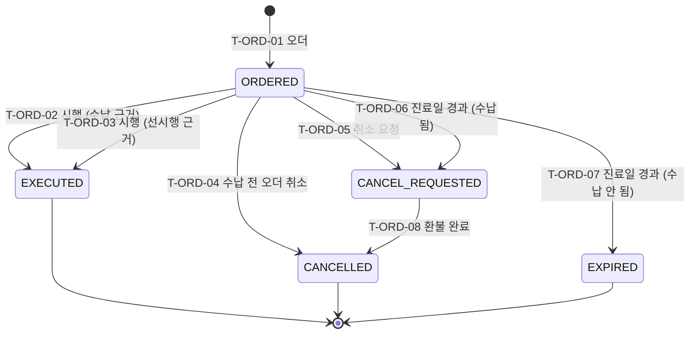
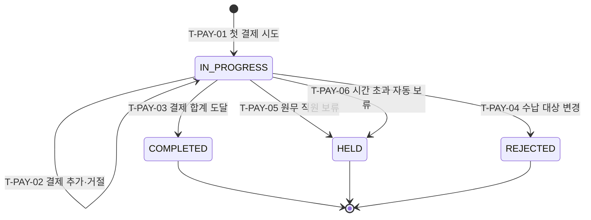
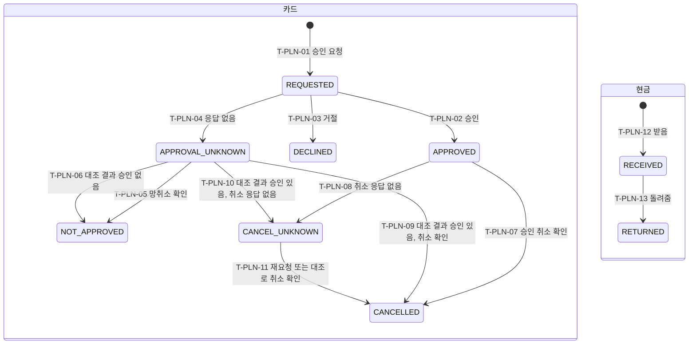
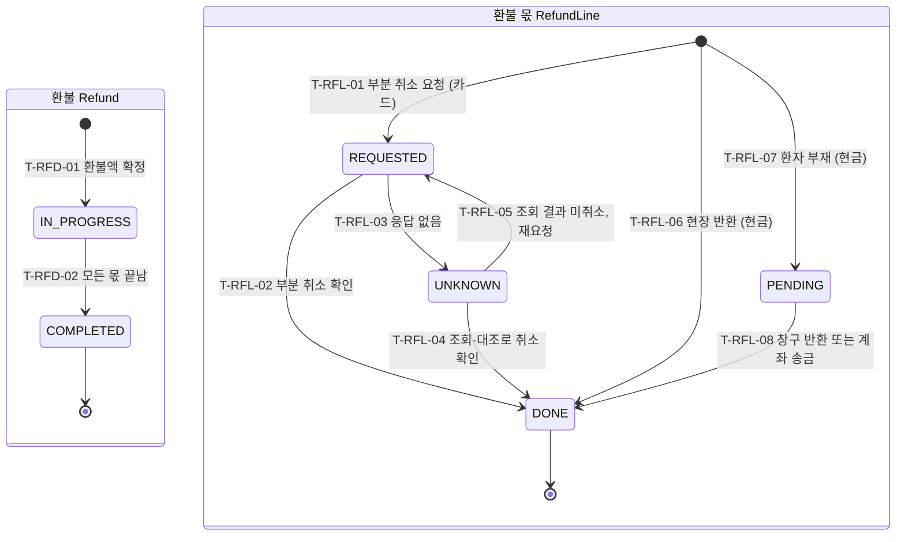

# 상태 전이표

상태: 초안 · 갱신: 2026-11-05

> [업무 흐름](01-flow.md)에서 상태를 갖는 대상의 생명주기를 정의합니다.  
> 상태도와 표가 다르면 **표가 우선**합니다. 용어는 [용어 사전](02-glossary.md)을 따릅니다.

---

## 목차
- [대상 목록](#대상-목록)
- [오더 항목 OrderItem](#오더-항목-orderitem)
- [수납 건 Payment](#수납-건-payment)
- [결제 PaymentLine](#결제-paymentline)
- [환불 Refund와 환불 몫 RefundLine](#환불-refund와-환불-몫-refundline)

---

## 대상 목록

| 대상 | 약어 | 상태 | 비고 |
| :--- | :--- | :--- | :--- |
| [오더 항목](02-glossary.md#오더-항목) `OrderItem` | `ORD` | 작성함 | |
| [수납 건](02-glossary.md#수납-건) `Payment` | `PAY` | 작성함 | 차액 수납 건도 같은 상태표를 따른다. |
| [결제](02-glossary.md#결제) `PaymentLine` | `PLN` | 작성함 | 카드와 현금의 생명주기가 다르다. |
| [환불](02-glossary.md#환불) `Refund` | `RFD` | 작성함 | |
| [환불 몫](02-glossary.md#환불-몫) `RefundLine` | `RFL` | 작성함 | 마감에 속하는 단위다(A-26). |
| [일 마감](02-glossary.md#일-마감) `DailyClosing` | `CLS` | 미작성 | |

---

## 오더 항목 OrderItem

### 0. 모델링 결정

오더 항목의 생명주기에는 서로 독립적으로 움직이는 세 가지 축이 있습니다. 수납(미수납 → 완납), 시행(미시행 → 시행 완료), 효력(유효 → 취소·소멸)입니다. 이 가운데 **수납 축은 오더 항목의 엔티티 상태로 직접 관리하지 않습니다.**

- 특정 오더 항목의 수납 여부는 "해당 항목을 포함한 완료(COMPLETED)된 수납 건이 존재하는가"로만 판정합니다. 즉, 수납 여부를 기록하고 보증하는 단일 진실 공급원(SSOT)은 수납 건 엔티티뿐입니다.
- 레거시 시스템에서는 오더 엔티티에도 수납 여부를 중복 관리하여, 수납 건과 오더 상태가 불일치하는 문제(오더는 취소되었으나 수납 완료로 남거나, 수납 건이 없는데도 수납됨으로 표시되는 등)가 정합성 문의의 단골 원인이었습니다. 상태 관리 주체를 수납 건 하나로 일원화함으로써 이러한 어긋남을 구조적으로 방지합니다.
- 이에 따라 오더 항목의 "수납되었는가" 가드 조건은 다른 집합체(수납 건)의 사실을 확인하게 됩니다. 이 확인 방법은 현재 미정입니다. 미정(ADR-0002, ADR-0003: 오더 항목 전이 시 수납 건의 사실을 어떻게 검증할 것인가?).
- 동일한 원칙에 따라 선시행 항목의 미수납이나 시행 후 예외 환불(F-06.c) 역시 오더 항목의 상태를 바꾸지 않으며, 각각 독립된 미수납 내역과 환불 엔티티의 사실로 관리됩니다.

### 1. 상태 목록

| 상태 | 의미 | 종료 상태 여부 (Y/N) |
| :--- | :--- | :--- |
| `OrderItem.ORDERED` | 오더가 발행되었으며 아직 시행·취소·소멸되지 않은 유효 상태다. (수납 여부와는 무관) | N |
| `OrderItem.EXECUTED` | 의료 행위가 시행 완료된 상태다. 시행 근거(수납 완료 또는 선시행)는 시행 기록에 남는다. (실시 취소는 범위 제외) | Y |
| `OrderItem.CANCEL_REQUESTED` | 수납된 항목에 대해 취소가 접수되어 환불 완료를 대기 중인 상태다. 이 상태에서는 시행할 수 없다. | N |
| `OrderItem.CANCELLED` | 취소가 최종 확정된 종료 상태다. | Y |
| `OrderItem.EXPIRED` | 진료일 종료 시점까지 수납도 시행도 되지 않아 효력을 잃은 종료 상태다. | Y |

### 2. 정상/허용 전이표

| 전이 ID | 현재 상태 | 트리거 이벤트 | 행위자 | 가드 조건 (전제) | 다음 상태 | 남는 기록 | 관련 INV |
| :--- | :--- | :--- | :--- | :--- | :--- | :--- | :--- |
| `T-ORD-01` | (없음) | 오더 발행 (F-02) | 의사 | 내원 건이 정상 접수 상태이며, 해당 수가 항목에 진료일 기준 유효한 단가가 존재한다(A-06). | `ORDERED` | 오더 항목(선시행 승인 여부 포함) | — |
| `T-ORD-02` | `ORDERED` | 시행 (F-06) | 검사·처치실 직원 | 이 항목을 포함하여 완료(COMPLETED)된 수납 건이 존재한다(수납 건의 사실). | `EXECUTED` | 시행 기록(시행 근거: 수납) | `INV-02` |
| `T-ORD-03` | `ORDERED` | 선시행 (F-02, F-02.a) | 검사·처치실 직원, 진료 의사(진찰료 및 진료실 즉석 검사) | 선시행 승인 속성이 설정되어 있다(A-01, A-08). 진찰료는 오더 발행과 함께 즉시 이 전이를 거친다. | `EXECUTED` | 시행 기록(시행 근거: 선시행) | `INV-14` |
| `T-ORD-04` | `ORDERED` | 수납 전 오더 취소 (F-02.b) | 의사 | 이 항목을 포함한 완료된 수납 건이 없다(수납 건의 사실). 만약 결제 진행 중인 수납 건이 있다면 해당 수납은 거부된다(F-04.c). | `CANCELLED` | 오더 취소 기록 | `INV-04` |
| `T-ORD-05` | `ORDERED` | 취소 요청 (F-04.a) | 의사 | 이 항목을 포함한 완료(COMPLETED)된 수납 건이 존재한다(수납 건의 사실). | `CANCEL_REQUESTED` | 취소 요청 기록, 수납 건 쪽에 확정된 환불액(A-19) | `INV-01` |
| `T-ORD-06` | `ORDERED` | 진료일 경과 (F-06.b) | 시스템 | 진료일이 종료되었다. 이 항목을 포함한 완료(COMPLETED)된 수납 건이 존재한다(수납 건의 사실). | `CANCEL_REQUESTED` | 취소 요청(요청자: 시스템, 사유: 진료일 경과) | `INV-01`, `INV-15` |
| `T-ORD-07` | `ORDERED` | 진료일 경과 (F-06.b) | 시스템 | 진료일이 종료되었다. 이 항목을 포함한 완료된 수납 건이 없다(수납 건의 사실). 결제 진행 중인 수납 건이 있다면 해당 수납은 거부된다(F-04.c). | `EXPIRED` | 오더 소멸 기록 | `INV-04` |
| `T-ORD-08` | `CANCEL_REQUESTED` | 환불 완료 (F-04.a) | 시스템 | 해당 취소 요청으로 발생한 환불의 모든 환불 몫 처리가 완료되었다(환불의 사실). 미완료된 환불 대기(PENDING) 몫이 남아 있다면 전이하지 않는다. | `CANCELLED` | 취소 확정 시각, 재발행 영수증(F-04.a) | `INV-13` |

- 자격 소급 변경(F-04.d), 시행 후 예외 환불(F-06.c), 미수납 기록(F-06.a)은 오더 항목의 상태를 바꾸지 않는다.
- 선시행 승인은 상태가 아니라 오더 항목의 속성(`executableBeforePayment`)이다.

### 3. 허용하지 않는 전이 (명시적 금지)

| 현재 상태 | 시도된 이벤트 | 거부 이유 | 관련 INV |
| :--- | :--- | :--- | :--- |
| `ORDERED` | 수납 완료 확인도 선시행 승인도 없이 시행 | 선수납이 원칙이다(A-01). 환자를 수납 창구로 안내한다(F-06). | `INV-02` |
| `ORDERED` | 완료된 수납 건에 포함된 항목을 단순 오더 취소(T-ORD-04 경로) | 수납 대금이 발생한 항목은 환불 절차를 거쳐야 하므로 취소 요청(T-ORD-05) 경로로만 처리할 수 있다. | `INV-04` |
| `ORDERED`, `EXECUTED` | 이미 완료된 수납 건에 포함된 항목을 다른 수납 건에 중복 포함 | 동일한 오더 항목은 두 번 이상 수납될 수 없다(F-04.c). | `INV-03` |
| `CANCEL_REQUESTED` | 시행 | 취소 요청된 항목은 수납되었더라도 시행할 수 없다(F-06). | `INV-01` |
| `CANCEL_REQUESTED` | 취소 요청 철회 | 취소 요청은 철회할 수 없다. 다시 필요한 경우 새 오더를 발행해야 한다(A-10). | — |
| `CANCEL_REQUESTED` | 다른 수납 건에 포함 | 이미 수납 완료되어 환불 처리를 대기 중인 항목이다. | `INV-03` |
| `EXECUTED` | 오더 취소 또는 취소 요청 | 이미 시행 완료된 항목은 취소할 수 없다. 환불은 원무 책임자 승인을 거친 예외 환불(F-06.c, A-18)로만 가능하다. | `INV-01` |
| `EXECUTED` | 재시행 | 하나의 오더 항목은 한 번만 시행된다. 추가 시행이 필요한 경우 새 오더를 발행해야 한다. | `INV-01` |
| `EXECUTED` | 시행 되돌림(실시 취소) | 본 시스템 범위 밖이다(01-flow 범위 제외). | — |
| `CANCELLED` | 시행, 취소 철회, 수납 건에 포함 | 종료 상태다. 확정된 취소는 번복할 수 없다(A-10). | `INV-01`, `INV-04` |
| `EXPIRED` | 시행, 수납 건에 포함 | 종료 상태다. 다시 필요하면 새 오더를 발행해야 한다(F-06.b). | `INV-01`, `INV-04` |

---

## 수납 건 Payment

### 0. 모델링 결정

- 수납 건은 첫 결제를 시도할 때 생성되며, 산정 하나를 근거로 한다. 한 산정을 근거로 한 수납 건은 하나뿐이다(A-22).
- 보류(`HELD`)되거나 거부(`REJECTED`)된 수납 건은 재개하지 않는다. 다시 받으려면 새로 산정하고 새 수납 건을 생성한다(A-22).
- 완료(`COMPLETED`)된 수납 건은 수정하지 않는다. 완료 이후의 변경은 환불과 차액 수납 건으로 기록하며, 그 결과는 현재 수납액(A-19)에만 반영된다. 전액 환불되어도 상태는 `COMPLETED`를 유지한다.
- 결제별 승인 확인 중·거절·승인 취소는 결제(`PaymentLine`)의 상태로 관리한다. 수납 건은 그 결과를 가드 조건으로만 참조한다.
- 차액 수납 건(`AdjustmentPayment`)도 동일한 상태표를 따른다. 포함하는 오더 항목이 없고 원래 수납 건을 참조한다는 점만 다르다. 환자가 없으면 차액 수납 건을 생성하지 않고 미수납으로 남긴다(F-04.d).

### 1. 상태 목록

| 상태 | 의미 | 종료 상태 여부 (Y/N) |
| :--- | :--- | :--- |
| `Payment.IN_PROGRESS` | 결제를 수령하는 중이다. 결제 합계가 아직 본인부담 합계에 미치지 않았거나, 승인 확인 중인 결제가 있다. | N |
| `Payment.COMPLETED` | 결제 합계가 본인부담 합계와 일치하여 수납이 완료되었다. 이 시점에 포함된 오더 항목이 수납된 것으로 확정된다. | Y |
| `Payment.HELD` | 금액을 다 받지 못해 보류했다. 이미 받은 결제는 되돌린다. | Y |
| `Payment.REJECTED` | 산정 이후 수납 대상이 변경되어 거부했다. 이미 받은 결제는 되돌린다. | Y |

### 2. 정상/허용 전이표

| 전이 ID | 현재 상태 | 트리거 이벤트 | 행위자 | 가드 조건 (전제) | 다음 상태 | 남는 기록 | 관련 INV |
| :--- | :--- | :--- | :--- | :--- | :--- | :--- | :--- |
| `T-PAY-01` | (없음) | 첫 결제 시도 (F-04) | 원무 직원 또는 환자(무인 수납기) | 근거가 될 산정이 존재한다(F-03). 해당 산정을 근거로 한 다른 수납 건이 없다(A-22). 산정 대상 항목이 모두 `OrderItem.ORDERED` 또는 `OrderItem.EXECUTED`다(오더 항목의 사실). | `IN_PROGRESS` | 수납 건(내원 건, 근거 산정, 창구, 시작 시각), 첫 결제 | `INV-05` |
| `T-PAY-02` | `IN_PROGRESS` | 결제 추가 또는 카드 승인 거절 (F-04, F-04.e) | 원무 직원 또는 환자(무인 수납기) | 결제를 추가해도 결제 합계가 본인부담 합계를 초과하지 않는다(A-20). 망취소가 확인되지 않은 결제가 있으면 카드 결제를 추가하지 않는다(A-11). | `IN_PROGRESS` | 결제(승인, 거절, 현금) | `INV-06` |
| `T-PAY-03` | `IN_PROGRESS` | 결제 합계 도달 (F-04) | 원무 직원 또는 환자(무인 수납기) | 결제 합계가 본인부담 합계와 일치한다. 결제 합계는 승인된 카드 결제(`APPROVED`)와 수령된 현금(`RECEIVED`)만 산입한다. 응답 대기 중이거나 승인 확인 중인 결제가 없다(결제의 사실). 산정 이후 수납 대상이 변경되지 않았다: 포함할 항목이 다른 완료된 수납 건에 없고, 취소·취소 요청·소멸되지 않았으며, 오더가 추가되지 않았다(오더 항목과 다른 수납 건의 사실). | `COMPLETED` | 수납 완료 시각, 영수증(F-05) | `INV-03`, `INV-06` |
| `T-PAY-04` | `IN_PROGRESS` | 수납 대상 변경 (F-04.c) | 시스템 | 산정 이후 동시 수납, 오더 추가·취소, 오더 소멸 가운데 하나가 발생했다(오더 항목과 다른 수납 건의 사실). 감지 시점은 미정(ADR-0003: 수납 시작 시 감지할 것인가, 완료 시도 시 감지할 것인가?). | `REJECTED` | 수납 거부, 결제 되돌림 | `INV-09` |
| `T-PAY-05` | `IN_PROGRESS` | 원무 직원의 수납 보류 (F-04.b, F-04.e) | 원무 직원 | 남은 금액을 수령하지 못했거나, 망취소가 확인되지 않아 카드로 재수령할 수 없다. | `HELD` | 수납 보류, 결제 되돌림 | `INV-09` |
| `T-PAY-06` | `IN_PROGRESS` | 시간 초과 (A-23) | 시스템 | 수납 시작 후 지정된 시간이 경과했다. | `HELD` | 수납 보류(사유: 시간 초과), 결제 되돌림 | `INV-09` |

- 결제 되돌림은 결제마다 개별로 처리된다. 카드 결제는 승인 취소, 현금 결제는 반환이다. 승인 여부를 알 수 없는 결제는 망취소와 일 마감(F-07) 대조에서 처리된다. 결제별 전이는 결제(`PaymentLine`) 절에서 다룬다.
- 환불, 차액 수납 건, 영수증 재발행은 수납 건의 상태를 변경하지 않는다. 현재 수납액만 갱신된다(A-19).
- 마감 소속은 상태가 아니라 속성(`closing`)이다. `COMPLETED` 상태의 수납 건만 마감에 포함된다(A-13). 환불은 수납 건 단위가 아니라 환불 몫 단위로 마감에 포함된다(A-26).

### 3. 허용하지 않는 전이 (명시적 금지)

| 현재 상태 | 시도된 이벤트 | 거부 이유 | 관련 INV |
| :--- | :--- | :--- | :--- |
| (없음) | 이미 수납 건이 있는 산정으로 새 수납 건 시작 | 한 산정을 근거로 한 수납 건은 하나뿐이다(A-22). 다시 받으려면 새로 산정한다. | `INV-05` |
| (없음) | 취소·취소 요청·소멸된 항목을 포함한 산정으로 수납 건 시작 | 효력이 없거나 이미 수납된 항목이다(T-ORD 금지 전이). | `INV-04` |
| `IN_PROGRESS` | 승인 확인 중인 결제가 있는 채로 완료 | 승인 여부가 불확실한 금액으로 수납을 완료할 수 없다(F-04.b). | `INV-06` |
| `IN_PROGRESS` | 결제 합계가 본인부담 합계와 다른 채로 완료 | 결제 합계가 본인부담 합계와 일치해야 수납이 완료된다(A-20). | `INV-06` |
| `IN_PROGRESS` | 망취소가 확인되지 않은 채로 카드 결제 추가 | 동일 금액이 이중으로 승인될 수 있다(A-11). | `INV-07` |
| `IN_PROGRESS` | 산정 이후 대상이 변경된 채로 완료 | 동일 항목이 중복 수납되거나, 효력 없는 항목이 수납된다(F-04.c). | `INV-03` |
| `COMPLETED` | 결제 추가·수정, 포함 항목 변경 | 완료된 수납 건은 수정하지 않는다. 변경 사항은 환불(F-04.a)과 차액 수납 건(F-04.d)으로 기록한다. | `INV-03`, `INV-06` |
| `COMPLETED` | 거부 또는 보류 | 완료 이후의 대상 변경은 취소 요청과 환불(F-04.a)로 처리한다. | — |
| `HELD`, `REJECTED` | 결제 추가, 완료, 재개 | 종료 상태다. 다시 받으려면 새로 산정하고 새 수납 건을 생성한다(A-22). | — |

---

## 결제 PaymentLine

### 0. 모델링 결정

- 결제는 수단에 따라 생명주기가 다르다. 카드는 결제 대행사와의 승인·취소 흐름을, 현금은 수령과 반환을 다룬다.
- 결제 상태로 관리하는 것은 **수납 성립 전의 결제 되돌림**뿐이다. 완료된 수납 건의 부분 취소와 현금 환불은 환불의 사실이며, 결제는 `APPROVED` 또는 `RECEIVED` 상태를 그대로 유지한다. 결제별 잔여 환불 가능 금액은 환불 기록을 집계하여 산출한다(A-21).
- 카드 승인 요청 사실은 요청 전송 전에 기록한다(A-24). 응답 기록이 없는 요청은 승인 확인 중으로 처리한다.
- 승인 요청을 재전송하면 이중 승인이 발생할 수 있으므로, 망취소가 확인되기 전에는 재전송하지 않는다(A-11). 승인 취소 요청은 승인번호를 지정하므로 재전송이 가능하다(A-25).

### 1. 상태 목록

| 상태 | 수단 | 의미 | 종료 상태 여부 (Y/N) |
| :--- | :--- | :--- | :--- |
| `PaymentLine.REQUESTED` | 카드 | 승인을 요청했고 응답을 기다리는 중이다. 요청 사실은 전송 전에 기록된다. | N |
| `PaymentLine.APPROVED` | 카드 | 승인되었다. 완료된 수납 건의 부분 취소가 발생해도 이 상태를 유지한다. | N (수납 건이 완료되면 더 전이하지 않음) |
| `PaymentLine.DECLINED` | 카드 | 응답을 수신했으며 거절되었다. | Y |
| `PaymentLine.APPROVAL_UNKNOWN` | 카드 | 응답을 수신하지 못해 승인 여부를 알 수 없다. 망취소를 전송한다. | N |
| `PaymentLine.NOT_APPROVED` | 카드 | 망취소가 확인되었거나, 대조 결과 승인이 없었던 것으로 확정되었다. | Y |
| `PaymentLine.CANCEL_UNKNOWN` | 카드 | 승인 취소를 요청했으나 응답을 수신하지 못했다. 동일한 승인번호로 재요청할 수 있다. | N |
| `PaymentLine.CANCELLED` | 카드 | 수납이 성립하지 않아 승인을 전액 취소했다. | Y |
| `PaymentLine.RECEIVED` | 현금 | 수령했다. 받은 금액과 거스름돈은 속성으로 기록된다. | N (수납 건이 완료되면 더 전이하지 않음) |
| `PaymentLine.RETURNED` | 현금 | 수납이 성립하지 않아 반환했다. | Y |

`APPROVED`와 `RECEIVED`는 수납 건이 완료되면 더 이상 전이하지 않는다. 수납 건이 보류·거부되면 각각 `CANCELLED`(또는 `CANCEL_UNKNOWN`), `RETURNED`로 전이한다.

### 2. 정상/허용 전이표

| 전이 ID | 현재 상태 | 트리거 이벤트 | 행위자 | 가드 조건 (전제) | 다음 상태 | 남는 기록 | 관련 INV |
| :--- | :--- | :--- | :--- | :--- | :--- | :--- | :--- |
| `T-PLN-01` | (없음) | 카드 승인 요청 (F-04, A-24) | 원무 직원 또는 환자(무인 수납기) | 수납 건이 `IN_PROGRESS`다(수납 건의 사실). 이 금액을 추가해도 결제 합계가 본인부담 합계를 초과하지 않는다(A-20). 해당 수납 건에 `REQUESTED` 또는 `APPROVAL_UNKNOWN`인 카드 결제가 없다(A-11). | `REQUESTED` | 승인 요청(수납 건, 금액, 요청 시각). 전송 전에 기록된다. | `INV-08` |
| `T-PLN-02` | `REQUESTED` | 승인 응답 (F-04) | 결제 대행사(외부) | 응답 시간 내에 승인 응답을 수신했다. | `APPROVED` | 승인번호, 승인 시각 | `INV-08` |
| `T-PLN-03` | `REQUESTED` | 거절 응답 (F-04.e) | 결제 대행사(외부) | 응답 시간 내에 거절 응답을 수신했다. | `DECLINED` | 승인 거절(거절 사유, 거절 시각) | — |
| `T-PLN-04` | `REQUESTED` | 응답 시간 초과 (F-04.b, A-24) | 시스템 | 응답 시간 내에 응답을 수신하지 못했거나, 응답이 기록되지 않았다. | `APPROVAL_UNKNOWN` | 승인 확인 중(시작 시각), 망취소 요청 | `INV-06` |
| `T-PLN-05` | `APPROVAL_UNKNOWN` | 망취소 확인 (F-04.b, A-11) | 결제 대행사(외부) | 망취소 결과가 확인되었다. | `NOT_APPROVED` | 망취소 결과, 승인 확인 중 종료(사유: 승인 없음 확정) | — |
| `T-PLN-06` | `APPROVAL_UNKNOWN` | 승인 내역 대조 (F-07) | 원무 직원 | 결제 대행사의 승인 내역에 이 요청의 승인이 없다. | `NOT_APPROVED` | 대조 결과 | — |
| `T-PLN-07` | `APPROVED` | 승인 취소 확인 (F-04.c, F-04.e, F-07) | 원무 직원 또는 시스템 | 수납 건이 `HELD` 또는 `REJECTED`이거나, 일 마감에서 짝 없는 승인으로 확인되었다(수납 건의 사실). | `CANCELLED` | 승인 취소(취소 시각, 결과) | `INV-09` |
| `T-PLN-08` | `APPROVED` | 승인 취소 응답 없음 (A-25) | 시스템 | T-PLN-07과 동일하다. 취소 요청에 대한 응답을 수신하지 못했다. | `CANCEL_UNKNOWN` | 승인 취소 요청(요청 시각, 응답 없음) | `INV-08` |
| `T-PLN-09` | `APPROVAL_UNKNOWN` | 승인 내역 대조 후 승인 취소 확인 (F-07) | 원무 직원 | 결제 대행사의 승인 내역에 이 요청의 승인이 존재한다. 해당 수납 건은 완료되지 않았으므로 짝 없는 승인이다. | `CANCELLED` | 대조 결과, 승인 취소 | `INV-08` |
| `T-PLN-10` | `APPROVAL_UNKNOWN` | 승인 내역 대조 후 취소 응답 없음 (F-07, A-25) | 원무 직원 | T-PLN-09와 동일하다. 취소 요청에 대한 응답을 수신하지 못했다. | `CANCEL_UNKNOWN` | 대조 결과, 승인 취소 요청 | — |
| `T-PLN-11` | `CANCEL_UNKNOWN` | 취소 재요청 응답 또는 대조 (A-25, F-07) | 원무 직원 또는 시스템 | 동일한 승인번호로 재요청하여 취소가 확인되었거나, 대조에서 취소된 것으로 확인되었다. | `CANCELLED` | 승인 취소 결과 | — |
| `T-PLN-12` | (없음) | 현금 수령 (F-04) | 원무 직원 | 수납 건이 `IN_PROGRESS`다(수납 건의 사실). 이 금액을 추가해도 결제 합계가 본인부담 합계를 초과하지 않는다(A-20). | `RECEIVED` | 결제(받은 금액, 거스름돈, 수납 반영 금액) | `INV-06` |
| `T-PLN-13` | `RECEIVED` | 현금 반환 (F-04.c, F-04.e) | 원무 직원 | 수납 건이 `HELD` 또는 `REJECTED`다(수납 건의 사실). | `RETURNED` | 현금 반환(반환 시각, 반환자) | `INV-09` |

- 완료된 수납 건의 부분 취소와 현금 환불은 결제 상태를 변경하지 않는다. 환불(`Refund`) 절에서 다룬다.
- 결제 수령 중 환자가 결제 수단을 변경하려 하면, 해당 수납 건을 보류하고 새로 산정하여 새 수납 건으로 받는다(A-22). 진행 중인 수납 건에서 결제 하나만 선택하여 되돌리는 흐름은 지원하지 않는다.

### 3. 허용하지 않는 전이 (명시적 금지)

| 현재 상태 | 시도된 이벤트 | 거부 이유 | 관련 INV |
| :--- | :--- | :--- | :--- |
| (없음) | `IN_PROGRESS`가 아닌 수납 건에 결제 추가 | 완료·보류·거부된 수납 건은 수정하거나 재개하지 않는다(A-22). | `INV-06` |
| (없음) | `REQUESTED`나 `APPROVAL_UNKNOWN`인 카드 결제가 있는 수납 건에 카드 승인 요청 | 동일 금액이 이중으로 승인될 수 있다(A-11). | `INV-07` |
| (없음) | 결제 합계가 본인부담 합계를 초과하는 결제 추가 | 받아야 할 금액보다 많이 받는다(A-20). | `INV-06` |
| `REQUESTED`, `APPROVAL_UNKNOWN` | 동일 결제로 승인 재요청 | 이중 승인 위험이 있다. 망취소 확인 후 새 결제로 요청한다(A-11). | — |
| `REQUESTED`, `APPROVAL_UNKNOWN`, `CANCEL_UNKNOWN` | 수납 완료의 결제 합계에 산입 | 승인 여부 또는 취소 여부를 알 수 없는 금액이다(F-04.b). | `INV-06` |
| `APPROVED`, `RECEIVED` | 완료된 수납 건의 결제를 승인 취소·반환(결제 되돌림) | 완료된 수납 건에서 돌려주는 것은 환불이다(F-04.a). 부분 취소나 현금 환불로 처리한다. | `INV-06` |
| `APPROVED`, `RECEIVED` | 진행 중인 수납 건에서 결제 하나만 되돌림 | 지원하지 않는 흐름이다. 수납 건을 보류하고 새 수납 건으로 받는다(A-22). | — |
| `DECLINED`, `NOT_APPROVED` | 승인 취소, 수납 완료에 포함 | 승인이 존재하지 않는다. | — |
| `CANCELLED`, `RETURNED` | 수납 완료에 포함, 승인 취소·반환 재처리 | 종료 상태다. 이미 되돌렸다. | `INV-06` |

---

## 환불 Refund와 환불 몫 RefundLine

### 0. 모델링 결정

- 환불은 취소 요청(F-04.a), 자격 변경 차액(F-04.d), 진료일 경과(F-06.b), 예외 환불(F-06.c) 각 건마다 하나씩 생성된다(A-26). 환불액은 생성 시점에 확정되며, 그 즉시 현재 수납액에서 차감된다(A-19).
- 환불액은 결제별 환불 몫으로 분배된다(A-21). 환불의 상태는 환불 몫들의 상태로 결정된다. 모든 몫이 완료되어야 환불이 완료되고, 취소 요청된 오더 항목의 취소가 확정된다(T-ORD-08).
- 마감에 귀속되는 단위는 환불 몫이다. 환불 몫마다 처리 완료일과 처리 창구의 마감에 귀속된다(A-26).
- 완료된 수납 건의 결제는 환불 몫이 완료되어도 상태가 변경되지 않는다(결제 절 0). 결제별 잔여 환불 가능 금액은 해당 결제를 대상으로 한 환불 몫을 집계하여 산출한다.
- 부분 취소는 동일 승인에서 금액을 감액하는 요청이므로, 응답이 없을 때 잔액을 조회한 후에만 재요청한다(A-27). 이는 승인 전액 취소(A-25)와 다르다.
- 환불 대기는 새 수납과 상계하지 않는다(범위 밖).
- 부분 취소가 거절되는 경우의 처리는 미정(질문: 카드 부분 취소가 거절되면 현금이나 계좌로 돌려주는가?)

### 1. 상태 목록

**환불 `Refund`**

| 상태 | 의미 | 종료 상태 여부 (Y/N) |
| :--- | :--- | :--- |
| `Refund.IN_PROGRESS` | 환불액이 확정되었고 완료되지 않은 환불 몫이 있다. | N |
| `Refund.COMPLETED` | 모든 환불 몫이 완료되었다. | Y |

**환불 몫 `RefundLine`**

| 상태 | 수단 | 의미 | 종료 상태 여부 (Y/N) |
| :--- | :--- | :--- | :--- |
| `RefundLine.REQUESTED` | 카드 | 대상 결제의 승인에 대해 부분 취소를 요청했고 응답을 기다리는 중이다. | N |
| `RefundLine.UNKNOWN` | 카드 | 부분 취소 요청에 대한 응답을 수신하지 못했다. | N |
| `RefundLine.PENDING` | 현금 | 환자가 직접 와야 반환할 수 있어 대기 중이다(환불 대기). 기한이 없으며 소멸하지 않는다. | N |
| `RefundLine.DONE` | 카드, 현금 | 완료되었다. 카드는 부분 취소가 확인되었고, 현금은 창구에서 반환하거나 계좌로 송금했다. 이때 마감 귀속이 확정된다. | Y |

### 2. 정상/허용 전이표

**환불 `Refund`**

| 전이 ID | 현재 상태 | 트리거 이벤트 | 행위자 | 가드 조건 (전제) | 다음 상태 | 남는 기록 | 관련 INV |
| :--- | :--- | :--- | :--- | :--- | :--- | :--- | :--- |
| `T-RFD-01` | (없음) | 환불액 확정 (F-04.a, F-04.d, F-06.b, F-06.c) | 시스템 | 대상 수납 건이 `COMPLETED`다(수납 건의 사실). 환불액(현재 수납액 − 재산정 합계)이 0보다 크다(A-19). 예외 환불이면 원무 책임자의 승인이 존재한다(A-18). 환불액을 A-21의 순서로 결제별 몫으로 분배했으며, 각 몫이 해당 결제의 잔여 반환 가능 금액을 초과하지 않는다. | `IN_PROGRESS` | 환불(대상 수납 건, 원인, 환불 전 현재 수납액, 재산정 합계, 환불액, 확정 시각), 환불 몫들 | `INV-10`, `INV-11` |
| `T-RFD-02` | `IN_PROGRESS` | 모든 몫 완료 (F-04.a) | 시스템 | 이 환불의 모든 환불 몫이 `DONE`이다. | `COMPLETED` | 완료 시각, 새 영수증(F-04.a). 원인이 취소 요청이면 오더 항목 취소 확정(T-ORD-08) | `INV-13` |

**환불 몫 `RefundLine`**

| 전이 ID | 현재 상태 | 트리거 이벤트 | 행위자 | 가드 조건 (전제) | 다음 상태 | 남는 기록 | 관련 INV |
| :--- | :--- | :--- | :--- | :--- | :--- | :--- | :--- |
| `T-RFL-01` | (없음) | 부분 취소 요청 (F-04.a, A-09) | 원무 직원 또는 시스템(자동 환불) | 대상 결제가 카드이고 `APPROVED` 상태다(결제의 사실). | `REQUESTED` | 부분 취소 요청(대상 결제, 금액, 요청 시각) | — |
| `T-RFL-02` | `REQUESTED` | 부분 취소 확인 (F-04.a) | 결제 대행사(외부) | 응답 시간 내에 부분 취소 결과를 수신했다. | `DONE` | 부분 취소 승인번호, 처리 창구, 처리 시각, 마감 귀속(A-26) | — |
| `T-RFL-03` | `REQUESTED` | 응답 없음 (A-27) | 시스템 | 응답 시간 내에 응답을 수신하지 못했다. | `UNKNOWN` | 응답 없음 시각 | `INV-12` |
| `T-RFL-04` | `UNKNOWN` | 잔액 조회 또는 대조 (A-27, F-07) | 원무 직원 또는 시스템 | 조회 또는 대조에서 이 부분 취소가 이미 처리된 것으로 확인되었다. | `DONE` | 조회·대조 결과, 처리 창구, 처리 시각, 마감 귀속 | — |
| `T-RFL-05` | `UNKNOWN` | 잔액 조회 후 재요청 (A-27) | 원무 직원 또는 시스템 | 조회에서 이 부분 취소가 아직 처리되지 않은 것으로 확인되었다. | `REQUESTED` | 조회 결과, 재요청 시각 | `INV-12` |
| `T-RFL-06` | (없음) | 현금 현장 반환 (F-04.a) | 원무 직원 | 대상 결제가 현금이고 `RECEIVED` 상태다(결제의 사실). 환자가 창구에 있다. | `DONE` | 현금 반환(처리자, 처리 창구, 처리 시각), 마감 귀속 | — |
| `T-RFL-07` | (없음) | 환자 부재 (F-04.a, F-04.d, F-06.b, F-06.c) | 원무 직원 또는 시스템(자동 환불) | 대상 결제가 현금이고 `RECEIVED` 상태다(결제의 사실). 환자가 창구에 없다. | `PENDING` | 환불 대기(대기 사유, 대기 시작 시각) | — |
| `T-RFL-08` | `PENDING` | 창구 반환 또는 계좌 송금 (F-04.a, A-05) | 원무 직원 | 환자가 창구에 왔거나, 계좌 송금을 요청했다. | `DONE` | 현금 반환 또는 계좌 송금(처리자, 처리 창구, 처리 시각), 마감 귀속 | — |

### 3. 허용하지 않는 전이 (명시적 금지)

| 현재 상태 | 시도된 이벤트 | 거부 이유 | 관련 INV |
| :--- | :--- | :--- | :--- |
| (없음) | `COMPLETED`가 아닌 수납 건에 환불 | 완료되지 않은 수납 건에서 돌려주는 것은 결제 되돌림이다(결제 절). | — |
| (없음) | 환불액이 0 이하인 환불 | 반환할 금액이 없다. 추가로 받을 금액이 있다면 차액 수납 건으로 받는다(F-04.d). | — |
| (없음) | 결제에서 잔여 반환 가능 금액을 초과하는 환불 몫 | 받은 금액보다 많이 돌려준다(A-21). | `INV-10` |
| (없음) | 되돌려진 결제(`CANCELLED`, `RETURNED`)나 승인 없는 결제를 대상으로 한 환불 몫 | 반환할 수령 금액이 존재하지 않는다. | — |
| `Refund.IN_PROGRESS` | 환불 철회 | 취소 요청은 철회할 수 없으므로(A-10) 그로 인해 확정된 환불도 철회하지 않는다. | — |
| `Refund.COMPLETED` | 몫 추가·변경 | 완료된 환불은 수정하지 않는다. 추가로 반환할 사유가 생기면 새 환불로 처리한다. | — |
| `RefundLine.UNKNOWN` | 조회 없이 부분 취소 재요청 | 이중으로 취소될 수 있다(A-27). | `INV-12` |
| `RefundLine.PENDING` | 새 수납과 상계 | 범위 밖이다. 반환만 한다(A-05). | — |
| `RefundLine.PENDING` | 기한 경과로 소멸 | 병원이 반환해야 할 금액이다(F-04.a). | — |
| `RefundLine.DONE` | 재처리, 마감 귀속 변경 | 종료 상태다. 완료된 마감은 수정하지 않는다(A-12). | — |
