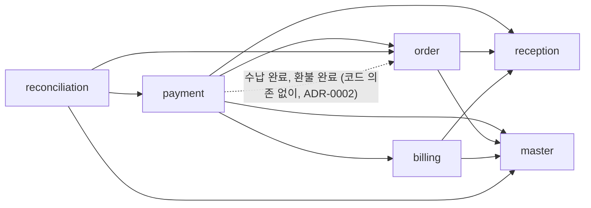

# 모듈 경계

상태: 초안 · 갱신: 2026-11-10

> [도메인 문서](../domain/)에서 정한 대상과 규칙을 Spring Modulith 모듈로 나눈 결과입니다.  
> 모듈은 애플리케이션 패키지 바로 아래의 패키지 하나이며, 모듈 사이의 순환 의존은 `ApplicationModules.verify()`에서 실패로 처리됩니다.

---

## 1. 모듈 목록

| 모듈 | 책임 | 소유 대상 | 문서 |
| :--- | :--- | :--- | :--- |
| `common` | 여러 모듈이 함께 쓰는 값 타입 | 금액 `Money` | [common.md](common.md) |
| `master` | 기준 정보 | 수가 항목, 수가, 창구 | [master.md](master.md) |
| `reception` | 접수와 내원 건의 자격 | 내원 건, 자격 기록, 자격 소급 변경 | [reception.md](reception.md) |
| `order` | 오더 항목의 생명주기와 시행 | 오더 항목, 시행 기록, 오더 취소·취소 요청·소멸, 원외처방 | [order.md](order.md) |
| `billing` | 금액 계산 | 산정, 산정 내역 | [billing.md](billing.md) |
| `payment` | 돈의 흐름 | 수납 건(차액 수납 건 포함), 결제, 환불, 환불 몫, 미수납, 영수증 | [payment.md](payment.md) |
| `reconciliation` | 일 마감과 사후 검출 | 일 마감, 대조 결과(차이, 시차, 짝 없는 승인) | [reconciliation.md](reconciliation.md) |

처음 계획(master, order, billing, payment, reconciliation)에서 두 가지를 바꿨습니다.
- 자격은 "환자의 지금 자격"이 아니라 "그 내원 건에 대해 남긴 기록"이므로 기준 정보가 아닙니다. 내원 건과 함께 `reception`으로 옮겼습니다.
- 창구는 수납 건과 마감이 함께 가리키는 기준 정보이므로 `master`에 둡니다.

개발을 시작하면서 `common`을 추가했습니다. 금액(`Money`)처럼 여러 모듈이 함께 쓰는 값 타입을 둡니다. 업무 규칙이 있는 것은 두지 않습니다([common.md](common.md)).

**공개 기능의 이름 규칙**

| 성격 | 이름 | 예 |
| :--- | :--- | :--- |
| 조회만 한다 | `XxxQueryService` | `FeeQueryService`, `PaymentQueryService` |
| 상태를 바꾸거나 계산한다 | `XxxService` | `BillingService`, `PaymentService` |

- 이름만 보고 그 호출이 무엇을 바꾸는지 알 수 있게 하려는 규칙입니다. 조회와 변경이 함께 공개되는 모듈(`payment`)은 둘로 나눕니다.
- 메서드 이름은 조회와 변경을 다르게 짓습니다.
  - 조회는 돌려주는 것의 이름(명사)으로 짓습니다. 부작용이 없으니 무엇이 나오는지만 알면 됩니다. 예: `feeItem(id)`, `priceOn(visitDate)`
  - 변경과 외부 호출은 하는 일(동사)과 대상으로 짓습니다. 무엇을 만들고 어디에 묻는지가 이름에 있어야 합니다. 예: `registerVisit(...)`, `inquireEligibility(...)`
- 공개 기능은 엔티티가 아니라 공개 패키지에 있는 값 객체(`FeeItemView` 등)를 주고받습니다.
- 값 객체의 이름은 방향에 따라 짓습니다. `Dto` 같은 기술 접미사는 쓰지 않습니다.
  - 모듈 밖으로 내보내는 값: `View`. 예: `FeeItemView`, `VisitView`
  - 외부 시스템에서 받은 값: `Response`. 모듈 안에서만 쓴다. 예: `EligibilityResponse`
  - 공개 기능에 넘기는 입력: 접미사 없이 무엇인지를 이름으로 한다. 예: `NewOrderItem`(새로 낼 오더 항목)

## 2. 의존 방향

- 실선은 코드 의존(직접 호출, 또는 상대 모듈이 발행한 이벤트를 받음)입니다. 화살표 방향이 "의존하는 쪽 → 의존받는 쪽"입니다.
- `common`은 어느 모듈이든 의존할 수 있고 `common`은 아무것도 의존하지 않으므로, 그림에서 생략했습니다.
- 점선은 payment의 사실을 order가 알아야 하는 방향입니다. order는 payment에 코드 의존을 가질 수 없으므로(순환), 방식은 미정(ADR-0002)입니다.

**이렇게 정한 이유**

| 결정 | 이유 |
| :--- | :--- |
| payment → order (직접 확인) | 수납을 완료하는 순간 포함할 항목이 아직 효력이 있는지 직접 확인해야 INV-04를 지킬 수 있다(C-04, C-05). 반대 방향(order → payment)으로 두면 payment는 오더 변경을 이벤트로만 알게 되어 구조적으로 막을 수 없다. |
| payment → billing, billing은 대상을 고르지 않음 | 어느 항목이 이미 수납되었는지는 payment의 사실이다. billing이 대상을 고르면 billing → payment 의존이 생기고, 재산정 요청(payment → billing)과 순환한다. 재산정은 환불액 확정(T-RFD-01)에 바로 필요하므로 이벤트로 돌리지 않는다. |
| reception은 payment에 의존하지 않음 | 접수 때 미수납·환불 대기를 알리는 일(F-01)은 접수 화면이 payment의 공개 조회를 함께 사용해 처리한다. reception이 payment를 부르면 payment → order → reception과 순환한다. |
| 마감 소속은 payment가 갖고 reconciliation이 정함 | "완료된 것만, 한 번만 마감에 속한다"를 수납 건과 환불 몫을 가진 쪽에서 지키기 위해서다. reconciliation은 payment의 공개 기능을 호출해 정한다(reconciliation → payment). |

## 3. 모듈 사이의 사실 전달

| 사실 | 발행 | 받는 쪽 | 받는 쪽이 하는 일 | 방식 |
| :--- | :--- | :--- | :--- | :--- |
| 자격 소급 변경됨 | `reception` | `payment` | 수납 건마다 재산정하고 환불 또는 차액 수납을 시작한다(F-04.d). | 이벤트 |
| 취소 요청됨 (의사, 진료일 경과) | `order` | `payment` | 환불액을 정하고 환불을 시작한다(T-RFD-01). | 이벤트 |
| 오더 취소됨, 오더 소멸됨 | `order` | `payment` | 그 항목을 포함한 진행 중인 수납을 거부한다(F-04.c, T-PAY-04). 완료 직전의 직접 확인(T-PAY-03)이 실제 방어이고, 이 이벤트는 거부를 앞당긴다. | 이벤트 |
| 수납 완료 (포함 항목) | `payment` | `order` | 시행 근거로 쓴다(T-ORD-02, INV-02). 진료일 경과 판단에 쓴다(T-ORD-06, T-ORD-07). | 미정(ADR-0002) |
| 환불 완료 (취소 요청 항목) | `payment` | `order` | 취소를 확정한다(T-ORD-08, INV-13). | 미정(ADR-0002) |

- 이벤트는 발행한 쪽의 기록이 확정된 뒤에만 나가야 하고, 받는 쪽에 도달하기 전에 사라지면 안 됩니다. Spring Modulith의 이벤트 발행 기록(Event Publication Registry)으로 이 요구를 만족시키는 것을 기본으로 합니다.
- `payment`가 발행한 이벤트를 `order`가 받으면 `order`가 `payment`의 이벤트 타입에 의존하게 되어 순환합니다. 그래서 payment → order 방향은 이벤트가 아닌 다른 방식의 후보(payment가 order의 공개 기능을 호출해 알림, 폴링 워터마크, 읽기 전용 조회 등)를 ADR-0002에서 비교합니다.

## 4. 불변식과 모듈

| 불변식 | 걸친 모듈 | 강제 시점 | 비고 |
| :--- | :--- | :--- | :--- |
| INV-01 | order | 즉시 | |
| INV-02 | order ← payment | 미정(ADR-0002) | |
| INV-03, INV-05 | payment | 즉시(ADR-0003) | 같은 모듈 안이지만 서로 다른 수납 건 사이의 경쟁이다. 순서대로 오면 서비스의 확인이, 동시에 오면 DB 제약이 막는다. |
| INV-04 | payment → order | 미정(ADR-0003) | |
| INV-06, INV-07 | payment | 즉시 | 경계를 정한 뒤에도 같은 모듈 안이다. |
| INV-08, INV-09, INV-11 | payment, reconciliation | 사후 검출 | |
| INV-10 | payment | 미정(ADR-0003) | |
| INV-12 | payment, reconciliation | 즉시, 사후 검출 | |
| INV-13 | order ← payment | 즉시 | order는 환불 완료를 받은 뒤에만 취소를 확정하므로, 모듈이 나뉘어도 확정이 환불보다 먼저 일어나지 않는다. |
| INV-14, INV-15 | order, payment, reconciliation | 사후 검출 | |
